# SDD — Review 2 proposed input

FA26SE124 | GFA26SE25 | 30 October 2026. Contact emails/phones redacted in this public repository view; full editable originals are in the team Drive. No business requirement or source rule is redacted.

CAPSTONE PROJECT REPORT

Report 4 – Software Design Document

Smartorderbutton

– Ho Chi Minh City, October 2026 –

Table of Contents

## I. Record of Changes

| Date | A* M, D | In charge | Change Description |
| --- | --- | --- | --- |
| 27/10/2026 | A | Project team | Initial Smartorderbutton software design: system and packages, database, class specifications and principal sequences. |
| 29/10/2026 | M | Draft preparation; team review pending | Draft update to Review-2 behavior and source baseline; document central 120-second cancellation and post-lock validation; retain wider design and historical evidence pending Registration reconciliation. |
| 30/10/2026 | M | Team confirmation | Financial implementation reported complete; declared deployment: Vercel Web, Render Backend, Supabase PostgreSQL, Flutter Mobile. Registration approval and runtime acceptance remain separate. |
| 30/10/2026 | M | Project team (review pending) | Add declared Web/Worker/Render URLs; deployment/provider/version/AI declarations and proposed rollback; replace architecture/cancellation views; add four workflow activities and principal state views with editable sources and full Prisma relation source. No live acceptance or approved ownership asserted. |
|  |  |  |  |
|  |  |  |  |
|  |  |  |  |
|  |  |  |  |
|  |  |  |  |
|  |  |  |  |
|  |  |  |  |
|  |  |  |  |
|  |  |  |  |

*A - Added M - Modified D - Deleted

Project FA26SE124 | Group GFA26SE25 | Review 2: 05 November 2026 | Revision: 30 October 2026 | No separate official submission deadline supplied.

## II. Software Design Document

Smartorderbutton supports recurring essential-goods orders through Web, Mobile and an IoT button. This working design draft follows Report 3 and the Review-2 software snapshot. Household membership, shared shopping lists and household prediction remain outside the currently described scope. Customer cancellation uses a common 120-second creation-time deadline for PENDING/CONFIRMED orders. Final Registration reconciliation remains pending.

### 1. System Design

#### 1.1 System Architecture

The solution uses four codebases: a React Web client, Flutter Mobile client, NestJS cloud application and ESP32 firmware. The backend is a modular application with shared infrastructure rather than a set of independently deployed microservices. Feature controllers handle transport and authorization boundaries; services apply business rules; repositories and Prisma execute persistence. Some services deliberately use Prisma directly, notably wallet, shift and queue operations, so a repository layer is not assumed for every method.

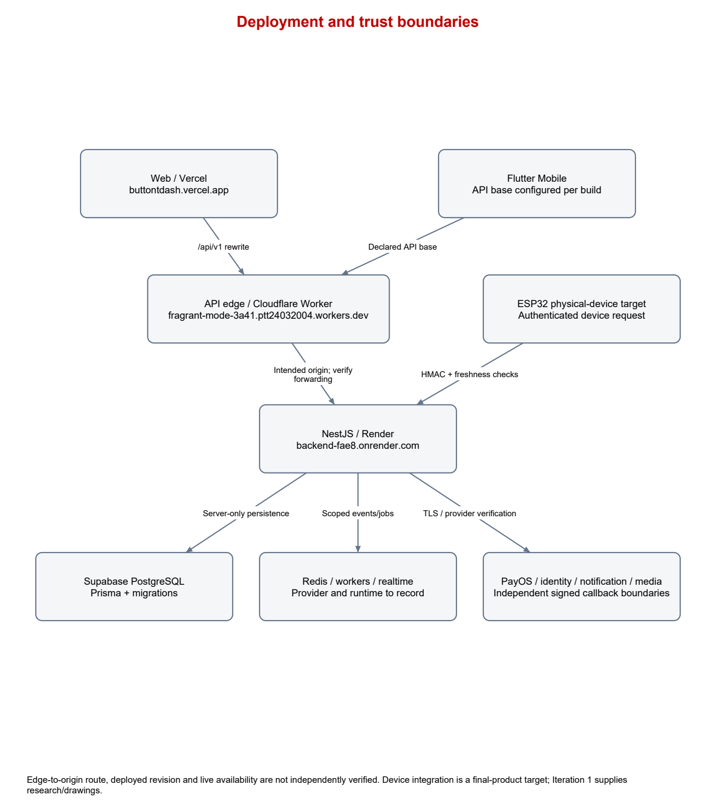

Figure 1. System components and principal connections

| No | Component | Description |
| --- | --- | --- |
| 01 | Web client | React 18/Vite pages, layouts, functional contexts, Axios API client and Socket.IO connection. Role-based screens cover customers, stores, delivery and platform operations. |
| 02 | Mobile client | Flutter application with User, Device, Order, Address and Notification providers. The main shell has Home, Devices, Orders and Account tabs. |
| 03 | Cloud API | NestJS AppModule imports feature modules, validation/security boundaries, Prisma, scheduling, queues and provider integrations. Business endpoints normally use /api/v1. |
| 04 | Database | PostgreSQL stores identity, store tenancy, devices, orders, inventory and finance. Prisma models use physical table/column mappings; migrations add routines, triggers and additional constraints. |
| 05 | Real-time and background services | EventsGateway authenticates room membership. Notifications combine persisted messages with provider delivery. QueueService supports configured BullMQ/Redis and a local fallback. |
| 06 | Device subsystem | Firmware orchestrates button gestures, BLE provisioning, Wi-Fi, signed cloud requests, feedback and power functions. Physical prototype development is continuing. |
| 07 | External services | PayOS collection/payout, bank account verification, Didit, Google/Firebase, email and Cloudinary are separate providers with their own availability and evidence contracts. |

The architecture diagram shows device traffic entering the cloud boundary; devices never connect directly to PostgreSQL. Web/Mobile requests use user authentication, while device requests use per-device authentication. WebSocket and provider callback paths are independently authenticated and scoped.

##### 1.1.1 Deployment and Runtime Configuration

The declared Web is https://buttontdash.vercel.app/. Its tagged frontend/vercel.json rewrites /api/v1 traffic to https://fragrant-mode-3a41.ptt24032004.workers.dev/api/v1/:path*. The team supplies that Worker host as the public API base and https://backend-fae8.onrender.com as the Backend/Swagger host. The intended topology is Vercel client → Cloudflare Worker → Render Backend; Worker forwarding configuration and the deployed revision are not established by the frontend rewrite alone. See Section 4 for deployment and evidence boundaries.

Backend startup validates JWT_SECRET, OTP_PEPPER, BANK_ACCOUNT_ENCRYPTION_KEY and BANK_ACCOUNT_HASH_SALT. PostgreSQL connection configuration and provider credentials are supplied through the runtime environment. Secret values must not appear in client bundles or this document. The startup pipeline retains webhook raw bodies, applies request-size limits, rate limiting, DTO whitelist/transform checks and a common exception filter.

The Web and Mobile store user-facing token/session state; protected APIs revalidate the token and object scope. Device signing uses the configured device secret, nonce and timestamp. A local API override, legacy endpoint fallback or development-only provider fallback must not silently change the production trust boundary.

#### 1.2 Package Diagram

The package diagrams show source-level dependencies. A connection means a package uses or coordinates another package; it does not imply a separate process. Feature classes in Section 3 provide the method-level contracts.

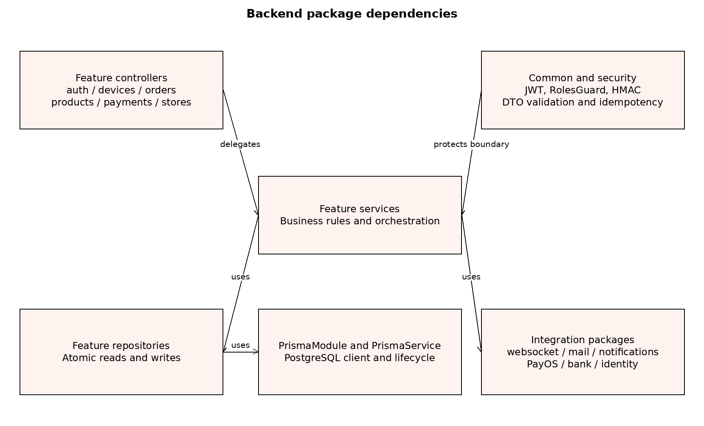

Figure 2. Backend package decomposition

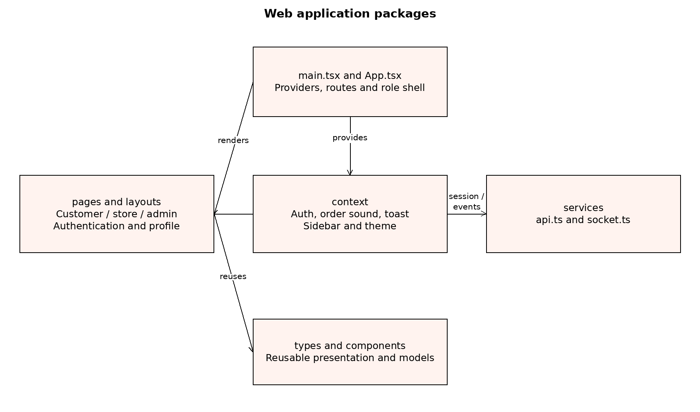

Figure 3. Web package decomposition

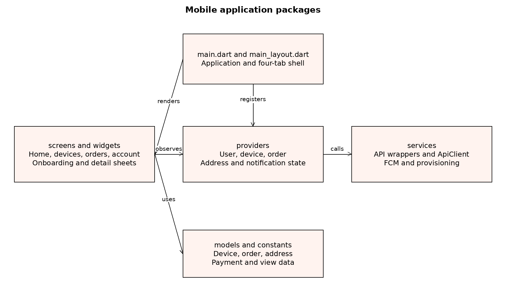

Figure 4. Mobile package decomposition

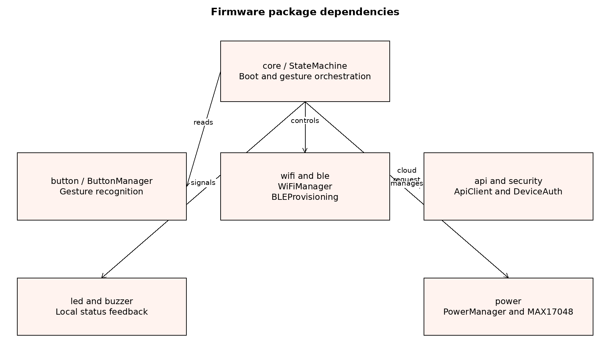

Figure 5. Firmware package decomposition

Package Descriptions

| No | Package | Description |
| --- | --- | --- |
| 01 | backend/auth | Accounts, credential verification, OTP consumption, refresh sessions and token revocation. |
| 02 | backend/common and security | JWT/role/device guards, request idempotency, crypto utilities, queues and exception handling. |
| 03 | backend/devices and iot | Provisioning, ownership, templates, fleet operations, signed events and telemetry. |
| 04 | backend/products, categories and product-discounts | Catalog writes, stock interfaces, images, price history and time-bounded promotions. |
| 05 | backend/orders | Button/storefront order creation, cancellation, transitions, delivery assignment and evidence. |
| 06 | backend/payments | PayOS request lifecycle, signed callbacks and payout integration. |
| 07 | backend/store-wallet and bank-verification | Balances, ledger, withdrawals, encrypted banking and ownership verification. |
| 08 | backend/rentals and store-subscriptions | Customer hardware rental contracts and store wallet-funded plan entitlement. |
| 09 | backend/stores, store-staff and store-customers | Merchant profile, scoped team membership and customer relationship management. |
| 10 | backend/drivers and driver-shifts | Driver availability, shift statistics and store handover operations. |
| 11 | backend/admin and analytics | Platform governance, commercial definitions and scoped store/platform reporting. |
| 12 | backend/identity-verifications | Hosted Didit sessions, decision verification and callback deduplication. |
| 13 | backend/websocket, notifications, mail and media | Authenticated events, persisted/push/email messages and scoped uploads. |
| 14 | backend/prisma | Prisma client dependency and database lifecycle. |
| 15 | frontend/pages, layouts and components | Role workspaces, navigation and reusable UI elements. |
| 16 | frontend/context and services | Functional session/UI context, Axios request/refresh and Socket.IO coordination. |
| 17 | mobile/screens and providers | Screen rendering, four-tab navigation and ChangeNotifier state. |
| 18 | mobile/services and models | Typed HTTP wrappers, API client, notification/provisioning interfaces and parsed domain data. |
| 19 | hardware/core and button | StateMachine orchestration and selected gesture recognition. |
| 20 | hardware/wifi, ble, api and security | Connectivity, local onboarding and signed cloud requests. |
| 21 | hardware/led, buzzer and power | User feedback, power policy and battery monitoring. |

### 2. Database Design

#### 2.1 Database Files and Persistence Model

The current Prisma datasource is PostgreSQL. prisma/schema.prisma is the application model, prisma/migrations contains versioned DDL, indexes, checks, triggers and routines, and prisma/seed.ts supplies development/bootstrap data. Historical SQLite statements from earlier planning documents do not define this backend baseline. BigInt identifiers are serialized as strings in client-facing DTOs, monetary fields use Decimal types, and timestamp columns use PostgreSQL timestamp types as declared in the schema.

One shared relational database supports multiple stores. Store-scoped foreign keys and access checks protect tenant boundaries. Customer identities are global, while store_customer links a customer to individual stores. An IoT button can be associated with a customer/store configuration. A storefront order can omit button_id and, for guest checkout, customer_id. Order items preserve product and price snapshots instead of reconstructing history from a mutable catalog.

#### 2.2 Database Relationships

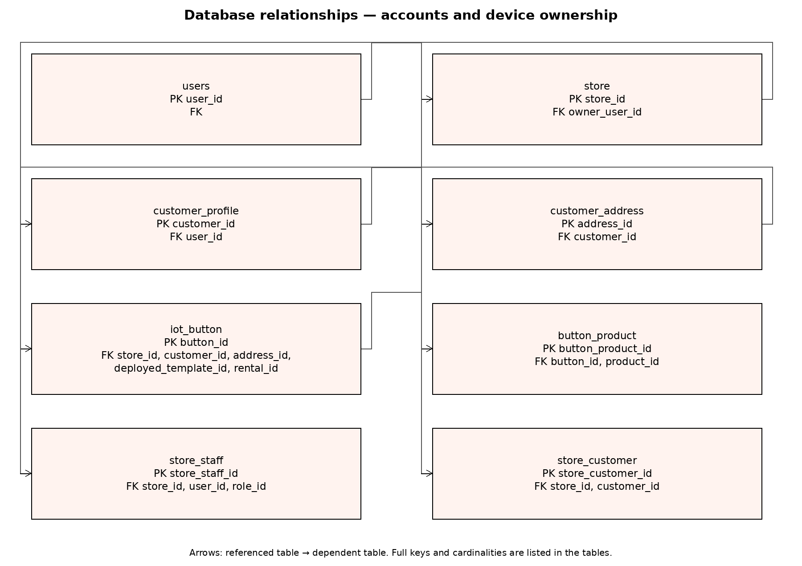

Figure 6. Accounts stores and device ownership relationships

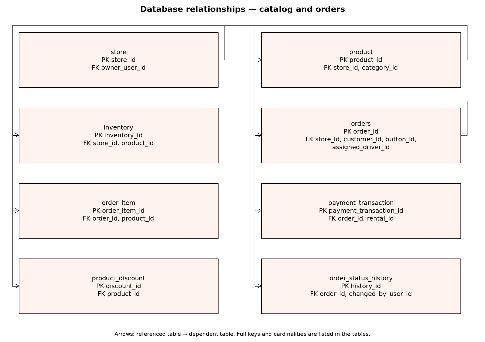

Figure 7. Catalog ordering and payment relationships

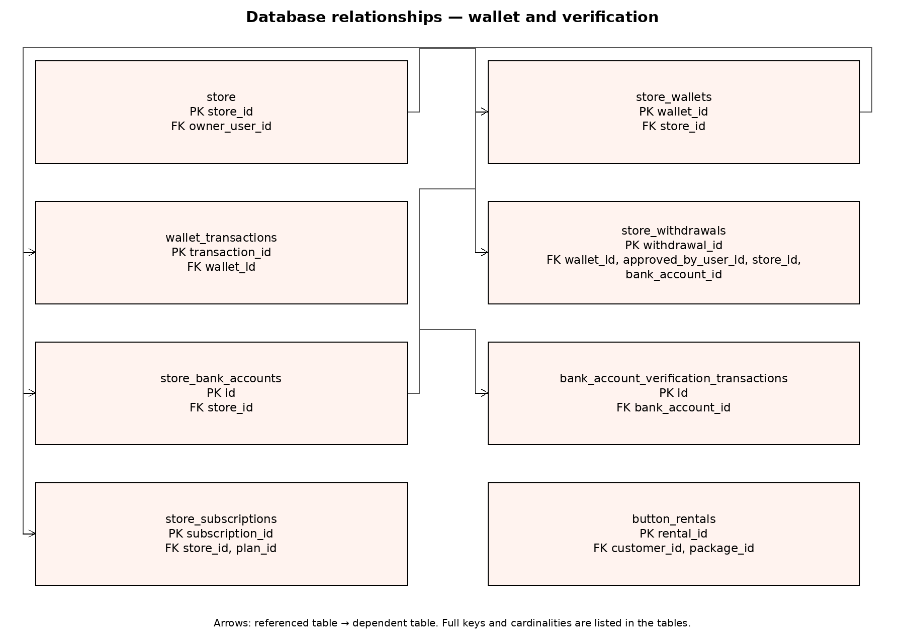

Figure 8. Finance banking and service-package relationships

The diagrams are module views; the table catalogue lists every schema entity. Singular required relations point to one parent; optional relation fields may point to zero or one parent. A unique foreign key restricts a parent to at most one dependent record. For example, customer_profile.user_id, inventory.product_id and store_wallets.store_id are unique, whereas orders.store_id has many order dependents.

Table Descriptions

| No | Table | Description |
| --- | --- | --- |
| 01 | roles | Authorization role definitions. Primary keys: role_id. Foreign keys: No explicit Prisma relation foreign key declared. Unique keys: role_code. |
| 02 | users | Account identity, profile and activation state. Primary keys: user_id. Foreign keys: No explicit Prisma relation foreign key declared. Unique keys: auth_id; username; email; phone; firebase_uid. |
| 03 | store | Merchant identity, operating state and owner. Primary keys: store_id. Foreign keys: owner_user_id → users(user_id). Unique keys: code. |
| 04 | store_staff | Store workforce membership and assigned role. Primary keys: store_staff_id. Foreign keys: store_id → store(store_id); user_id → users(user_id); role_id → roles(role_id). Unique keys: (store_id, user_id). |
| 05 | customer_profile | Global customer identity attached to one user. Primary keys: customer_id. Foreign keys: user_id → users(user_id). Unique keys: user_id. |
| 06 | customer_address | Customer delivery location and default selection. Primary keys: address_id. Foreign keys: customer_id → customer_profile(customer_id). Unique keys: (customer_id, address_id). |
| 07 | store_customer | Store-specific customer relationship and state. Primary keys: store_customer_id. Foreign keys: store_id → store(store_id); customer_id → customer_profile(customer_id). Unique keys: (store_id, customer_id). |
| 08 | category | Store-scoped catalog category including optional parent category. Primary keys: category_id. Foreign keys: store_id → store(store_id); store_id, parent_category_id → category(store_id, category_id). Unique keys: (store_id, category_id). |
| 09 | product | Merchant product, price and descriptive master. Primary keys: product_id. Foreign keys: store_id → store(store_id); store_id, category_id → category(store_id, category_id). Unique keys: (store_id, product_code); (store_id, product_id). |
| 10 | product_price_history | Historical product price change and actor. Primary keys: history_id. Foreign keys: product_id → product(product_id); changed_by_user_id → users(user_id). |
| 11 | product_discount | Time-bounded discount for a product. Primary keys: discount_id. Foreign keys: product_id → product(product_id). |
| 12 | inventory | Physical and reserved stock for a product. Primary keys: inventory_id. Foreign keys: store_id → store(store_id); product_id → product(product_id). Unique keys: product_id. |
| 13 | iot_button | Device identity, ownership, mapping, security/configuration and telemetry. Primary keys: button_id. Foreign keys: store_id → store(store_id); customer_id → customer_profile(customer_id); customer_id, address_id → customer_address(customer_id, address_id); deployed_template_id → device_templates(template_id); rental_id → button_rentals(rental_id). Unique keys: device_id; button_code; (button_id, customer_id, store_id). |
| 14 | button_product | Configured ordered product quantity per button. Primary keys: button_product_id. Foreign keys: button_id → iot_button(button_id); product_id → product(product_id). Unique keys: (button_id, product_id). |
| 15 | orders | Accepted order, shipping snapshot, amounts and fulfillment/payment state. Primary keys: order_id. Foreign keys: store_id → store(store_id); customer_id → customer_profile(customer_id); button_id → iot_button(button_id); assigned_driver_id → users(user_id). Unique keys: order_code; (button_id, iot_request_id). |
| 16 | order_item | Product name, quantity and price snapshot for one order line. Primary keys: order_item_id. Foreign keys: order_id → orders(order_id); product_id → product(product_id). |
| 17 | order_status_history | Order state transition and actor/reason history. Primary keys: history_id. Foreign keys: order_id → orders(order_id); changed_by_user_id → users(user_id). |
| 18 | payment_transaction | Provider transaction for an order or rental. Primary keys: payment_transaction_id. Foreign keys: order_id → orders(order_id); rental_id → button_rentals(rental_id). |
| 19 | refresh_tokens | Hashed refresh credential and session metadata. Primary keys: id. Foreign keys: user_id → users(user_id). Unique keys: token_hash. |
| 20 | user_fcm_tokens | Notification delivery token association. Primary keys: id. Foreign keys: user_id → users(user_id). Unique keys: token. |
| 21 | device_templates | Reusable device configuration definition. Primary keys: template_id. Foreign keys: store_id → store(store_id); default_product_id → product(product_id). Unique keys: code. |
| 22 | subscription_plans | Store service price, period and limits. Primary keys: plan_id. Foreign keys: No explicit Prisma relation foreign key declared. Unique keys: plan_code. |
| 23 | store_subscriptions | Store entitlement and subscription period. Primary keys: subscription_id. Foreign keys: store_id → store(store_id); plan_id → subscription_plans(plan_id). |
| 24 | rental_packages | Hardware rental commercial definition. Primary keys: package_id. Foreign keys: No explicit Prisma relation foreign key declared. Unique keys: package_code. |
| 25 | button_rentals | Customer rental contract and state. Primary keys: rental_id. Foreign keys: customer_id → customer_profile(customer_id); package_id → rental_packages(package_id). Unique keys: rental_code. |
| 26 | store_wallets | One monetary account per store. Primary keys: wallet_id. Foreign keys: store_id → store(store_id). Unique keys: store_id. |
| 27 | wallet_transactions | Financial debit/credit entry and business reference. Primary keys: transaction_id. Foreign keys: wallet_id → store_wallets(wallet_id). Unique keys: (wallet_id, type, reference_id). |
| 28 | store_withdrawals | Withdrawal decision, bank snapshot and payout tracking. Primary keys: withdrawal_id. Foreign keys: wallet_id → store_wallets(wallet_id); approved_by_user_id → users(user_id); store_id → store(store_id); bank_account_id → store_bank_accounts(id). Unique keys: withdrawal_code; provider_reference_id; (store_id, idempotency_key). |
| 29 | product_image | Product media references and display metadata. Primary keys: image_id. Foreign keys: product_id → product(product_id). |
| 30 | pairing_tokens | Hashed time-bounded device pairing credential. Primary keys: id. Foreign keys: No explicit Prisma relation foreign key declared. Unique keys: token_hash. |
| 31 | revoked_tokens | Revoked JWT/token metadata. Primary keys: id. Foreign keys: No explicit Prisma relation foreign key declared. Unique keys: token_hash. |
| 32 | auth_otps | Hashed verification or password-reset code. Primary keys: id. Foreign keys: user_id → users(user_id). |
| 33 | iot_idempotency_keys | Device/request lease, status and associated order. Primary keys: id. Foreign keys: device_id → iot_button(button_id); order_id → orders(order_id). Unique keys: (device_id, request_id). |
| 34 | device_nonces | Consumed device nonce and expiry for replay defense. Primary keys: . Foreign keys: No explicit Prisma relation foreign key declared. |
| 35 | provisioning_sessions | Setup session and device/customer confirmation state. Primary keys: id. Foreign keys: No explicit Prisma relation foreign key declared. Unique keys: session_id. |
| 36 | subscription_idempotency_keys | Store-scoped subscription request deduplication. Primary keys: id. Foreign keys: store_id → store(store_id); subscription_id → store_subscriptions(subscription_id). Unique keys: (store_id, idempotency_key). |
| 37 | driver_duties | Driver availability and store association. Primary keys: driver_duty_id. Foreign keys: driver_id → users(user_id); store_id → store(store_id). Unique keys: driver_id. |
| 38 | driver_shifts | Shift dates, delivery counts, collections and handover. Primary keys: shift_id. Foreign keys: store_id → store(store_id); driver_id → users(user_id); confirmed_by_user_id → users(user_id). |
| 39 | identity_verification_sessions | User/provider identity-verification session. Primary keys: id. Foreign keys: user_id → users(user_id). Unique keys: didit_session_id. |
| 40 | didit_webhook_events | Deduplicated provider verification callback. Primary keys: id. Foreign keys: didit_session_id → identity_verification_sessions(didit_session_id). Unique keys: event_id; payload_hash. |
| 41 | store_bank_accounts | Encrypted store bank identity and verification state. Primary keys: id. Foreign keys: store_id → store(store_id). Unique keys: (store_id, account_number_hash). |
| 42 | bank_account_verification_transactions | Bank verification reference, provider evidence and refund state. Primary keys: id. Foreign keys: bank_account_id → store_bank_accounts(id). Unique keys: provider_transaction_id; (bank_account_id, reference_code). |
| 43 | notifications | Persisted user message and read state. Primary keys: notification_id. Foreign keys: user_id → users(user_id). Unique keys: idempotency_key. |
| 44 | api_idempotency_keys | Actor/path/method request deduplication and response cache. Primary keys: id. Foreign keys: user_id → users(user_id). Unique keys: (actor_scope, idempotency_key, method, actual_path). |
| 45 | dead_letter_jobs | Exhausted background job retained for recovery. Primary keys: id. Foreign keys: No explicit Prisma relation foreign key declared. |

#### 2.3 Transactions Constraints and Indexes

The application combines Prisma transactions, conditional updates, PostgreSQL row locks and database constraints. Database routines and triggers must be applied with the corresponding migration version. Schema.prisma alone does not describe every check, partial unique index or procedural rule. The following boundaries explain how the main invariants are enforced.

| No | Operation | Design and invariant |
| --- | --- | --- |
| 01 | Button order creation | The normal path invokes sp_create_order_from_button. A repository transaction is used only when the routine is missing (42883). Device/request uniqueness prevents duplicate orders; available stock is checked before reservation. |
| 02 | IoT idempotency | The device/request record has a unique key and lease/fencing state. New valid nonces do not authorize an extra business effect for the same request. In-memory debounce is additional protection, not a replacement for database deduplication. |
| 03 | Order status and stock | Repositories lock order/inventory rows and use the backend state graph. The migration defines transition validation and status/history synchronization triggers. Completion/cancellation helper effects must match the deployed trigger body to avoid applying stock effects twice. |
| 04 | Payment settlement | confirmPaymentAtomicTx locks payment_transaction and orders. A PAID payment is an idempotent return. Late payment after cancellation/rejection produces REFUND_PENDING without reopening the order. |
| 05 | Wallet and payout | Withdrawal creates one debit/reservation under a wallet lock. Financial references and provider/reference keys limit duplicates. Failed payout refunds are checked and written once. |
| 06 | Subscription | subscribeWithWalletAtomicTx combines entitlement creation and wallet debit with a store/idempotency record. |
| 07 | Pairing | confirmPairingAtomicTx checks session/ownership and changes the accepted device mapping atomically. |
| 08 | Driver claim | A conditional assignment rejects a competing driver claim rather than allowing last-write-wins reassignment. |
| 09 | Database constraints | Migration checks protect amounts, address/default and discount relationships; partial/unique indexes protect active payment and concurrency invariants not fully expressible through ordinary client validation. |
| 10 | Query indexes | Recent migrations add composite indexes for production order/store/date and other filtered lookups. Pagination and bounded query sizes remain necessary even when indexes exist. |

#### 2.4 Key Field Design

##### 2.4.1 IoTButton

| Field | Type | Constraint |
| --- | --- | --- |
| button_id | BigInt | PK; default autoincrement() |
| store_id | BigInt | See schema and service validation |
| customer_id | BigInt? | nullable |
| address_id | BigInt? | nullable |
| device_id | String | unique |
| button_code | String | unique |
| button_name | String? | nullable |
| hmac_secret | String | See schema and service validation |
| status | String | default "ACTIVE" |
| battery_level | Int? | nullable; default 100 |
| warranty_until | DateTime? | nullable |
| click_behavior | String? | nullable; default "SINGLE" |
| double_click_window_ms | Int? | nullable; default 300 |
| hold_duration_ms | Int? | nullable; default 1500 |
| single_press_action | String? | nullable; VarChar(50); default "CREATE_ORDER" |
| double_press_action | String? | nullable; VarChar(50); default "CANCEL_ORDER" |
| long_press_action | String? | nullable; VarChar(50); default "WIFI_CONFIGURATION" |
| cancel_window_seconds | Int? | nullable; historical database default 60. Retained metadata; NOT authoritative for the common 120-second customer-cancellation policy in Review-2. |
| deployed_template_id | BigInt? | nullable |
| installed_at | DateTime? | nullable |
| created_at | DateTime | default now() |
| updated_at | DateTime | default now() |
| rental_id | BigInt? | nullable |

##### 2.4.2 Order

| Field | Type | Constraint |
| --- | --- | --- |
| order_id | BigInt | PK; default autoincrement() |
| order_code | String | unique; VarChar(50) |
| store_id | BigInt | See schema and service validation |
| customer_id | BigInt? | nullable |
| button_id | BigInt? | nullable |
| order_status | String | VarChar(30); default "PENDING" |
| payment_status | String | VarChar(30); default "UNPAID" |
| payment_method | String | VarChar(30) |
| subtotal_amount | Decimal | Decimal(15, 2); default 0 |
| discount_amount | Decimal | Decimal(15, 2); default 0 |
| shipping_fee | Decimal | Decimal(15, 2); default 0 |
| total_amount | Decimal | Decimal(15, 2); default 0 |
| commission_rate | Decimal? | nullable; Decimal(5, 2); default 8.0 |
| commission_amount | Decimal? | nullable; Decimal(15, 2); default 0 |
| net_amount | Decimal? | nullable; Decimal(15, 2); default 0 |
| shipping_recipient_name | String | VarChar(255) |
| shipping_phone | String | VarChar(20) |
| shipping_address | String | VarChar(500) |
| order_note | String? | nullable |
| order_date | DateTime | Timestamptz(6); default now() |
| completed_at | DateTime? | nullable; Timestamptz(6) |
| created_at | DateTime | Timestamptz(6); default now() |
| updated_at | DateTime | Timestamptz(6); default now() |
| iot_request_id | String? | nullable; VarChar(128) |
| assigned_driver_id | BigInt? | nullable |
| pod_image_url | String? | nullable; VarChar(1000) |
| delivered_at | DateTime? | nullable; Timestamptz(6) |
| failure_reason_code | String? | nullable; VarChar(50) |
| failure_note | String? | nullable |
| evidence_image_url | String? | nullable; VarChar(1000) |
| shipping_latitude | Decimal? | nullable; Decimal(10, 7) |
| shipping_longitude | Decimal? | nullable; Decimal(10, 7) |

##### 2.4.3 OrderItem

| Field | Type | Constraint |
| --- | --- | --- |
| order_item_id | BigInt | PK; default autoincrement() |
| order_id | BigInt | See schema and service validation |
| product_id | BigInt | See schema and service validation |
| product_name_snapshot | String | See schema and service validation |
| unit_price_snapshot | Decimal | Decimal(15, 2) |
| discount_percent_snapshot | Decimal? | nullable; Decimal(5, 2); default 0 |
| discount_amount_snapshot | Decimal? | nullable; Decimal(15, 2); default 0 |
| final_unit_price | Decimal | Decimal(15, 2) |
| quantity | Int | See schema and service validation |
| item_subtotal | Decimal | Decimal(15, 2) |

##### 2.4.4 PaymentTransaction

| Field | Type | Constraint |
| --- | --- | --- |
| payment_transaction_id | BigInt | PK; default autoincrement() |
| order_id | BigInt? | nullable |
| rental_id | BigInt? | nullable |
| provider | String | See schema and service validation |
| transaction_code | String? | nullable |
| amount | Decimal | Decimal(15, 2) |
| payment_method | String | See schema and service validation |
| payment_link_id | String? | nullable |
| checkout_url | String? | nullable |
| qr_code | String? | nullable |
| status | String | default "PENDING" |
| paid_at | DateTime? | nullable |
| created_at | DateTime | default now() |
| updated_at | DateTime | default now() |

##### 2.4.5 StoreWithdrawal

| Field | Type | Constraint |
| --- | --- | --- |
| withdrawal_id | BigInt | PK; default autoincrement() |
| withdrawal_code | String | unique |
| wallet_id | BigInt | See schema and service validation |
| amount | Decimal | Decimal(15, 2) |
| fee | Decimal | Decimal(15, 2); default 0 |
| net_amount | Decimal? | nullable; Decimal(15, 2) |
| bank_code | String? | nullable |
| bank_name | String | See schema and service validation |
| bank_account_number | String? | nullable |
| bank_account_holder | String | See schema and service validation |
| status | String | default "PENDING" |
| provider | String | default "PAYOS" |
| provider_payout_id | String? | nullable |
| provider_reference_id | String? | unique; nullable |
| failure_reason | String? | nullable |
| approved_by_user_id | BigInt? | nullable |
| rejection_reason | String? | nullable |
| transfer_evidence_url | String? | nullable |
| requested_at | DateTime | default now() |
| processed_at | DateTime? | nullable |
| created_at | DateTime | default now() |
| updated_at | DateTime | default now() |
| store_id | BigInt? | nullable |
| idempotency_key | String? | nullable; VarChar(255) |
| bank_account_id | BigInt? | nullable |
| bank_account_encrypted | String? | nullable; Text |
| bank_account_hash | String? | nullable; VarChar(64) |
| bank_account_masked | String? | nullable; VarChar(32) |
| bank_account_name_snapshot | String? | nullable; VarChar(255) |
| bank_bin_snapshot | String? | nullable; VarChar(10) |
| bank_name_snapshot | String? | nullable; VarChar(100) |

##### 2.4.6 StoreBankAccount

| Field | Type | Constraint |
| --- | --- | --- |
| id | BigInt | PK; default autoincrement() |
| store_id | BigInt | See schema and service validation |
| bank_bin | String | VarChar(10) |
| bank_code | String? | nullable; VarChar(20) |
| bank_name | String | VarChar(100) |
| account_number_encrypted | String | Text |
| account_number_hash | String | VarChar(64) |
| account_name | String | VarChar(255) |
| verification_status | String | VarChar(32); default "PENDING" |
| is_default | Boolean | default true |
| verified_at | DateTime? | nullable; Timestamptz(6) |
| last_verified_at | DateTime? | nullable; Timestamptz(6) |
| created_at | DateTime | Timestamptz(6); default now() |
| updated_at | DateTime | Timestamptz(6); default now() |

##### 2.4.7 ApiIdempotencyKey

| Field | Type | Constraint |
| --- | --- | --- |
| id | BigInt | PK; default autoincrement() |
| idempotency_key | String | VarChar(128) |
| method | String | VarChar(10); default "POST" |
| actual_path | String | VarChar(255); default "/" |
| actor_scope | String | VarChar(128); default "public" |
| route | String | VarChar(255) |
| user_id | BigInt? | nullable |
| request_hash | String | Char(64) |
| status_code | Int? | nullable |
| response_body | Json? | nullable |
| status | String | VarChar(20); default "PROCESSING" |
| locked_until | DateTime | Timestamptz(6) |
| expires_at | DateTime | Timestamptz(6) |
| created_at | DateTime | Timestamptz(6); default now() |
| updated_at | DateTime | Timestamptz(6); default now() |

### 3. Detailed Design

Feature groups below map to the FR identifiers in Report 3. Shared structures are drawn once and referenced from related functions, as permitted by the template. Class diagrams are simplified dependency/responsibility views; selected operations are taken from the inspected source. Sequence diagrams abstract transport boilerplate while retaining transaction, authentication and external-service boundaries.

#### 3.1 Account and Session Management

Requirements covered: FR01–FR04

Identity flows share AuthController, AuthService and AuthRepository. Password login, Google login and verified phone login converge on a server-derived user role and store/customer context. A client role value is not trusted.

##### 3.1.1 Class Diagram

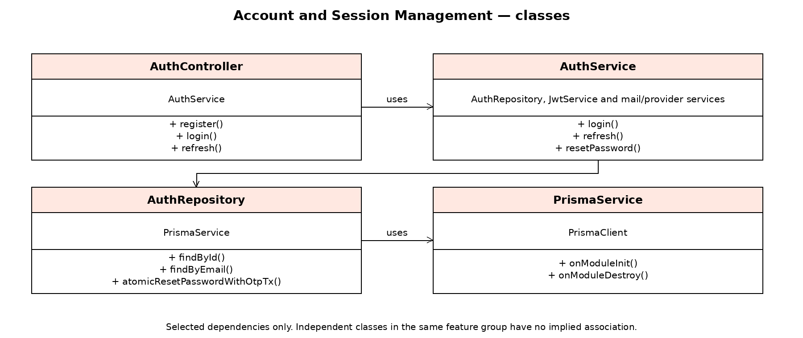

Figure 9. Account and Session Management class responsibilities

##### 3.1.2 Class Specifications

| No | Class | Specification |
| --- | --- | --- |
| 01 | AuthController | Maps supported account/session endpoints and validated DTOs to the service. Collaborators/state: AuthService. Selected operations: register(), login(), refresh(). Source: Backend/src/auth/auth.controller.ts |
| 02 | AuthService | Validates credentials, resolves actor context, issues/rotates tokens and coordinates verification. Collaborators/state: AuthRepository, JwtService and mail/provider services. Selected operations: login(), refresh(), resetPassword(). Source: Backend/src/auth/auth.service.ts |
| 03 | AuthRepository | Reads identity state and performs atomic account/OTP operations. Collaborators/state: PrismaService. Selected operations: findById(), findByEmail(), atomicResetPasswordWithOtpTx(). Source: Backend/src/auth/auth.repository.ts |
| 04 | PrismaService | Owns database-client connection and lifecycle. Collaborators/state: PrismaClient. Selected operations: onModuleInit(), onModuleDestroy(). Source: Backend/src/prisma/prisma.service.ts |

##### 3.1.3 Principal Sequence Diagram

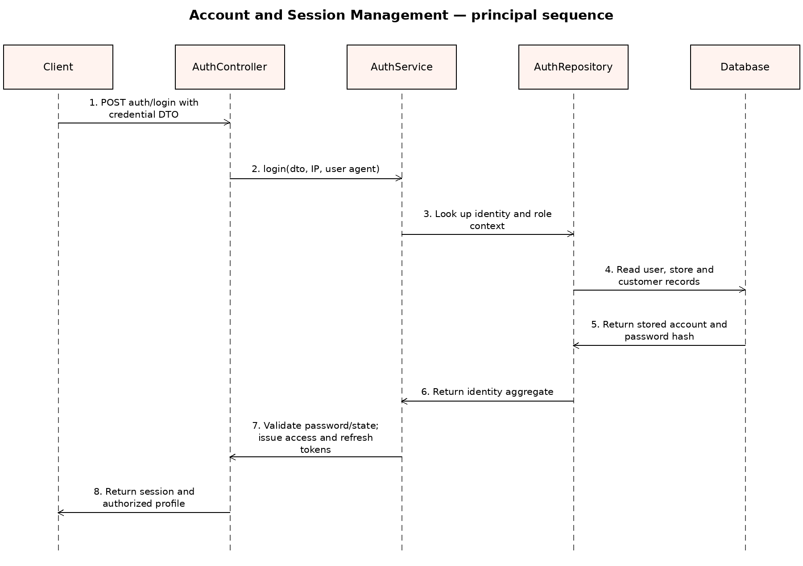

Figure 10. Account and Session Management principal sequence

##### 3.1.4 Processing and Exception Design

Invalid credentials or inactive accounts terminate before token issuance. Reset codes are hashed and atomically consumed. Change-password verifies the current password, writes the new hash and revokes relevant sessions. Concurrent client refresh calls are coordinated on each client; server rotation remains authoritative.

Persistence and state: users, roles, store_staff, customer_profile, refresh_tokens, auth_otps and revoked_tokens. Verification/reset tokens are not stored as reusable plaintext credentials. JWT validation and role/object checks run again at protected boundaries.

#### 3.2 Device Provisioning and Fleet Management

Requirements covered: FR14–FR17, FR31–FR32

Provisioning separates a public QR/session discovery step, authenticated device bootstrap, and authenticated customer confirmation. Atomic confirmation binds ownership and product/address context. Fleet and template operations reuse the device access rules.

##### 3.2.1 Class Diagram

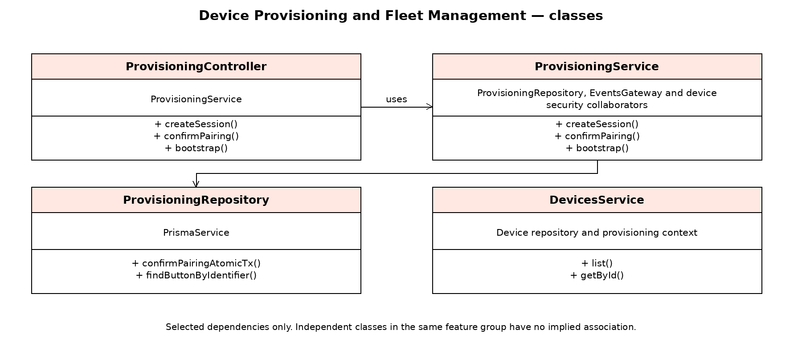

Figure 11. Device Provisioning and Fleet Management class responsibilities

##### 3.2.2 Class Specifications

| No | Class | Specification |
| --- | --- | --- |
| 01 | ProvisioningController | Exposes setup, claim, transfer, Wi-Fi and security endpoints with action-specific guards. Collaborators/state: ProvisioningService. Selected operations: createSession(), confirmPairing(), bootstrap(). Source: Backend/src/devices/provisioning.controller.ts |
| 02 | ProvisioningService | Resolves setup input, verifies device evidence and translates repository outcomes to HTTP errors. Collaborators/state: ProvisioningRepository, EventsGateway and device security collaborators. Selected operations: createSession(), confirmPairing(), bootstrap(). Source: Backend/src/devices/provisioning.service.ts |
| 03 | ProvisioningRepository | Performs atomic pairing and device/session persistence. Collaborators/state: PrismaService. Selected operations: confirmPairingAtomicTx(), findButtonByIdentifier(). Source: Backend/src/devices/provisioning.repository.ts |
| 04 | DevicesService | Applies device ownership/configuration rules and supports fleet operations. Collaborators/state: Device repository and provisioning context. Selected operations: list(), getById(). Source: Backend/src/devices/devices.service.ts |

##### 3.2.3 Principal Sequence Diagram

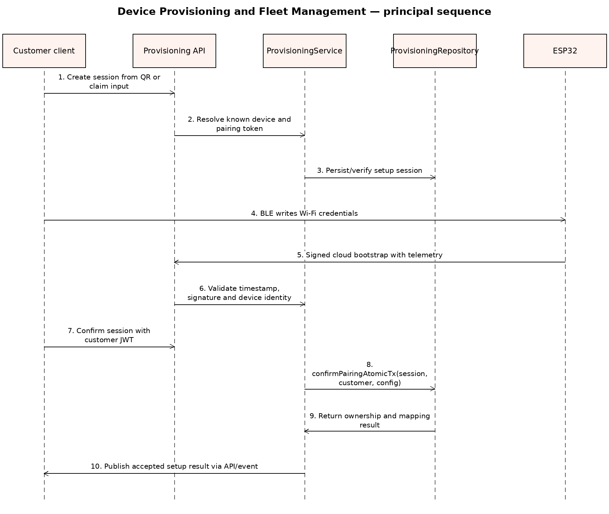

Figure 12. Device Provisioning and Fleet Management principal sequence

##### 3.2.4 Processing and Exception Design

Reject unknown devices, invalid or consumed pairing credentials and conflicting ownership. Bootstrap requires device-specific HMAC evidence. Failed BLE/Wi-Fi setup must not be represented as physical success. Customer transfer/unclaim and store factory reset have distinct permissions.

Persistence and state: iot_button, pairing_tokens, provisioning_sessions, button_product, customer_address and device_templates. Customer product/store changes must preserve valid ownership and catalog relationships.

#### 3.3 Catalog Inventory and Customer Data

Requirements covered: FR05–FR08, FR33, FR36–FR37

Catalog, category, discount, address, staff and store-customer operations use the same controller/service/repository pattern. The class and sequence diagrams show the product write pattern; the reuse table identifies the corresponding implementations.

##### 3.3.1 Class Diagram

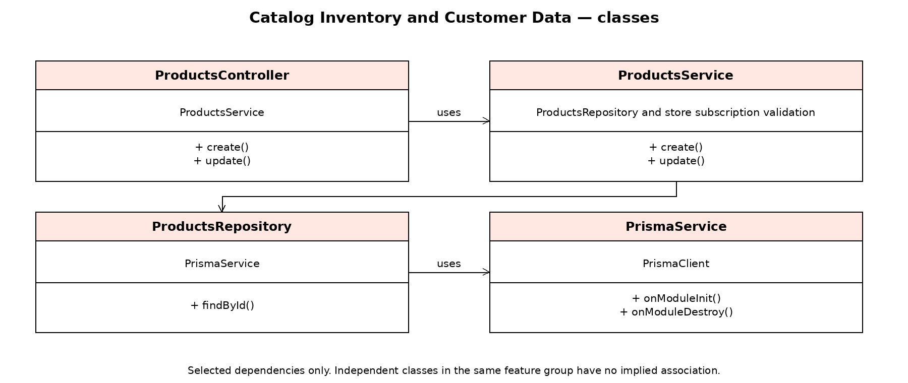

Figure 13. Catalog Inventory and Customer Data class responsibilities

##### 3.3.2 Class Specifications

| No | Class | Specification |
| --- | --- | --- |
| 01 | ProductsController | Receives product and inventory requests with endpoint-level role restrictions. Collaborators/state: ProductsService. Selected operations: create(), update(). Source: Backend/src/products/products.controller.ts |
| 02 | ProductsService | Applies store access, commercial eligibility, product and image rules. Collaborators/state: ProductsRepository and store subscription validation. Selected operations: create(), update(). Source: Backend/src/products/products.service.ts |
| 03 | ProductsRepository | Persists product, media, pricing and inventory data. Collaborators/state: PrismaService. Selected operations: findById(). Source: Backend/src/products/products.repository.ts |
| 04 | PrismaService | Executes typed Prisma operations and database transactions. Collaborators/state: PrismaClient. Selected operations: onModuleInit(), onModuleDestroy(). Source: Backend/src/prisma/prisma.service.ts |

##### 3.3.3 Principal Sequence Diagram

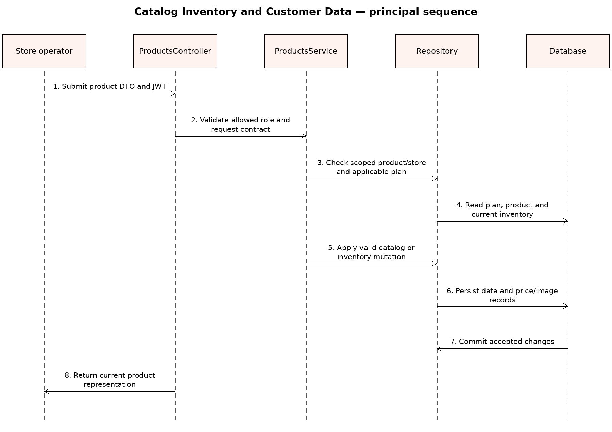

Figure 14. Catalog Inventory and Customer Data principal sequence

##### 3.3.4 Processing and Exception Design

The owner product-write role and manager query permissions are not identical. Prevent cross-store record access. Numeric/image/date constraints remain in DTOs and domain checks. Stock reservation is owned by order transactions, not a speculative client stock adjustment.

Persistence and state: product, product_image, product_price_history, category, product_discount and inventory; address/profile operations use their own ownership keys. Products have store-scoped unique codes and inventory has a unique product reference.

| Function | Service | Repository or persistence |
| --- | --- | --- |
| Categories | CategoriesService | CategoriesRepository |
| Discounts | ProductDiscountsService | ProductDiscountsRepository |
| Customer addresses | CustomerAddressesService | CustomerAddressesRepository |
| Store staff | StoreStaffService | StoreStaffRepository |
| Store customers | StoreCustomersService | StoreCustomersRepository |
| Store profile | StoresService | StoresRepository |

#### 3.4 Order Creation and Lifecycle

Requirements covered: FR09–FR13, FR18

Physical-button ordering enters through HmacAuthGuard and IotService, while storefront checkout enters through StorefrontController and optional customer authentication. Both paths delegate business persistence to OrdersRepository. Fulfillment transitions use the backend state graph.

##### 3.4.1 Class Diagram

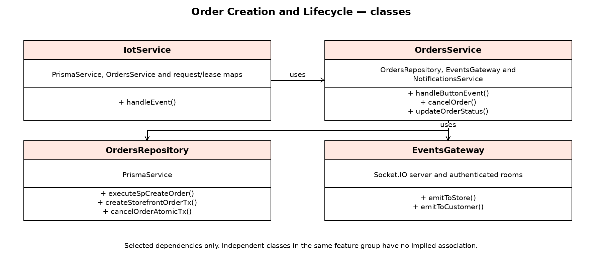

Figure 15. Order Creation and Lifecycle class responsibilities

##### 3.4.2 Class Specifications

| No | Class | Specification |
| --- | --- | --- |
| 01 | IotService | Deduplicates device requests, applies debounce and coordinates order events. Collaborators/state: PrismaService, OrdersService and request/lease maps. Selected operations: handleEvent(). Source: Backend/src/iot/iot.service.ts |
| 02 | OrdersService | Checks ownership and the common 120-second customer deadline for PENDING/CONFIRMED orders; keeps privileged lifecycle rules separate. Collaborators: OrdersRepository, EventsGateway, NotificationsService. cancelOrderAtomicTx rechecks customer eligibility after the row lock. Source: backend/src/orders/orders.service.ts; customer-cancellation.policy.ts; orders.repository.ts. |
| 03 | OrdersRepository | Executes order/stock transactions with row locking and idempotency. Collaborators/state: PrismaService. Selected operations: executeSpCreateOrder(), createStorefrontOrderTx(), cancelOrderAtomicTx(). Source: Backend/src/orders/orders.repository.ts |
| 04 | EventsGateway | Publishes committed changes only to permitted scopes. Collaborators/state: Socket.IO server and authenticated rooms. Selected operations: emitToStore(), emitToCustomer(). Source: Backend/src/websocket/events.gateway.ts |

##### 3.4.3 Principal Sequence Diagram

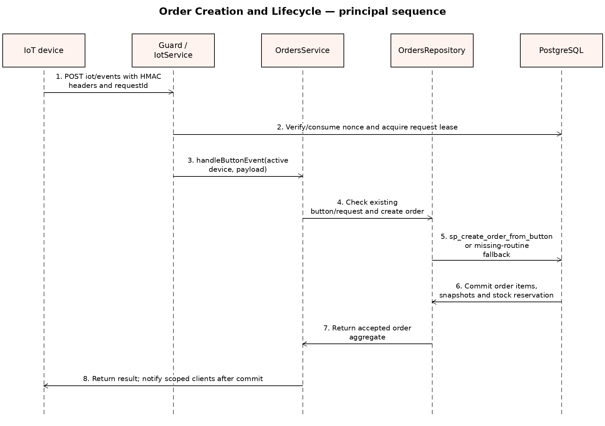

Figure 16. Order Creation and Lifecycle principal sequence

##### 3.4.4 Processing and Exception Design

Invalid signatures, nonce replay, debounce, inactive mappings and insufficient stock stop creation. The stored-procedure fallback is used only for missing routine error 42883. Customer cancellation applies to every order channel while PENDING/CONFIRMED and elapsed server time is below 120 seconds. Ownership is checked before idempotent responses. The repository rechecks eligibility after the row lock using a fresh database-clock read, before reservation compensation. Cancellation/complete helpers and database triggers must be deployed together and verified against the current migrations.

Persistence and state: orders, order_item, order_status_history, inventory, iot_idempotency_keys, device_nonces and notifications. Storefront orders may have no customer_id/button_id. Minimum order total is 2,000 VND and prices are recomputed server-side.

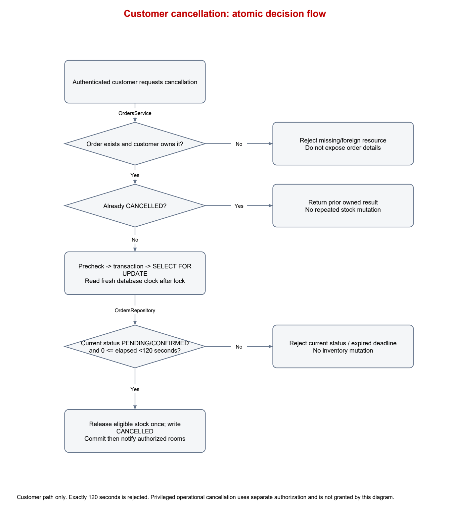

Figure 17. Customer cancellation and stock compensation

#### 3.5 Delivery and Driver Shifts

Requirements covered: FR19–FR22

Delivery assignment, fulfillment evidence and driver shifts are separate concerns. OrdersRepository protects assignment and order state; DriverShiftsService records driver duty/shift totals and store handover confirmation.

##### 3.5.1 Class Diagram

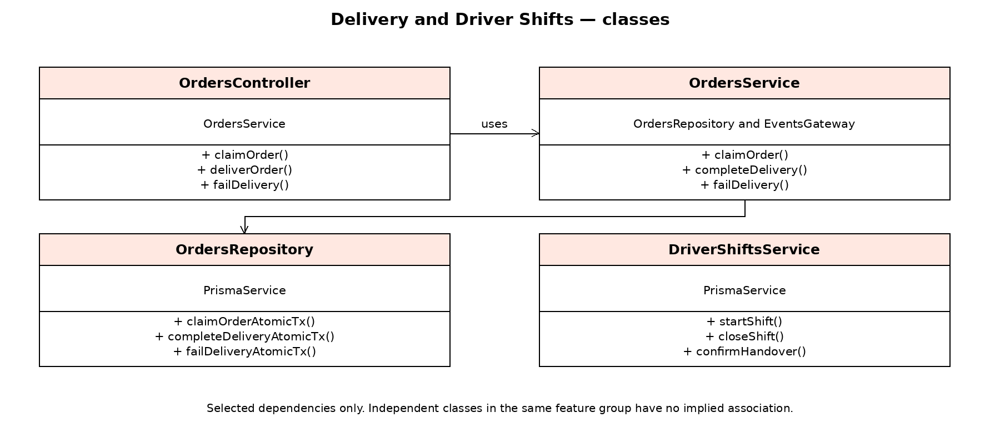

Figure 18. Delivery and Driver Shifts class responsibilities

##### 3.5.2 Class Specifications

| No | Class | Specification |
| --- | --- | --- |
| 01 | OrdersController | Maps queue and delivery actions to validated service operations. Collaborators/state: OrdersService. Selected operations: claimOrder(), deliverOrder(), failDelivery(). Source: Backend/src/orders/orders.controller.ts |
| 02 | OrdersService | Checks caller context and orchestrates delivery outcomes. Collaborators/state: OrdersRepository and EventsGateway. Selected operations: claimOrder(), completeDelivery(), failDelivery(). Source: Backend/src/orders/orders.service.ts |
| 03 | OrdersRepository | Makes one valid assignment and validates proof/payment before atomic delivery changes. Collaborators/state: PrismaService. Selected operations: claimOrderAtomicTx(), completeDeliveryAtomicTx(), failDeliveryAtomicTx(). Source: Backend/src/orders/orders.repository.ts |
| 04 | DriverShiftsService | Computes shift statistics and separates driver closure from store receipt confirmation. Collaborators/state: PrismaService. Selected operations: startShift(), closeShift(), confirmHandover(). Source: Backend/src/driver-shifts/driver-shifts.service.ts |

##### 3.5.3 Principal Sequence Diagram

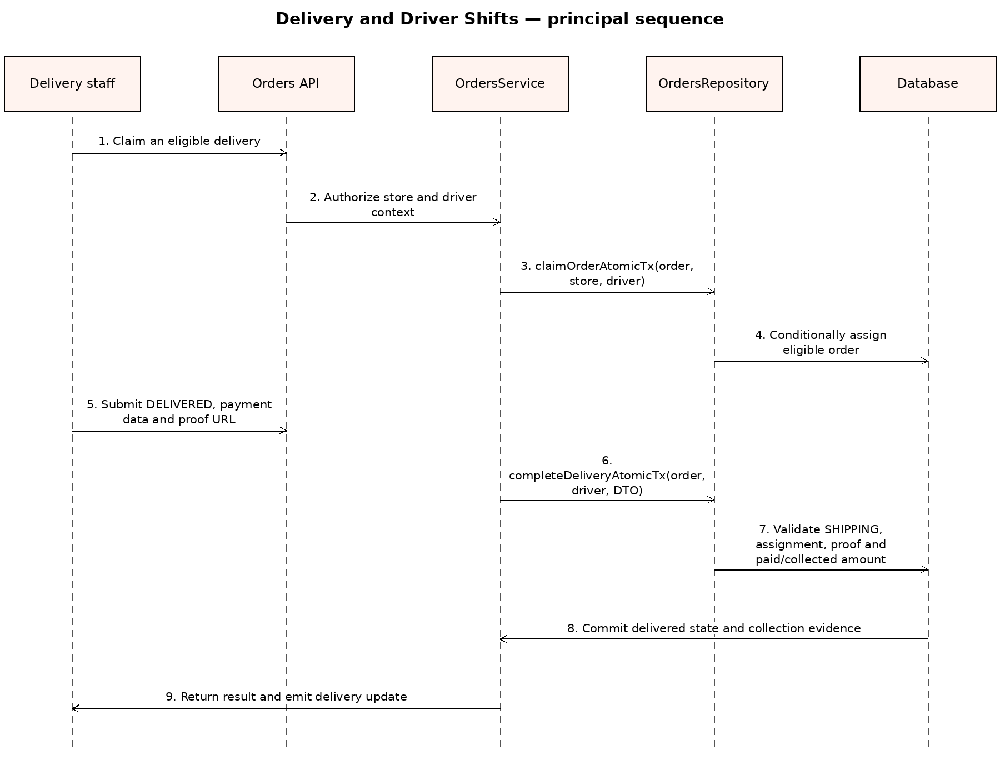

Figure 19. Delivery and Driver Shifts principal sequence

##### 3.5.4 Processing and Exception Design

A competing driver claim must fail when the order is already assigned. COD collectedAmount must equal the order total. Electronic payment must already be paid. A Cloudinary proof URL must belong to stores/{storeId}/pod and must not be reused. Failure uses DELIVERY_FAILED and an allowed retry/cancel transition.

Persistence and state: orders.assigned_driver_id, delivery evidence and amount fields; driver_duties and driver_shifts. Closing a shift does not itself confirm store handover. Foreign-store or foreign-driver actions remain prohibited.

#### 3.6 PayOS Payment Processing

Requirements covered: FR23

Payment initiation validates order ownership and state before creating a provider request. Callback verification is independent of browser redirect navigation. PaymentsRepository confirms an accepted payment under transaction locks.

##### 3.6.1 Class Diagram

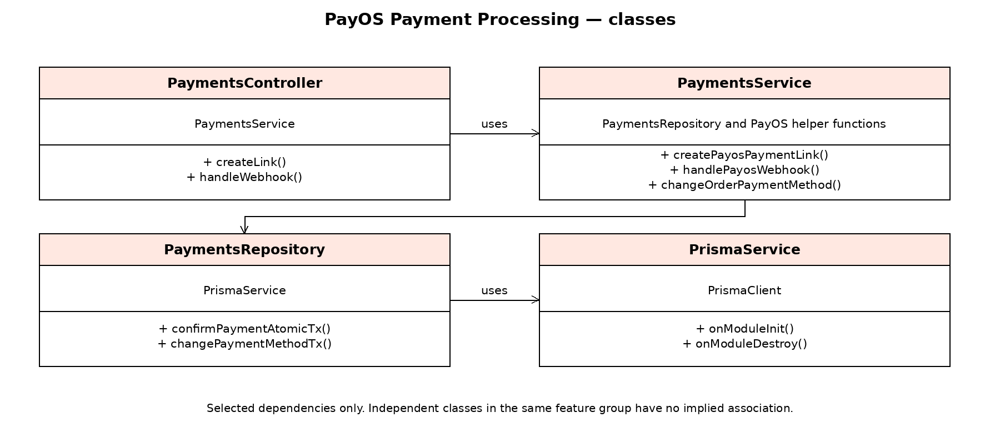

Figure 20. PayOS Payment Processing class responsibilities

##### 3.6.2 Class Specifications

| No | Class | Specification |
| --- | --- | --- |
| 01 | PaymentsController | Exposes payment initiation, query/cancel and webhook actions. Collaborators/state: PaymentsService. Selected operations: createLink(), handleWebhook(). Source: Backend/src/payments/payments.controller.ts |
| 02 | PaymentsService | Checks amount/provider identity, validates callback signature and coordinates settlement. Collaborators/state: PaymentsRepository and PayOS helper functions. Selected operations: createPayosPaymentLink(), handlePayosWebhook(), changeOrderPaymentMethod(). Source: Backend/src/payments/payments.service.ts |
| 03 | PaymentsRepository | Locks payment and order; applies one settlement and manages eligible method changes. Collaborators/state: PrismaService. Selected operations: confirmPaymentAtomicTx(), changePaymentMethodTx(). Source: Backend/src/payments/payments.repository.ts |
| 04 | PrismaService | Runs payment and notification persistence. Collaborators/state: PrismaClient. Selected operations: onModuleInit(), onModuleDestroy(). Source: Backend/src/prisma/prisma.service.ts |

##### 3.6.3 Principal Sequence Diagram

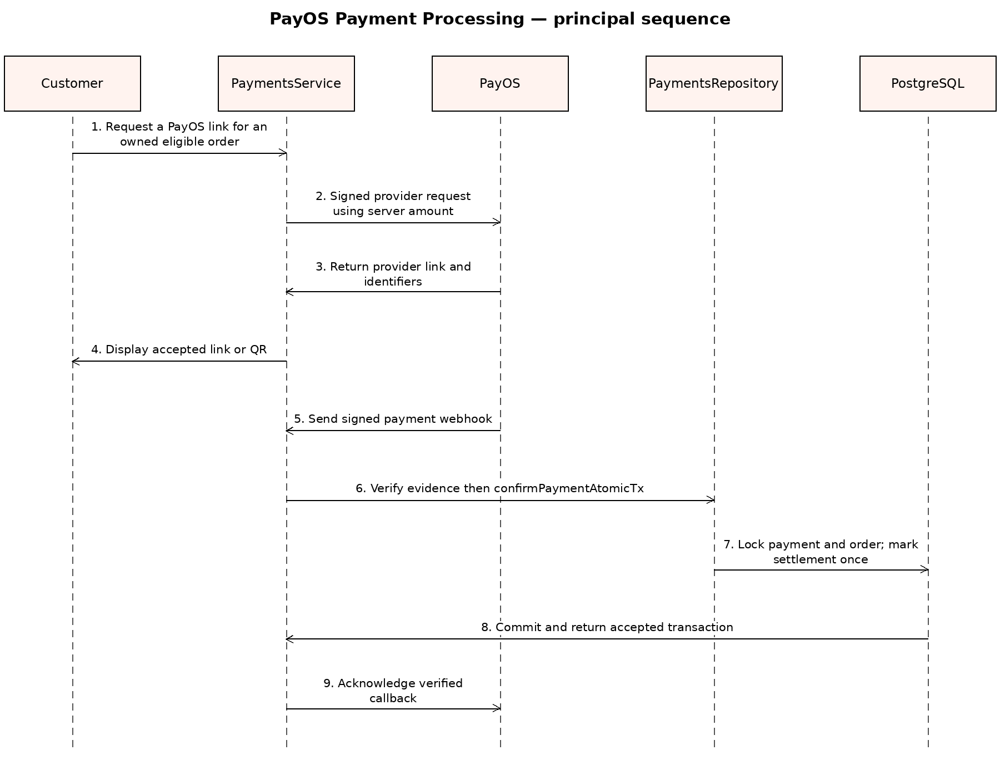

Figure 21. PayOS Payment Processing principal sequence

##### 3.6.4 Processing and Exception Design

Already-paid callbacks return the existing payment without repeating effects. Only PENDING transactions are confirmed. An order still PENDING can become CONFIRMED. If payment arrives after CANCELLED/REJECTED, the repository sets paymentStatus to REFUND_PENDING rather than reopening the order. This flag is a reconciliation obligation, not evidence that a refund has completed.

Persistence and state: payment_transaction links to an order or a rental. For order payment, the transaction and order are locked together and a unique notification idempotency key prevents duplicate payment notices. Production redirect inputs currently accept HTTPS smartorder.vn hosts.

#### 3.7 Store Wallet Banking and Payouts

Requirements covered: FR24–FR26

StoreWalletService manages balances and withdrawal state; bank verification is performed by BankVerificationService. Payout execution is an external side effect separated from wallet locking, with idempotent failure compensation.

##### 3.7.1 Class Diagram

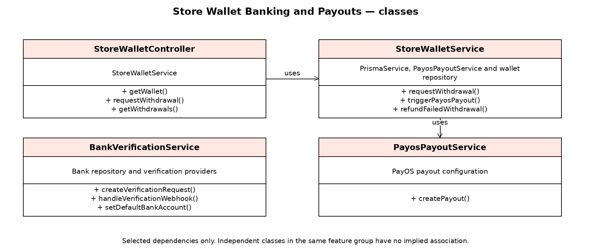

Figure 22. Store Wallet Banking and Payouts class responsibilities

##### 3.7.2 Class Specifications

| No | Class | Specification |
| --- | --- | --- |
| 01 | StoreWalletController | Restricts finance APIs to authorized owner/manager context and supported administrator scope. Collaborators/state: StoreWalletService. Selected operations: getWallet(), requestWithdrawal(), getWithdrawals(). Source: Backend/src/store-wallet/store-wallet.controller.ts |
| 02 | StoreWalletService | Locks funds, records withdrawals and reconciles payout/refund outcomes. Collaborators/state: PrismaService, PayosPayoutService and wallet repository. Selected operations: requestWithdrawal(), triggerPayosPayout(), refundFailedWithdrawal(). Source: Backend/src/store-wallet/store-wallet.service.ts |
| 03 | BankVerificationService | Confirms store access and bank account ownership before use. Collaborators/state: Bank repository and verification providers. Selected operations: createVerificationRequest(), handleVerificationWebhook(), setDefaultBankAccount(). Source: Backend/src/bank-verification/bank-verification.service.ts |
| 04 | PayosPayoutService | Encapsulates configured external payout requests. Collaborators/state: PayOS payout configuration. Selected operations: createPayout(). Source: Backend/src/payments/payos-payout.service.ts |

##### 3.7.3 Principal Sequence Diagram

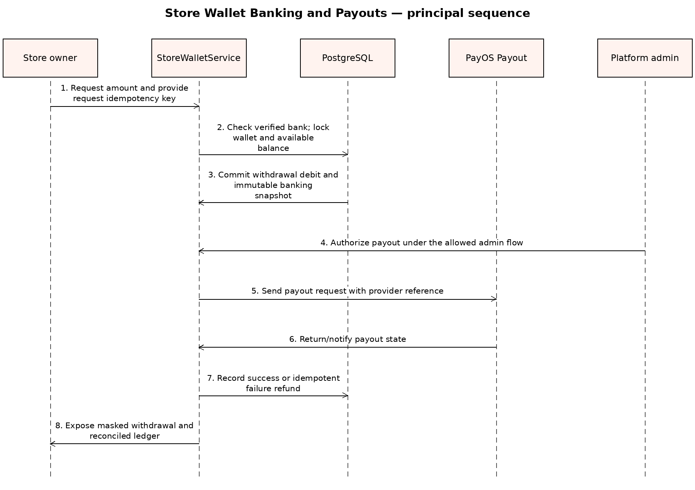

Figure 23. Store Wallet Banking and Payouts principal sequence

##### 3.7.4 Processing and Exception Design

Reject amounts below 50,000 VND, insufficient balance and a non-OWNERSHIP_VERIFIED account. The same request key cannot spend the balance twice. Provider failure compensation checks ledger uniqueness. Unknown/provider-pending results require status synchronization rather than an invented success.

Persistence and state: store_wallets, wallet_transactions, store_withdrawals, store_bank_accounts and bank_account_verification_transactions. Bank numbers are encrypted and hashes support lookup; responses use masks and banking snapshots preserve the accepted withdrawal destination.

#### 3.8 Rentals and Store Subscriptions

Requirements covered: FR27–FR28

Rental contracts belong to customers, while store subscriptions belong to stores and are funded through the store wallet. Their plan definitions are administered centrally. Both services use repository transactions rather than client-calculated entitlements.

##### 3.8.1 Class Diagram

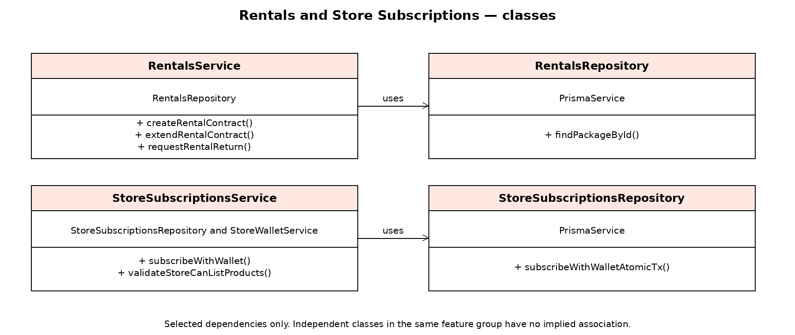

Figure 24. Rentals and Store Subscriptions class responsibilities

##### 3.8.2 Class Specifications

| No | Class | Specification |
| --- | --- | --- |
| 01 | RentalsService | Coordinates customer contracts, payment requests, extension and return state. Collaborators/state: RentalsRepository. Selected operations: createRentalContract(), extendRentalContract(), requestRentalReturn(). Source: Backend/src/rentals/rentals.service.ts |
| 02 | RentalsRepository | Persists rental package/contract and associated state. Collaborators/state: PrismaService. Selected operations: findPackageById(). Source: Backend/src/rentals/rentals.repository.ts |
| 03 | StoreSubscriptionsService | Validates active plans and product limits and delegates atomic wallet-funded subscription. Collaborators/state: StoreSubscriptionsRepository and StoreWalletService. Selected operations: subscribeWithWallet(), validateStoreCanListProducts(). Source: Backend/src/store-subscriptions/store-subscriptions.service.ts |
| 04 | StoreSubscriptionsRepository | Applies subscription and wallet debit atomically with deduplication. Collaborators/state: PrismaService. Selected operations: subscribeWithWalletAtomicTx(). Source: Backend/src/store-subscriptions/store-subscriptions.repository.ts |

##### 3.8.3 Principal Sequence Diagram

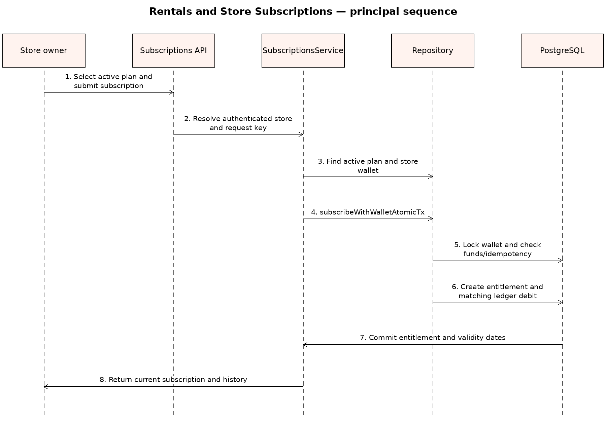

Figure 25. Rentals and Store Subscriptions principal sequence

##### 3.8.4 Processing and Exception Design

Inactive plans and insufficient wallet funds fail without a partial subscription. A repeated subscription key reuses the prior operation. The current listing service allows products without a subscription only when no plans are configured. Rental activation requires an accepted paid state and does not certify that unfinished hardware has been physically delivered.

Persistence and state: rental_packages, button_rentals, subscription_plans, store_subscriptions, subscription_idempotency_keys and wallet_transactions.

#### 3.9 Administration Identity and Notifications

Requirements covered: FR29–FR30, FR34–FR35, FR38

Administration, identity verification, persisted notification delivery and background processing are separate modules. They share scoped authorization and provider verification rules; they do not share a universal administrator bypass for every service-level constraint.

##### 3.9.1 Class Diagram

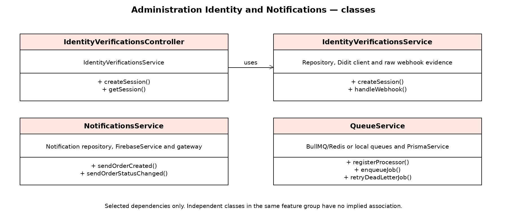

Figure 26. Administration Identity and Notifications class responsibilities

##### 3.9.2 Class Specifications

| No | Class | Specification |
| --- | --- | --- |
| 01 | IdentityVerificationsController | Starts and retrieves owned verification sessions with privileged management actions. Collaborators/state: IdentityVerificationsService. Selected operations: createSession(), getSession(). Source: Backend/src/identity-verifications/identity-verifications.controller.ts |
| 02 | IdentityVerificationsService | Validates session ownership and verified callback decisions. Collaborators/state: Repository, Didit client and raw webhook evidence. Selected operations: createSession(), handleWebhook(). Source: Backend/src/identity-verifications/identity-verifications.service.ts |
| 03 | NotificationsService | Persists/delivers user-scoped notifications after business changes. Collaborators/state: Notification repository, FirebaseService and gateway. Selected operations: sendOrderCreated(), sendOrderStatusChanged(). Source: Backend/src/notifications/notifications.service.ts |
| 04 | QueueService | Runs registered jobs with retry and dead-letter recovery. Collaborators/state: BullMQ/Redis or local queues and PrismaService. Selected operations: registerProcessor(), enqueueJob(), retryDeadLetterJob(). Source: Backend/src/common/queues/queue.service.ts |

##### 3.9.3 Principal Sequence Diagram

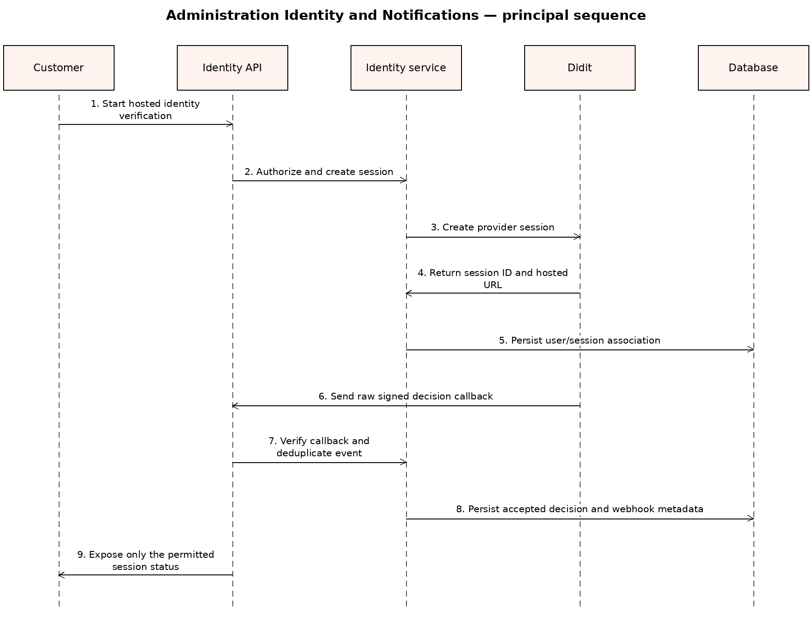

Figure 27. Administration Identity and Notifications principal sequence

##### 3.9.4 Processing and Exception Design

Invalid signatures or foreign session reads fail. A verification state such as PENDING/DECLINED must not become APPROVED through client input. Notification send failure does not roll back a committed order. Redis/BullMQ is conditional; local fallback is not a durable multi-instance queue. Exhausted jobs are retained through the dead-letter design.

Persistence and state: identity_verification_sessions, didit_webhook_events, notifications, user_fcm_tokens and dead_letter_jobs; admin operations also read store/user/plan records. Health endpoints distinguish process liveness from readiness and draining.

#### 3.10 Web and Mobile Client Design

Requirements covered: FR01–FR38 through supported role interfaces

The Web uses functional React components and context providers rather than Java-style page classes. Mobile uses ChangeNotifier providers and typed service/model classes. Both clients treat server authorization and committed order/payment state as authoritative.

##### 3.10.1 Class Diagram

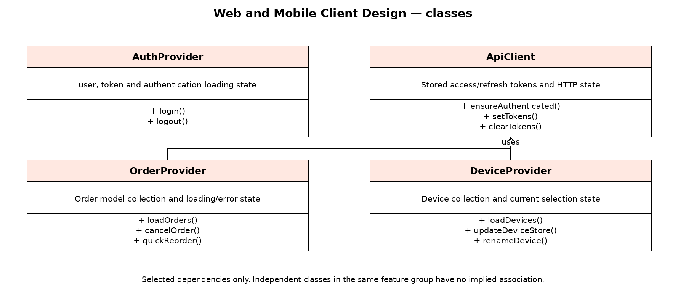

Figure 28. Web and Mobile Client Design class responsibilities

##### 3.10.2 Class Specifications

| No | Class | Specification |
| --- | --- | --- |
| 01 | AuthProvider | Provides React authentication context and authorized routing data; this is a functional provider, not an OO class. Collaborators/state: user, token and authentication loading state. Selected operations: login(), logout(). Source: Frontend/src/context/AuthContext.tsx |
| 02 | ApiClient | Provides authenticated HTTP requests, refresh coordination, errors, timeout and upload support. Collaborators/state: Stored access/refresh tokens and HTTP state. Selected operations: ensureAuthenticated(), setTokens(), clearTokens(). Source: Mobile/lib/services/api_client.dart |
| 03 | OrderProvider | Exposes reactive order state and actions to the four-tab application. Collaborators/state: Order model collection and loading/error state. Selected operations: loadOrders(), cancelOrder(), quickReorder(). Source: Mobile/lib/providers/order_provider.dart |
| 04 | DeviceProvider | Exposes device state and calls device/provisioning service wrappers. Collaborators/state: Device collection and current selection state. Selected operations: loadDevices(), updateDeviceStore(), renameDevice(). Source: Mobile/lib/providers/device_provider.dart |

##### 3.10.3 Principal Sequence Diagram

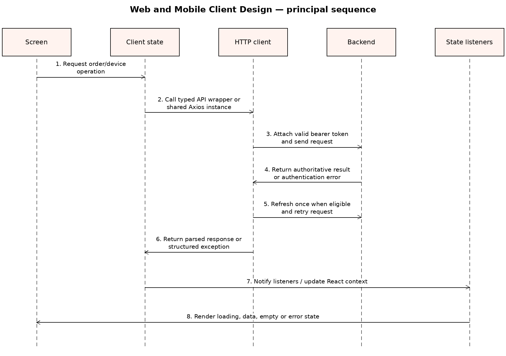

Figure 29. Web and Mobile Client Design principal sequence

##### 3.10.4 Processing and Exception Design

Web refresh promises/queues prevent avoidable concurrent client refresh calls. Mobile ApiClient has its own refresh mechanism. A JWT decoded locally is used for expiry convenience only; it is not a substitute for server signature validation. BLE/camera permission denial and network errors require explicit UI states.

Persistence and state: Web context and browser token storage; Mobile provider/model state and the ApiClient token persistence implemented in its source. Mobile principal tabs are Home, Devices, Orders and Account. Runtime API URL overrides and the active frontend build root must be aligned with deployment.

#### 3.11 Embedded Firmware Design

Requirements covered: FR10, FR12, FR14, FR16–FR17

Firmware is organized around a static StateMachine coordinating gesture input, networking, request signing, feedback and power management. The design describes source behavior and integration contracts; the physical prototype is still under development.

##### 3.11.1 Class Diagram

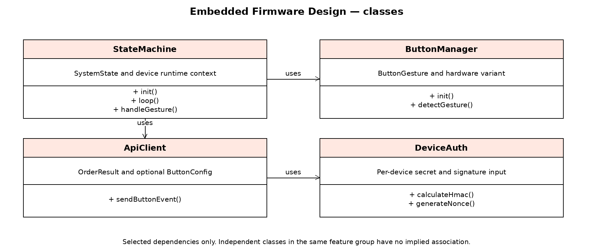

Figure 30. Embedded Firmware Design class responsibilities

##### 3.11.2 Class Specifications

| No | Class | Specification |
| --- | --- | --- |
| 01 | StateMachine | Coordinates boot, gesture handling, BLE/Wi-Fi and send/feedback/sleep paths. Collaborators/state: SystemState and device runtime context. Selected operations: init(), loop(), handleGesture(). Source: Hardware/src/core/StateMachine.h |
| 02 | ButtonManager | Recognizes the selected single-button or triple-button input configuration. Collaborators/state: ButtonGesture and hardware variant. Selected operations: init(), detectGesture(). Source: Hardware/src/button/ButtonManager.h |
| 03 | ApiClient | Builds/sends the signed device event and returns success, number, cancellation window or error. Collaborators/state: OrderResult and optional ButtonConfig. Selected operations: sendButtonEvent(). Source: Hardware/src/api/ApiClient.h |
| 04 | DeviceAuth | Produces the device-authentication signature used by the cloud interface. Collaborators/state: Per-device secret and signature input. Selected operations: calculateHmac(), generateNonce(). Source: Hardware/src/security/DeviceAuth.h |

##### 3.11.3 Principal Sequence Diagram

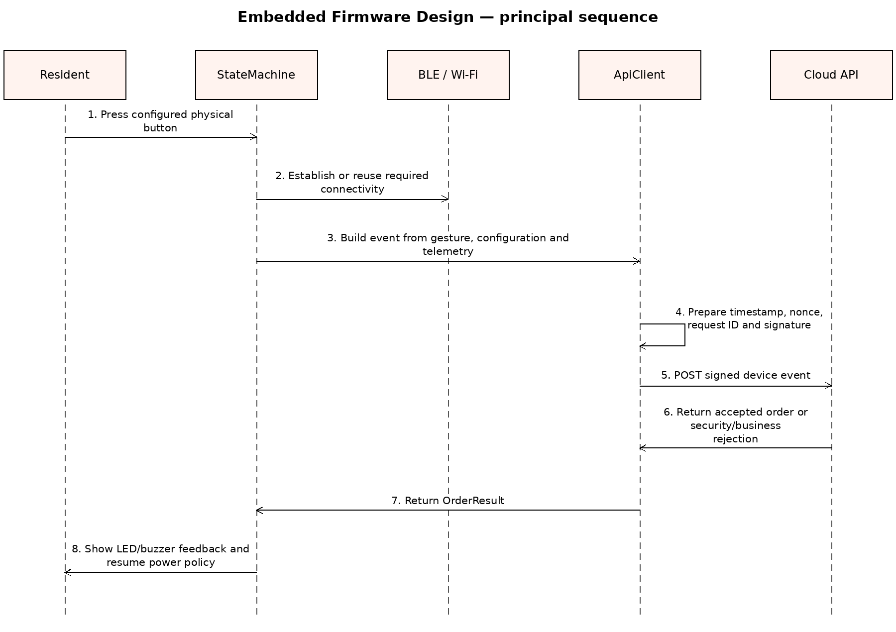

Figure 31. Embedded Firmware Design principal sequence

##### 3.11.4 Processing and Exception Design

A network timeout does not prove that the cloud failed to create an order; retries need the cloud idempotency contract. Different firmware paths and legacy .ino code are not assumed equivalent. Confirm the selected PlatformIO board/variant, exact gesture mapping, time source, nonce behavior and transport configuration in the final device tests.

Persistence and state: Configuration and credentials use the selected firmware storage/configuration mechanism. Wi-Fi/BLE handles connectivity; PowerManager and MAX17048 support the power/telemetry path. No battery-life or physical reliability result is asserted.

##### 3.11.5 Firmware State Enumeration

| No | State | Responsibility |
| --- | --- | --- |
| 01 | STATE_BOOT | Initialize selected board, storage, input and power/network state. |
| 02 | STATE_DETECT_GESTURE | Recognize configured physical action. |
| 03 | STATE_BLE_PROVISIONING | Run local BLE onboarding and accept the provisioning workflow. |
| 04 | STATE_WIFI_CONNECTING | Establish network connectivity before a cloud operation. |
| 05 | STATE_SENDING_EVENT | Send a signed request and interpret OrderResult. |
| 06 | STATE_LED_FEEDBACK | Indicate accepted or failed action through local feedback. |
| 07 | STATE_ENTER_SLEEP | Apply the selected board power policy. |

#### 3.12 Design Traceability and Integration Contracts

##### 3.12.1 Requirement Mapping

| No | Design group | Report 3 requirement coverage |
| --- | --- | --- |
| 01 | Account and Session Management | FR01–FR04 |
| 02 | Device Provisioning and Fleet Management | FR14–FR17, FR31–FR32 |
| 03 | Catalog Inventory and Customer Data | FR05–FR08, FR33, FR36–FR37 |
| 04 | Order Creation and Lifecycle | FR09–FR13, FR18 |
| 05 | Delivery and Driver Shifts | FR19–FR22 |
| 06 | PayOS Payment Processing | FR23 |
| 07 | Store Wallet Banking and Payouts | FR24–FR26 |
| 08 | Rentals and Store Subscriptions | FR27–FR28 |
| 09 | Administration Identity and Notifications | FR29–FR30, FR34–FR35, FR38 |
| 10 | Web and Mobile Client Design | FR01–FR38 through supported role interfaces |
| 11 | Embedded Firmware Design | FR10, FR12, FR14, FR16–FR17 |

##### 3.12.2 Shared Interface Conventions

REST contracts use the DTO and response mapper defined by the target module. IDs are handled as strings across JSON when backed by BigInt. Validation errors and authorization failures are returned through the common exception handling path. WebSocket rooms are derived from authenticated identity/store/customer context. Provider callbacks verify the appropriate signature, raw-body evidence and transaction/session association before persistence.

User order state and payment state are separate. A delivery action, a browser payment return, a notification and a wallet credit each have their own conditions. The cloud publishes ordinary order events after a successful database transaction; a failed push must not be reported as a failed order commit. A physical action additionally requires hardware acknowledgment; server acceptance alone is insufficient to demonstrate a completed reset or Wi-Fi change.

##### 3.12.3 Integration Verification Points

| No | Boundary | Verification needed |
| --- | --- | --- |
| 01 | Frontend packaging and role entry | Confirm the deployed root/nested frontend entry. Route references and specialized staff entry must match the actual build; backend permissions remain authoritative. |
| 02 | Stock/routine deployment | Apply and inspect the final PostgreSQL migration chain together with order repositories. Validate reservation, completion and cancellation against the deployed trigger bodies. |
| 03 | Payment redirect hosts | Align production PayOS return/cancel host validation with the intended Vercel/custom domain configuration. |
| 04 | External providers | Verify active credentials, webhook authenticity, replay behavior and pending/failure reconciliation for payment, payout, bank and identity integrations. |
| 05 | Physical firmware | Verify board variant, final pinout, gesture mapping, signatures, time/nonce generation, TLS configuration, provisioning and power consumption on the prototype. |
| 06 | Background recovery | Verify configured Redis/BullMQ behavior and dead-letter persistence. The local fallback has different durability and multi-instance characteristics. |
| 07 | Common 120-second customer deadline | Validate every customer channel, the elapsed < 120 seconds boundary and row-lock recheck. Device cancelWindowSeconds is legacy configuration metadata, not an override. |

##### 3.12.4 Source Baseline

The active software review snapshot is https://github.com/AmazonButton/Review-2/tree/review-2, commit 9e7ff50dc6f0c60392b5fe96dd76779d9396c6d1. Customer cancellation follows the common 120-second policy described in this draft and Report 3. Historical source and CI records are preserved as historical evidence. Hardware remains research in Iteration 1, with separate firmware references for later integration.

| No | Repository | Revision |
| --- | --- | --- |
| 01 | Review-2/frontend (tag review-2) | 9e7ff50dc6f0c60392b5fe96dd76779d9396c6d1 |
| 02 | Review-2/backend (tag review-2) | 9e7ff50dc6f0c60392b5fe96dd76779d9396c6d1 |
| 03 | Review-2/mobile (tag review-2) | 9e7ff50dc6f0c60392b5fe96dd76779d9396c6d1 |
| 04 | Hardware / main | ac82792daebf01b47e4c8489435308a27c793688 |

https://github.com/AmazonButton/Review-2/tree/review-2/frontend

https://github.com/AmazonButton/Review-2/tree/review-2/backend

https://github.com/AmazonButton/Review-2/tree/review-2/mobile

https://github.com/AmazonButton/Hardware/tree/ac82792daebf01b47e4c8489435308a27c793688

## Review 2 synchronization addendum — working draft

Prepared 29 October 2026. Frozen software snapshot: https://github.com/AmazonButton/Review-2/tree/review-2; commit 9e7ff50dc6f0c60392b5fe96dd76779d9396c6d1.

These edits synchronize the available documents with the implemented Iteration 1 snapshot. The final Registration form is not yet baselined. Existing wider product requirements are retained as proposals, not silently removed. COD is selected for Iteration 1; PayOS collection, bank verification and withdrawals are included and implementation-complete as reported by the team on 30 October 2026. Deployment providers are declared as Vercel/Render/Supabase; Flutter is the Mobile framework. Formal Registration approval and deployed-revision/provider acceptance evidence remain separate. No BM03/BM02 approval is asserted.

### Iteration 1 boundary

| ID | Review scope |
| --- | --- |
| I1-01 | Sign-in and basic role authorization |
| I1-02 | Store and product browsing |
| I1-03 | Customer delivery-address management |
| I1-04 | COD checkout |
| I1-05 | Store order processing |
| I1-06 | Customer order list, detail and timeline |
| I1-07 | Hardware component research, block diagram, proposed schematic and operating flow |
| I1-08 | Common 120-second customer cancellation rule |

Hardware is research and proposed drawings in Iteration 1, not an assembled or validated prototype. This does not remove functional IoT hardware from the final capstone scope. Features outside Iteration 1 remain subject to the approved final Registration.

### Customer cancellation contract

Customers may cancel their own orders from any channel only while PENDING or CONFIRMED, with elapsed server time >= 0 and < 120 seconds from order creation. At exactly 120 seconds or later, reject with CANCEL_WINDOW_EXPIRED. Authenticate and check ownership before an idempotent response; a retry of an already CANCELLED order by its owner does not repeat stock effects. Privileged operational cancellation remains a separate permission-controlled path.

The service validates eligibility and the repository repeats status/deadline validation after SELECT ... FOR UPDATE using a database clock read after the lock. Invalid requests have no inventory mutation. Active generic status transitions are still subject to staff authorization. A legacy device cancelWindowSeconds column/default may remain in the schema; it no longer overrides the common customer-cancellation policy in this snapshot.

### Observed verification

| Evidence | Observed result | Limit |
| --- | --- | --- |
| Tag workflow | https://github.com/AmazonButton/Review-2/actions/runs/40885061978 — success, four jobs | Selected Iteration 1 checks; not the full inherited suite |
| Backend | Build/type check and 9 cancellation regressions passed locally; DB/API job passed on tag | Does not certify real provider or physical-device behavior |
| Web | Build and 4 cancellation-policy tests passed | Manual browser acceptance remains pending |
| Mobile | Analysis: no issues; selected local suite: 71 tests passed; tag CI job passed | Initial full inherited run failed; not replaced by a full-suite pass claim |
| Hardware | Research, two proposed drawings, valid SVG XML | No assembly, flashing, physical measurements or integration acceptance |

### Open review items

• Obtain BM03 and approve Registration. Reports 1 and 2 were synchronized on 30 October 2026; their effort, final ownership and scope approval remain pending.

• Staging URLs supplied by the team are recorded in Section 4. Deployed revisions, Worker-to-origin forwarding, provider modes, database project/region and live readiness still require evidence. Financial implementation is team-reported complete.

• Editable architecture, full Prisma logical-ERD relation source, principal state views and four workflow activity sources are supplied in the companion source package. They are not claimed to be in the frozen review-2 tag; reconcile the submission repository before BM02.

• Figures 1 and 17 are updated in this revision. Section 5 adds rendered workflow/state views and source references. Review remaining older class/sequence views against the final approved baseline.

• Map each main workflow to one owner, acceptance criteria, demo scenarios and uniquely identified test cases.

• Retest inherited bank-verification and DLQ findings separately before closing them; selected CI success does not prove those fixes.

• Complete manual demo/NFR/provider execution records; do not convert Not Run/Blocked into Pass without evidence.

• After approval and final layout review, export official English PDFs with the course naming convention and reconcile the submission snapshot without silently moving the published tag.

## 4. Review 2 Deployment, External Services and Release Control

Revision date: 30 October 2026. Team-declared infrastructure is separated from inspected source configuration and independently executed acceptance. No live transfer, deployment or database modification was performed while preparing this document.

### 4.1 Environment and Endpoint Register

| Environment / component | Declared address / configuration | Evidence / remaining action |
| --- | --- | --- |
| Web staging / Vercel | https://buttontdash.vercel.app/ | Team supplied; tagged rewrite inspected. Record deployment ID, source commit and browser smoke-test evidence. |
| Public API / Cloudflare Worker | https://fragrant-mode-3a41.ptt24032004.workers.dev | Use /api/v1 for application endpoints as in frontend/vercel.json. Confirm origin mapping, forwarding headers, CORS, realtime upgrade behavior and revision. |
| Backend / Render | https://backend-fae8.onrender.com | Team supplied as Backend/Swagger host. Source config mounts Swagger at /docs; exact live path and deployed revision are unverified. |
| Database / Supabase PostgreSQL | Project/region and secret connection configuration not supplied | Record safe project identifier/region and migration revision; do not publish passwords or full connection strings. |
| Redis / queue / realtime | Runtime provider and persistence not supplied | Record availability and persistence. Local fallback is not a durable multi-instance queue. |
| Mobile / Flutter | Build distribution and runtime API configuration to record | Flutter is the framework. Record Android/iOS build, supported device and selected API host; do not label Flutter as hosting. |
| Development | Local scripts and isolated database | Synthetic fixtures; separate provider credentials/modes from public staging. |
| Production | Not declared / not accepted | Do not infer a production environment from public staging URLs. |

Read-only availability check attempted on 30 October 2026: Web root, Worker /healthz and /readyz, Render /healthz, /readyz and /docs. The execution environment could not resolve these hosts; the web fetch tool also could not retrieve them. This is an unverified check, not evidence that any service is down. The source defines /healthz for liveness and /readyz for database/queue readiness; an HTML page or liveness success alone does not establish dependency readiness.

### 4.2 Platform Versions, External Data and Trust Boundaries

| Dependency | Inspected declaration / data boundary | Review requirement |
| --- | --- | --- |
| Node / Backend | CI selects Node 20; NestJS ^10.4.22, Prisma ^5.22.0 | Package ranges are not deployed versions. Record resolved lockfile and runtime build. |
| Web | React ^18.3.1, Vite ^6.0.3, TypeScript ^5.7.2 | Build-time public configuration must point to the declared API; no provider/database secrets in bundles. |
| Mobile | Flutter/Dart versions and device build to record | Use pubspec/lock and actual SDK output for release; runtime host overrides must be visible to the demo operator. |
| PostgreSQL / Redis | CI service images PostgreSQL 15 and Redis 7; Supabase runtime versions not supplied | CI service versions do not establish staging versions. Migrations/triggers are part of the persistence contract. |
| PayOS collection/payout | Payment amount/reference and payout recipient/bank details as required by configured provider | Verify signatures, association and idempotency. Provider mode and controlled evidence must be declared; credentials remain server-side. |
| Bank verification | Account identity/verification transfer evidence; stored account numbers encrypted and hashed | Separate bank-account verificationStatus, verification-transaction status and refund status; mask bank details in evidence. |
| Identity / authentication | Configured Google/Firebase/Didit flows exchange identity/session data as implemented | Record enabled providers, configuration and the data sent; do not assume every configured development path is enabled on staging. |
| Notification / media | FCM device tokens and payloads; Cloudinary media/proof uploads | Use minimal authorized payloads. Verify store-scoped proof paths and avoid logging tokens or private images. |
| AI assistance | Codex used for document alignment and source-derived diagram drafting on 30 October 2026 | Exact model identifier is not exposed in this session. Team reviews generated content. This is not execution of the official BM02 prompt. |

### 4.3 Branches, CI and Release Evidence

Frozen source input: https://github.com/AmazonButton/Review-2/tree/review-2, commit 9e7ff50dc6f0c60392b5fe96dd76779d9396c6d1. .github/workflows/ci.yml runs on main pushes, review-2 tag pushes, main pull requests and manual dispatch. The four jobs cover Backend quality/build and selected cancellation checks, isolated database verification, Web build/tests and selected Flutter analysis/tests. The recorded tag run https://github.com/AmazonButton/Review-2/actions/runs/40885061978 succeeded. It is not an automatic deployment, a full legacy-suite acceptance run, or evidence that the public services run this commit.

Document/diagram edits in this revision are separate from the frozen tag. The companion package identifies its source baseline. Add approved sources/documents through a reviewed follow-up and declare the final submission snapshot; do not silently move the published tag. Branch protection, required reviews and hosting auto-deploy settings are not asserted without configuration evidence.

### 4.4 Proposed Deployment and Rollback Runbook

| Step | Required action / evidence |
| --- | --- |
| 1. Record release | Capture intended source commit, Web/Backend build IDs, Worker revision, mobile build, provider modes and applied database migration IDs. Identify the previous known-good compatible release. |
| 2. Preflight | Verify runtime secret configuration without printing values; confirm database/queue readiness and provider callbacks. Use existing hosting/database recovery facilities and retention settings according to actual capabilities; no new document backup copies are required. |
| 3. Migrations | Review prisma/migrations and compatibility before any release. In the authorized deployment environment, use the project migration procedure (typically prisma migrate deploy); never reset/reseed a shared live database as a smoke test. |
| 4. Deploy compatible components | Apply a backward-compatible order of schema, Backend, Worker routing, Web and Mobile releases. Record CORS/API host/realtime callback configuration and successful readiness checks. |
| 5. Controlled smoke test | Use synthetic accounts/store/stock for login, address, COD checkout, fulfillment and cancellation before/at/after 120s. Verify negative ownership, one stock effect, provider-mode financial callbacks and a return to a known fixture state. |
| 6. Application rollback | If a release fails acceptance, select the known-good Web/Backend/Worker release compatible with the current schema. Recheck /healthz, /readyz and the same smoke cases; record exact revisions and outcome. |
| 7. Database recovery | No automatic down-migration is assumed. Prefer a reviewed forward repair for schema/data faults; use a separately authorized restore only when actual recovery availability, target point, data-loss window and dependent jobs/provider reconciliation are understood. |
| 8. Reconcile and report | Pause/review affected financial work where necessary, reconcile in-flight payments/withdrawals and repeat only idempotent operations. Log deployment/rollback evidence, known defects and the accountable operator in Tracking. |

This is a proposed runbook, not a record of deployment, rollback, backup availability or restoration performed. Hosting dashboards, credentials and production mutations were not accessed for this revision.

## 5. Workflow Activities and Principal State Models

Figures 32–38 supplement the existing class/sequence diagrams. Each activity has a proposed BM01 owner, related FRs, a principal and exception demo, and an explicit outcome. Figure 17 now uses the common atomic cancellation flow. State views describe separate entity domains and do not grant authorization or constitute a final complete transition/test inventory.

| Workflow / proposed owner | SRS mapping / demos | Entity result and evidence boundary |
| --- | --- | --- |
| WF01 / Nguyen Van Thanh | FR01–04, FR08, FR34–35; DS01a/DS01b | Session/account/address records; own-data authorization; provider-specific identity subflows are referenced separately. |
| WF02 / Le Ho Gia Bao | FR05–09, FR12–13, FR18–22, FR29–30, FR33, FR36–37; DS02a/DS02b | Order/stock/delivery state changes, guarded cancellation and committed customer timeline. |
| WF03 / Tran Tan Phat | FR23–28, FR38; DS03a/DS03b | Collection, bank ownership, wallet/withdrawal outcomes; implementation completion is team-reported, controlled/live tests need evidence. |
| WF04 / Truong Quang Tan Tai | FR10–11, FR14–17, FR31–32; DS04a/DS04b | Owned/configured physical device -> one order. Hardware operation is a final-product target, not Iteration 1 acceptance. |

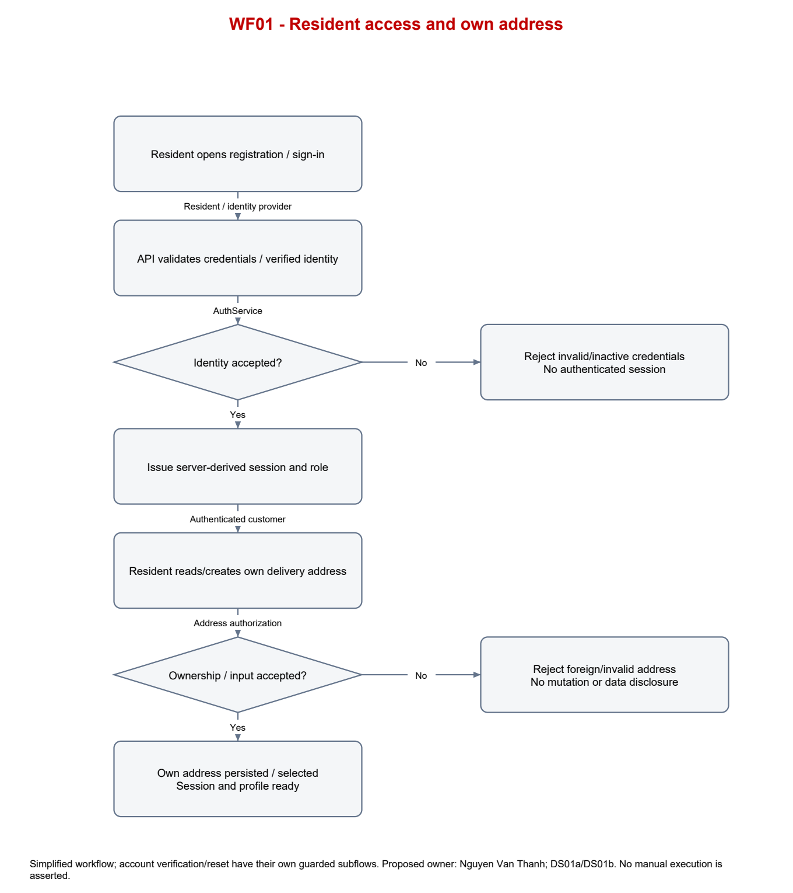

Figure 32. WF01 - Resident access and own address. Simplified workflow; account verification/reset have their own guarded subflows. Proposed owner: Nguyen Van Thanh; DS01a/DS01b. No manual execution is asserted.

Editable source: wf01-account.mmd. Source reference: backend/src/auth/auth.service.ts; customer address service/controller; SRS FR01-04, FR08, FR34-35

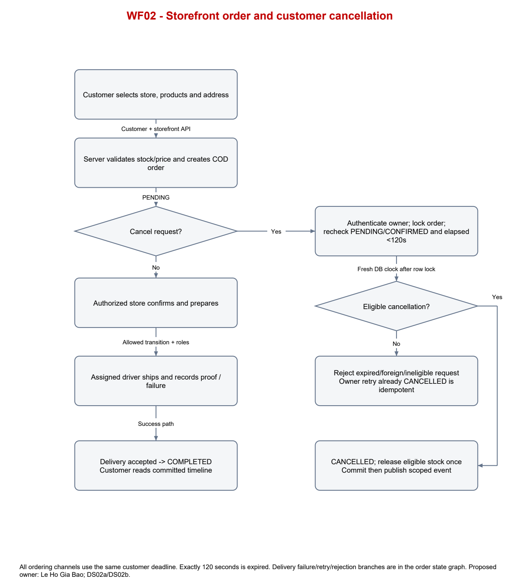

Figure 33. WF02 - Storefront order and customer cancellation. All ordering channels use the same customer deadline. Exactly 120 seconds is expired. Delivery failure/retry/rejection branches are in the order state graph. Proposed owner: Le Ho Gia Bao; DS02a/DS02b.

Editable source: wf02-order.mmd. Source reference: backend/src/orders/orders.service.ts; orders.repository.ts; dto/update-order-status.dto.ts

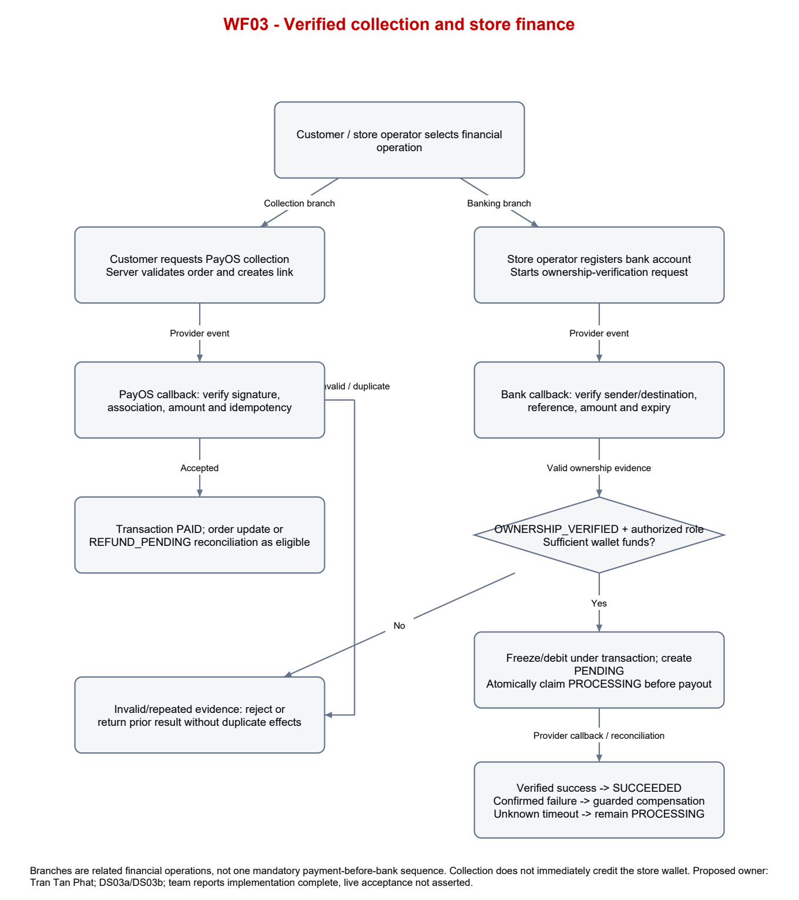

Figure 34. WF03 - Verified collection and store finance. Branches are related financial operations, not one mandatory payment-before-bank sequence. Collection does not immediately credit the store wallet. Proposed owner: Tran Tan Phat; DS03a/DS03b; team reports implementation complete, live acceptance not asserted.

Editable source: wf03-finance.mmd. Source reference: payments/payments.repository.ts; bank-verification/bank-verification.repository.ts; store-wallet/store-wallet.service.ts

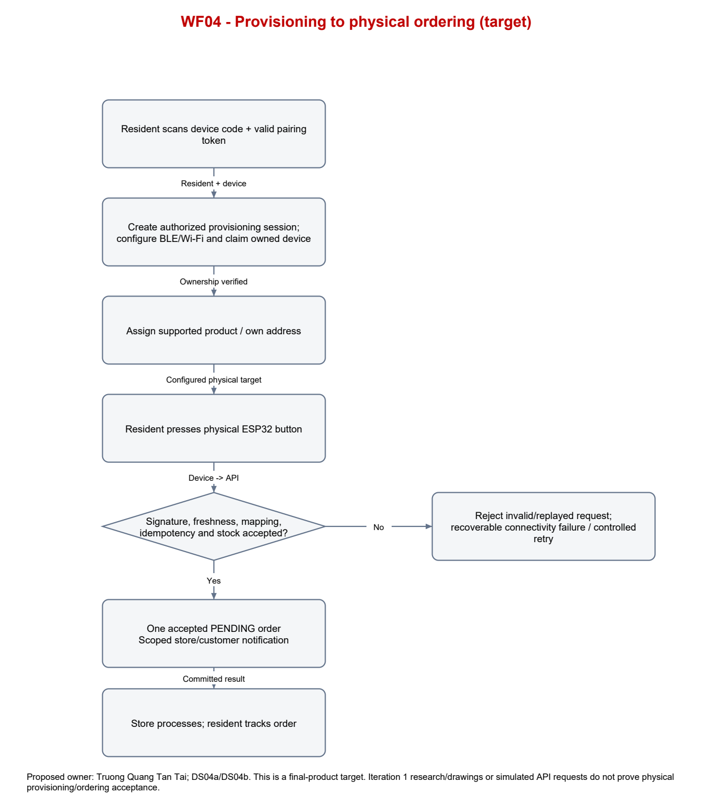

Figure 35. WF04 - Provisioning to physical ordering (target). Proposed owner: Truong Quang Tan Tai; DS04a/DS04b. This is a final-product target. Iteration 1 research/drawings or simulated API requests do not prove physical provisioning/ordering acceptance.

Editable source: wf04-device.mmd. Source reference: devices/provisioning.service.ts; devices.service.ts; iot/iot.service.ts; order persistence

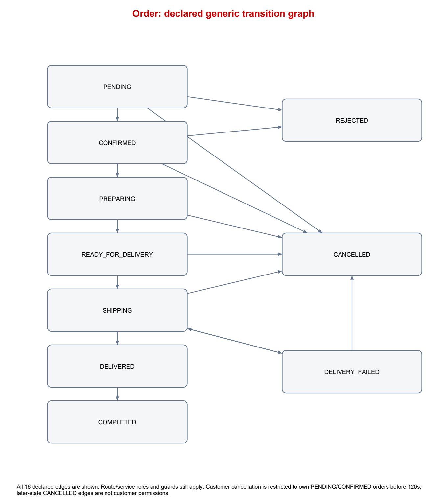

Figure 36. Order: declared generic transition graph. All 16 declared edges are shown. Route/service roles and guards still apply. Customer cancellation is restricted to own PENDING/CONFIRMED orders before 120s; later-state CANCELLED edges are not customer permissions.

Editable source: order-state.mmd. Source reference: backend/src/orders/dto/update-order-status.dto.ts: ALLOWED_ORDER_TRANSITIONS

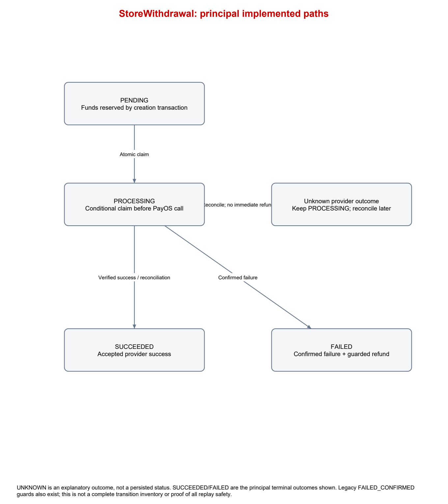

Figure 37. StoreWithdrawal: principal implemented paths. UNKNOWN is an explanatory outcome, not a persisted status. SUCCEEDED/FAILED are the principal terminal outcomes shown. Legacy FAILED_CONFIRMED guards also exist; this is not a complete transition inventory or proof of all replay safety.

Editable source: withdrawal-state.mmd. Source reference: backend/src/store-wallet/store-wallet.service.ts: triggerPayosPayout, refundFailedWithdrawal, webhook/reconciliation

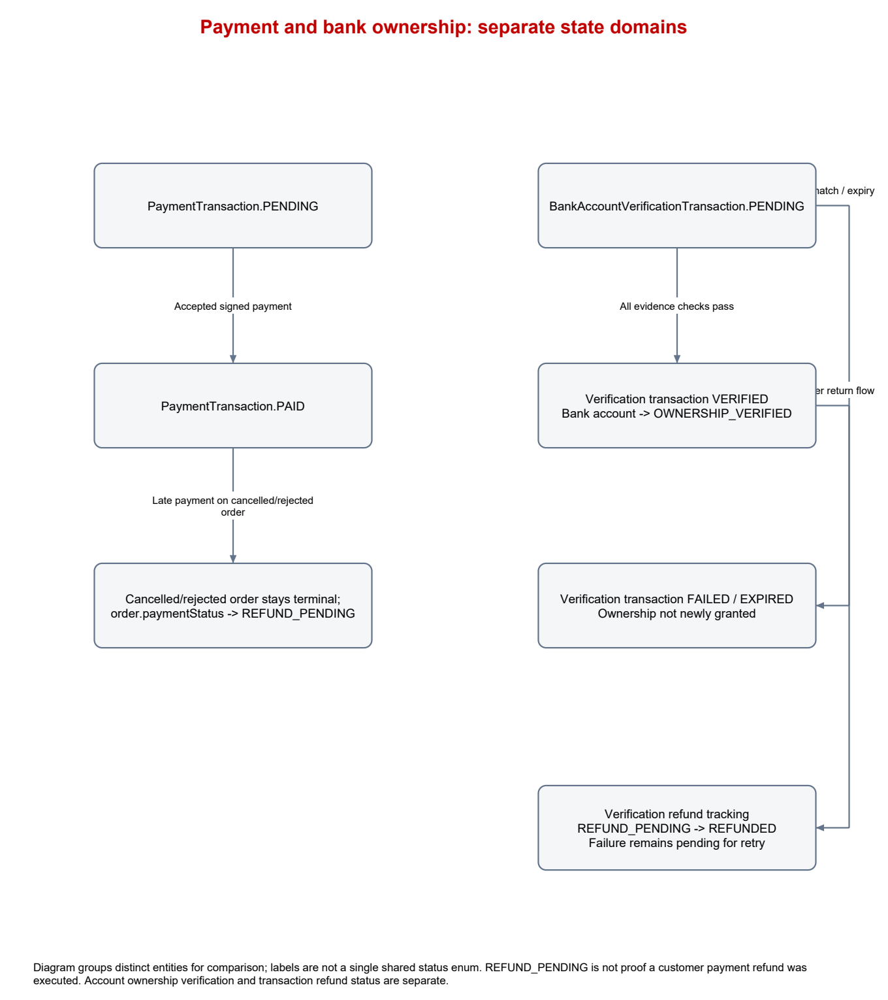

Figure 38. Payment and bank ownership: separate state domains. Diagram groups distinct entities for comparison; labels are not a single shared status enum. REFUND_PENDING is not proof a customer payment refund was executed. Account ownership verification and transaction refund status are separate.

Editable source: bank-payment-state.mmd. Source reference: payments/payments.repository.ts; bank-verification/bank-verification.repository.ts and service.ts

### 5.1 Editable Source and Logical ERD Inventory

The companion SDD_Diagram_Sources_Review2.zip contains nine editable Mermaid graph sources, corresponding renderings, diagram-manifest.json, this revision’s read-only endpoint-check log, and logical-erd-full.mmd generated from all 46 Prisma models with 66 explicit owning-side model relations at commit 9e7ff50dc6f0c60392b5fe96dd76779d9396c6d1. Existing database Figures 6–8 remain module views. The full relation source captures model/FK cardinality, including optional and unique relations; migration-only checks, indexes, routines and triggers remain authoritative in prisma/migrations and are not reconstructed by the logical ERD.

The diagram source package is supplied alongside the Drive report and locally under sdd-diagrams. It has not been inserted into the frozen source tag. Review the complete principal-entity state inventory before fixing the T term in 3F+W+T+N; the 16 generic order edges alone do not establish the final test count. Identity, rentals, subscriptions, bank refund/retry, device provisioning and driver-shift state paths still require full route/guard/invalid-transition reconciliation.

Companion editable diagram source package: https://drive.google.com/file/d/1sxu9lsOAro3zPXA91AaCcMnKm2DRRFwO/view

### 5.2 Additional Principal-Entity Lifecycle Models

These source-derived models explicitly distinguish persisted enums, derived time conditions and known missing guards/exits. They supplement Figures 36–38; do not interpret an unshown/reducer-controlled edge as forbidden unless its code guard says so. Remaining lifecycle gaps are reported in BM02 rather than hidden by invented terminal transitions.

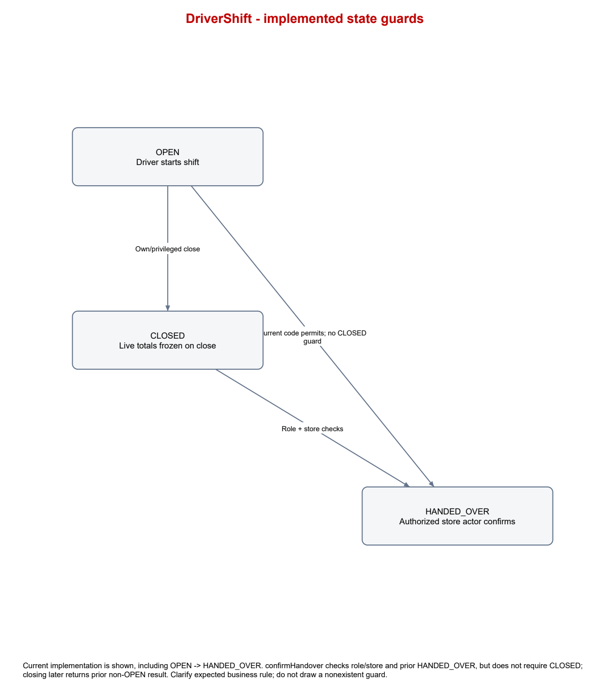

Figure 39. DriverShift - implemented state guards. Current implementation is shown, including OPEN -> HANDED_OVER. confirmHandover checks role/store and prior HANDED_OVER, but does not require CLOSED; closing later returns prior non-OPEN result. Clarify expected business rule; do not draw a nonexistent guard.

Source: driver-shift-state.mmd; backend/src/driver-shifts/driver-shifts.service.ts: 21-150

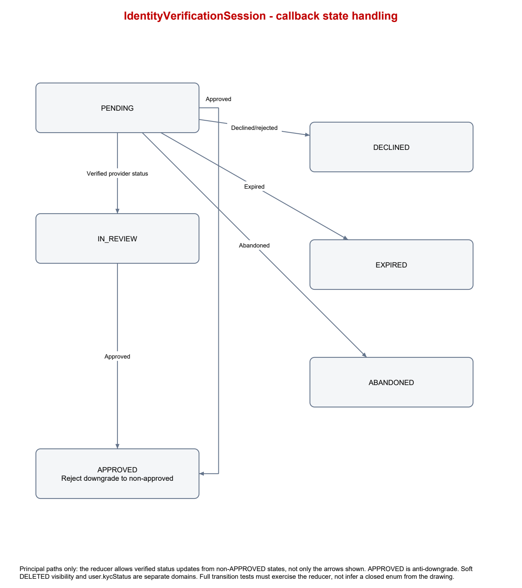

Figure 40. IdentityVerificationSession - callback state handling. Principal paths only: the reducer allows verified status updates from non-APPROVED states, not only the arrows shown. APPROVED is anti-downgrade. Soft DELETED visibility and user.kycStatus are separate domains. Full transition tests must exercise the reducer, not infer a closed enum from the drawing.

Source: identity-session-state.mmd; backend/src/identity-verifications/identity-verifications.repository.ts: 270-337; service.ts:135-143

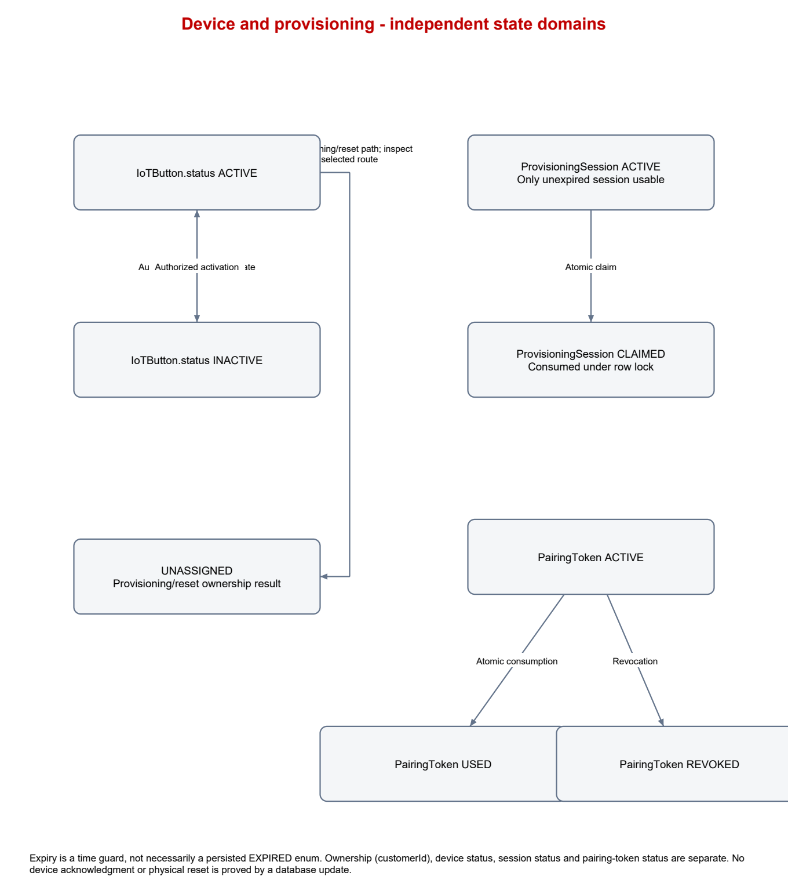

Figure 41. Device and provisioning - independent state domains. Expiry is a time guard, not necessarily a persisted EXPIRED enum. Ownership (customerId), device status, session status and pairing-token status are separate. No device acknowledgment or physical reset is proved by a database update.

Source: device-provisioning-state.mmd; backend/src/devices/devices.service.ts; provisioning.repository.ts:154-175,367-412

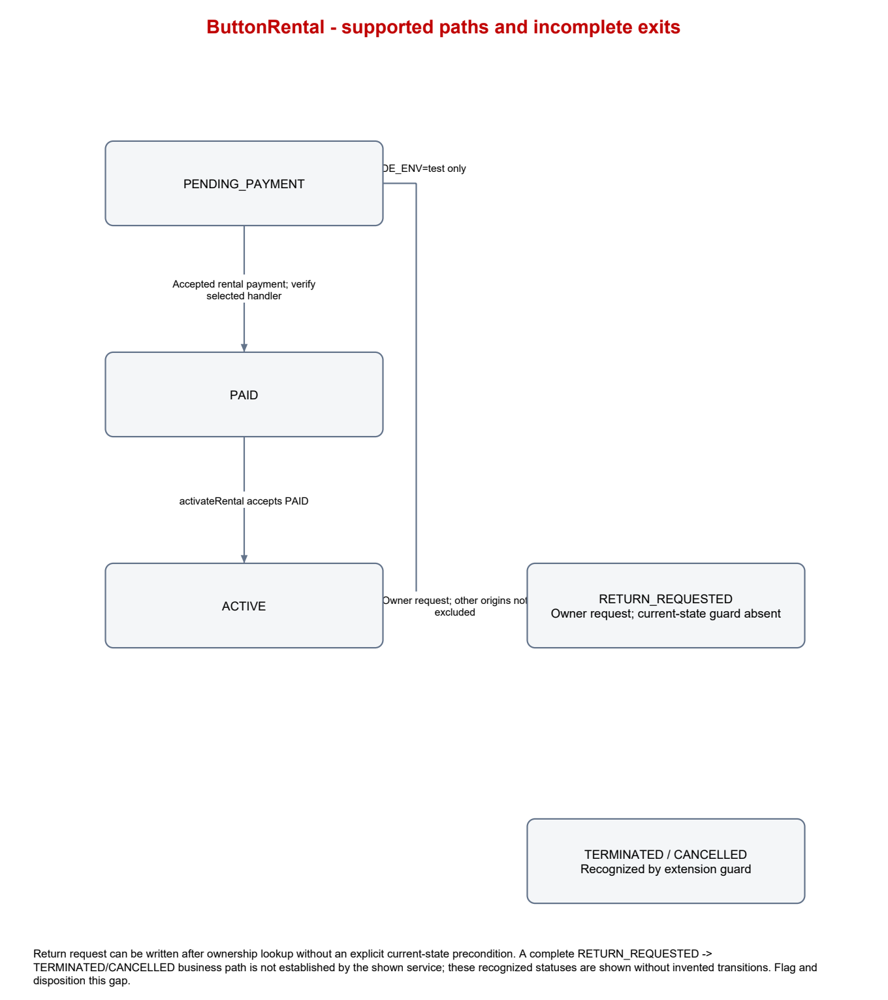

Figure 42. ButtonRental - supported paths and incomplete exits. Return request can be written after ownership lookup without an explicit current-state precondition. A complete RETURN_REQUESTED -> TERMINATED/CANCELLED business path is not established by the shown service; these recognized statuses are shown without invented transitions. Flag and disposition this gap. Clarification: PENDING_PAYMENT → PAID is a required business target, not a verified implementation path. Rental payment code builds illustrative link/QR values, while the inspected common confirmation routine locks an order; the rental-specific provider/activation path remains a Known Gap.

Source: rental-state.mmd; backend/src/rentals/rentals.service.ts:92,198-221; rentals.repository.ts:64-75,132

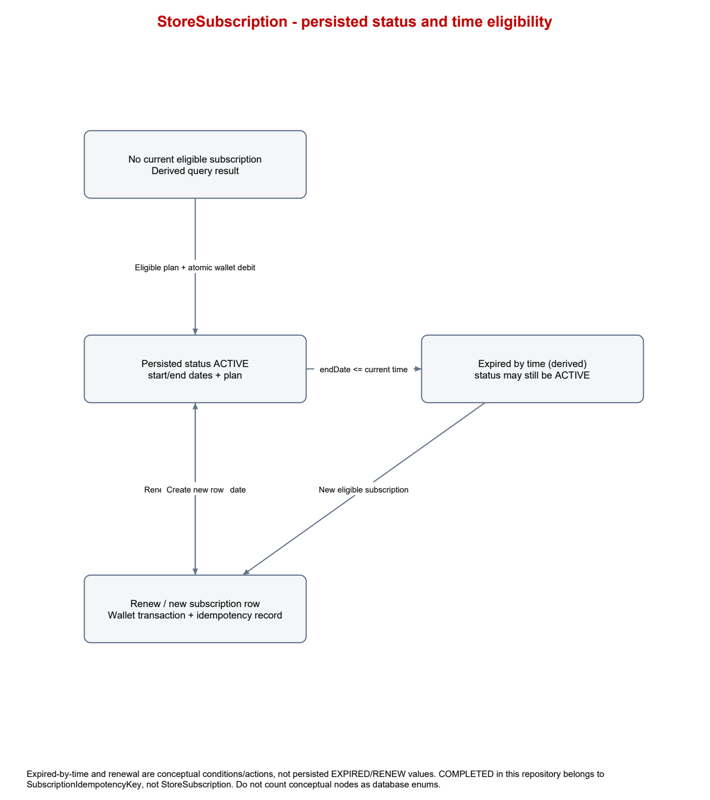

Figure 43. StoreSubscription - persisted status and time eligibility. Expired-by-time and renewal are conceptual conditions/actions, not persisted EXPIRED/RENEW values. COMPLETED in this repository belongs to SubscriptionIdempotencyKey, not StoreSubscription. Do not count conceptual nodes as database enums.

Source: subscription-state.mmd; backend/src/store-subscriptions/store-subscriptions.repository.ts:130-210; service.ts:getCurrentSubscription

### Observed staging check update — 30 October 2026

After an initial Render cold-start timeout, read-only GET checks obtained HTTP200 from https://backend-fae8.onrender.com/healthz and /docs-json. Web https://buttontdash.vercel.app/ also returned HTTP200. A Python certificate-verification error occurred for the Worker endpoint; no HTTPS bypass was used. Browser store/customer/admin logins subsequently succeeded; store dashboard/device/wallet and customer orders views loaded. Sessions were logged out after read-only checks. This proves only that observed subset, not /readyz, the deployed source revision, full workflows, physical devices or live settlement.
