# SRS — Review 2 proposed input

FA26SE124 | GFA26SE25 | 30 October 2026. Contact emails/phones redacted in this public repository view; full editable originals are in the team Drive. No business requirement or source rule is redacted.

CAPSTONE PROJECT REPORT

Report 3 – Software Requirement Specification

Project: Smart IoT Ordering Button for Apartment Residents 

– Ho Chi Minh, August 2026 –

Table of Contents

## I Record of Changes

| Date | Type | In charge | Change description |
| --- | --- | --- | --- |
| 27 Oct 2026 | A | Project team | Initial review draft based on current selected repositories. Product name standardized; PayOS included; household management deferred; physical-button cancellation set to 60 seconds. |
| 29/10/2026 | M | Draft preparation; team review pending | Draft synchronization to Review-2 tag: common 120-second customer cancellation, software baseline, Iteration 1 boundary and observed verification. Registration approval remains pending. |
| 30/10/2026 | M | Team confirmation | Financial implementation reported complete; declared deployment: Vercel Web, Render Backend, Supabase PostgreSQL, Flutter Mobile. Registration approval and runtime acceptance remain separate. |

A means Added, M means Modified and D means Deleted. This entry records document preparation and does not constitute supervisor approval.

Project FA26SE124 | Group GFA26SE25 | Review 2: 05 November 2026 | Revision: 30 October 2026 | No separate official submission deadline supplied.

## II Software Requirement Specification

WORKING DRAFT — REVIEW 2 SYNCHRONIZATION — TEAM REVIEW REQUIRED

29 October 2026. Existing diagrams/layouts are retained. Proposed changes are not supervisor approval. Registration/BM03 approval remains pending. On 30 October 2026 the team confirmed completion of PayOS collection, store-bank verification and withdrawals; declared deployment is Vercel Web, Render Backend, Supabase PostgreSQL and Flutter Mobile.

## 1 Product Overview

### 1.1 Product purpose

Smartorderbutton enables apartment residents to reorder household essentials through a physical IoT button, a mobile application or a web storefront. A customer associates a button with a store and selected products. The platform validates the request, creates an order, reserves inventory and notifies the store. Store operators prepare the order, delivery staff record fulfillment, and the customer follows order and payment progress.

The product consists of a React web application, a Flutter customer application, a NestJS backend with a Prisma relational data model, and ESP32 firmware. The public demonstration address supplied by the team is https://buttontdash.vercel.app/. This report does not claim that its authenticated screens or current deployment configuration were independently verified.

### 1.2 Scope and baseline decisions

| Area | Current requirement baseline |
| --- | --- |
| Commercial scope | Multiple stores; customer storefront and button ordering; catalog, inventory and promotions; delivery operations; COD and PayOS; store wallet, bank verification and withdrawals; rentals and subscriptions. |
| Account scope | Customer, platform administrator, store owner/manager and specialized store staff. Household Owner/Admin/Member roles are not part of the approved baseline. |
| Mobile scope | Four primary tabs: Home, Devices, Orders and Account. The previous five-tab SmartSupply proposal is superseded for this report. |
| Cancellation | Customers may cancel their own orders from any channel only while PENDING or CONFIRMED, with elapsed server time >= 0 and < 120 seconds from order creation. At exactly 120 seconds or later, reject with CANCEL_WINDOW_EXPIRED. Authenticate and check ownership before an idempotent response; a retry of an already CANCELLED order by its owner does not repeat stock effects. Privileged operational cancellation remains a separate permission-controlled path. |
| Hardware status | Firmware and hardware integration are specified as required behavior. Prototype assembly, physical reliability and final hardware validation are still in development. |
| Deferred scope | Household membership, shared household shopping lists, household order batching, Gaussian consumption insights and emergency household service functions from the earlier proposal are not included as committed features. |
| Excluded claims | No claim of certified production readiness, measured availability, completed penetration testing, iOS store release, mass-produced hardware or continuous live GPS tracking is made. |

The software review baseline is https://github.com/AmazonButton/Review-2/tree/review-2, commit 9e7ff50dc6f0c60392b5fe96dd76779d9396c6d1, containing backend/, frontend/ and mobile/. The hardware/ folder contains Iteration 1 research and drawings only. The separately referenced Hardware repository remains a historical/future integration reference. Broader product scope is pending final Registration review.

### 1.3 System context

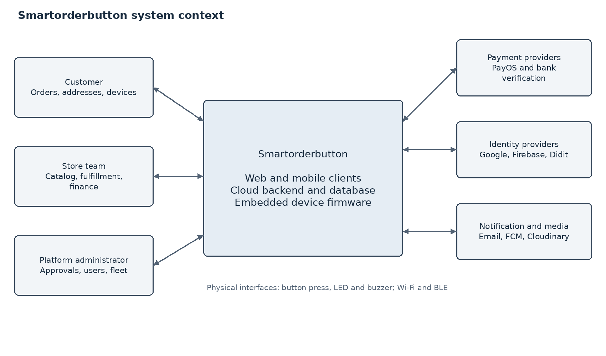

Figure 1  System boundary and external interactions

People interact through the Web or Mobile client. Device firmware belongs to the product; the physical press and local LED/buzzer are its human interfaces. Payment, identity, messaging and media providers are external systems. A provider callback is trusted only after the relevant verification checks. Wi-Fi carries cloud traffic, while BLE supports local provisioning.

### 1.4 Source baseline and evidence

| Repository | Branch | Inspected revision |
| --- | --- | --- |
| Review-2/frontend | tag review-2 | 9e7ff50dc6f0c60392b5fe96dd76779d9396c6d1 |
| Review-2/backend | tag review-2 | 9e7ff50dc6f0c60392b5fe96dd76779d9396c6d1 |
| Review-2/mobile | tag review-2 | 9e7ff50dc6f0c60392b5fe96dd76779d9396c6d1 |
| Hardware — historical separate firmware reference | main | ac82792daebf01b47e4c8489435308a27c793688 |

Requirement statements derived from inspected source are identified by their module paths. Team decisions explicitly supersede older report scope where stated. Numeric quality targets in Section 4 are proposed acceptance targets unless identified as inherited targets. Final UI appearance and runtime acceptance results remain separate review evidence.

## 2 User Requirements

### 2.1 Actors

| ID | Actor | Responsibility |
| --- | --- | --- |
| ACT01 | Visitor | Browse public content/catalog; register or use permitted guest storefront checkout. |
| ACT02 | Customer | Manage own profile, addresses, buttons, orders, rentals, payments and identity verification. |
| ACT03 | Store owner | Manage own store, catalog, order operations, subscriptions, staff and finances within backend permission checks. |
| ACT04 | Store manager | Manage permitted store operations and finance; product write access is not automatically equivalent to owner access. |
| ACT05 | Order staff | STAFF_ORDER processes permitted store orders, delivery queues and handover operations. |
| ACT06 | Inventory staff | STAFF_INVENTORY accesses inventory and authorized stock adjustments. |
| ACT07 | Button staff | STAFF_BUTTON performs explicitly allowed device actions such as enabling/disabling and maintenance-related updates. |
| ACT08 | Delivery staff | STAFF_DELIVERY claims and fulfills deliveries and manages driver duty/shifts. |
| ACT09 | Platform administrator | SUPER_ADMIN and SYSTEM_ADMIN have platform responsibilities. ADMIN is a legacy code recognized on some routes; privileges must follow actual guards and service checks. |
| ACT10 | IoT device | Produces signed events/telemetry and receives configuration. It is an actor relative to the cloud subsystem. |
| ACT11 | Payment and bank providers | PayOS collection/payout and bank-account verification services return verifiable transaction evidence. |
| ACT12 | Identity providers | Google/Firebase authenticate supported credentials; Didit supplies verification session decisions. |
| ACT13 | Notification and media providers | Email/FCM deliver messages and Cloudinary hosts media/proof images. |

STORE_STAFF is also recognized by portions of the Web and backend. It is a compatibility role rather than blanket permission for all specialized staff operations. A role label, menu visibility or local client state never replaces a backend authorization decision.

### 2.2 Use Cases

#### 2.2.1 Diagrams

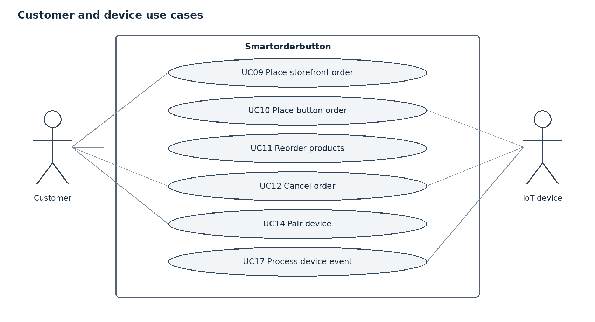

Figure 2  Customer and device use cases

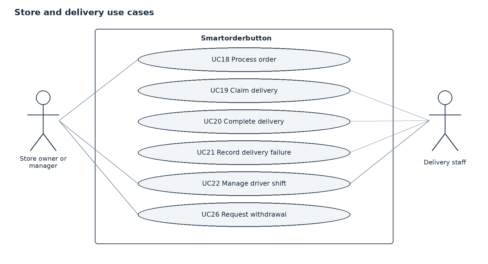

Figure 3  Store and delivery use cases

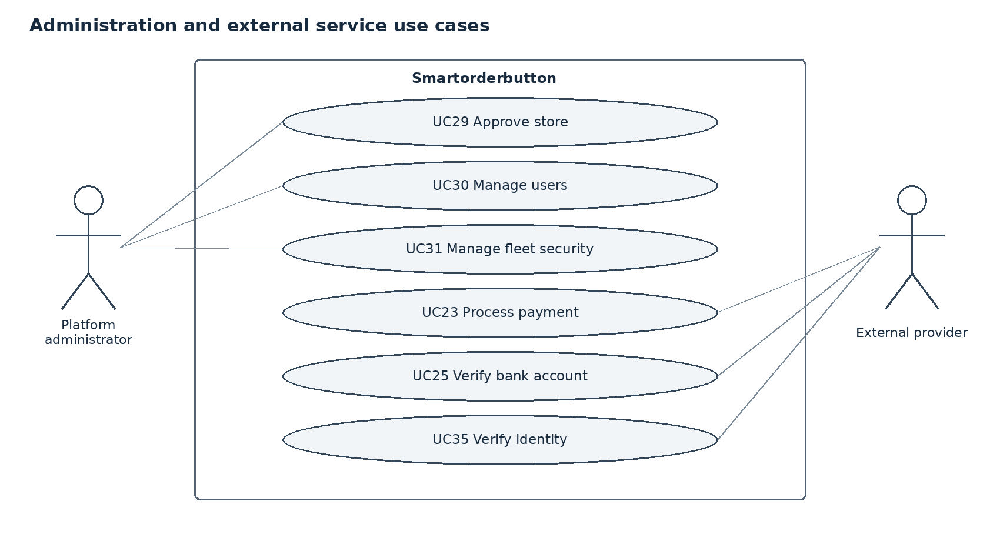

Figure 4  Administration and external-provider use cases

The diagrams group principal actor interactions to remain readable. The full catalogue below also includes supporting use cases. All authenticated use cases require a valid session and the applicable object/store scope. Device use cases require the separate device authentication contract. Place button order includes device authentication and stock validation. Cancel order is an optional extension of the order lifecycle; it is not a mandatory step in successful ordering.

#### 2.2.2 Descriptions

| ID | Use case | Primary actor | Outcome and detailed contract |
| --- | --- | --- | --- |
| UC01 | Register account | Visitor | An account exists with the appropriate verification and activation state. See Section 3.2. |
| UC02 | Sign in and manage session | Registered user | The user receives an authenticated session with server-derived authorization context. See Section 3.3. |
| UC03 | Recover and verify account | Registered user | Account verification or password update is recorded without exposing verification secrets. See Section 3.4. |
| UC04 | Maintain user profile | Authenticated user | Profile information is updated for the authenticated user. See Section 3.5. |
| UC05 | Maintain product catalog | Store owner or platform administrator | The catalog reflects the accepted change within its store scope. See Section 3.6. |
| UC06 | Manage categories and discounts | Authorized store operator | Category and promotion records apply only within their intended product/store scope. See Section 3.7. |
| UC07 | Maintain inventory | Store owner or inventory staff; manager for inventory queries | Inventory remains consistent with order reservations and stock deductions. See Section 3.8. |
| UC08 | Maintain delivery addresses | Customer | The address book and default selection remain valid for the customer. See Section 3.9. |
| UC09 | Place storefront order | Visitor or customer | A store-scoped order exists with reserved stock, shipping snapshots and the selected payment method. See Section 3.10. |
| UC10 | Place order from physical button | Customer through authenticated IoT device | Exactly one accepted order is associated with the button request. See Section 3.11. |
| UC11 | Reorder configured products | Customer | A new order exists for the customer using the accepted button configuration. See Section 3.12. |
| UC12 | Cancel order | Customer, signed device or authorized store manager | The order is CANCELLED and stock effects are applied once; repeating the same cancellation is safe. See Section 3.13. |
| UC13 | View orders and timeline | Customer, store operator or authorized delivery staff | Only orders within the actor scope are displayed. See Section 3.14. |
| UC14 | Provision and claim device | Customer using Web or Mobile | The verified device is bound to its owner and has an accepted configuration. See Section 3.15. |
| UC15 | Configure owned device | Customer | Subsequent requests use the accepted store/product mapping. See Section 3.16. |
| UC16 | Manage device lifecycle | Authorized customer or store/platform operator | A traceable lifecycle update exists for the selected device. See Section 3.17. |
| UC17 | Process device security and telemetry | Registered IoT device | Accepted events are attributable to one device and retries do not duplicate business effects. See Section 3.18. |
| UC18 | Process store order | Store owner, manager or authorized order staff | The order reaches one valid next state and its history records the transition. See Section 3.19. |
| UC19 | Claim delivery | Delivery staff or permitted store operator | One driver holds the accepted delivery assignment. See Section 3.20. |
| UC20 | Complete delivery | Assigned delivery staff or permitted store operator | The order is DELIVERED with the accepted proof and collection information. See Section 3.21. |
| UC21 | Record delivery failure | Assigned delivery staff or permitted store operator | The delivery failure is auditable and the order remains subject to valid transitions. See Section 3.22. |
| UC22 | Manage driver shift and handover | Delivery staff; store manager or order staff for handover | Shift status and handover information are recorded separately. See Section 3.23. |
| UC23 | Process PayOS order payment | Customer or permitted order actor; PayOS | A verified payment transaction is linked to the order without duplicate credit. See Section 3.24. |
| UC24 | View store wallet and ledger | Store owner or manager; scoped platform administrator | The actor sees only permitted wallet and ledger information. See Section 3.25. |
| UC25 | Verify store bank account | Authorized store owner or manager; bank verification provider | Only a confirmed account reaches OWNERSHIP_VERIFIED for eligible withdrawals. See Section 3.26. |
| UC26 | Request and process withdrawal | Store owner/manager; platform administrator; PayOS Payout | The withdrawal and associated ledger entries reflect one confirmed financial outcome. See Section 3.27. |
| UC27 | Manage device rental | Customer; authorized rental administrator | The rental lifecycle remains linked to one customer and package. See Section 3.28. |
| UC28 | Manage store subscription | Store owner or manager; administrator for plan definitions | The accepted subscription and wallet entry are recorded once. See Section 3.29. |
| UC29 | Approve and manage stores | Platform administrator | The store registration has one recorded review outcome. See Section 3.30. |
| UC30 | Manage platform users and plans | Platform administrator | Platform account governance and commercial definitions remain controlled. See Section 3.31. |
| UC31 | Manage fleet security | Platform administrator; permitted device operator | Device governance and permitted security views reflect accepted changes. See Section 3.32. |
| UC32 | Manage device templates and batches | Store owner/manager or platform administrator | Templates and device records remain associated with authorized store scope. See Section 3.33. |
| UC33 | View analytics and store customers | Store owner/manager; permitted order staff for customer queries | The actor sees store-scoped analysis and customer relationship information. See Section 3.34. |
| UC34 | Receive and manage notifications | Authenticated user; notification provider | Notification visibility and read state are limited to the intended user. See Section 3.35. |
| UC35 | Verify customer identity | Authenticated user; Didit; authorized platform administrator | The verification state is associated with the correct user and provider session. See Section 3.36. |
| UC36 | Manage store staff and profile | Store owner or authorized manager subject to service checks | Store profile and team permissions reflect accepted changes. See Section 3.37. |
| UC37 | Upload and manage media | Permitted store staff or administrator | Accepted media can be referenced by the permitted product/profile/delivery operation. See Section 3.38. |
| UC38 | Monitor background processing | Authorized operator or infrastructure monitor | Background work has a recoverable status and infrastructure health can be assessed. See Section 3.39. |

The functional contracts in Section 3 supply each use case trigger, required data, normal sequence, exception paths, postcondition and acceptance examples. Those sections are the detailed use case descriptions; the catalogue provides a single index without duplicating the contracts.

## 3 Functional Requirements

### 3.1 System Functional Overview

#### 3.1.1 Screens Flow

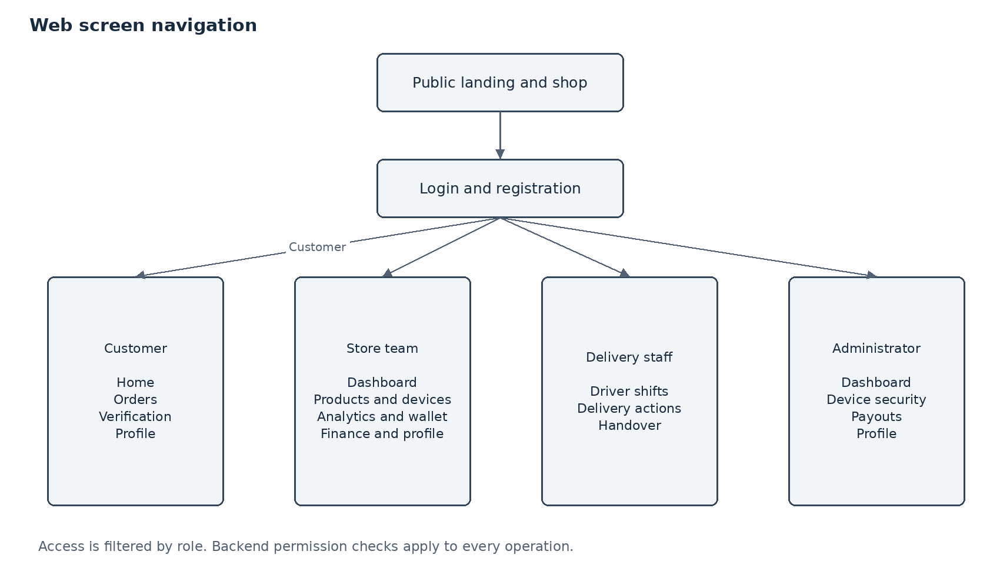

Figure 5  Principal Web navigation by role

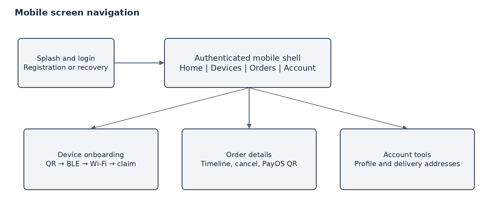

Figure 6  Mobile navigation with four primary tabs

#### 3.1.2 Screen Descriptions

| ID | Screen | Route or entry | Description |
| --- | --- | --- | --- |
| SC01 | Public landing and shop | / and /shop | Product discovery, store selection and storefront checkout. |
| SC02 | Authentication | /login; /register | Email/username, Google or supported phone registration/login. |
| SC03 | Account recovery | /forgot-password; /reset-password; /verify-email | Recovery, verification and resend actions. |
| SC04 | Quick setup | /quick-setup | QR/code-based setup, provisioning and BLE Wi-Fi tools. |
| SC05 | Customer home | /customer/home | Owned buttons, quick reorder, order activity and configuration actions. |
| SC06 | Customer orders | /customer/orders | Order list, details, cancellation and payment entry points. |
| SC07 | Customer verification | /customer/verification | Hosted identity session and decision/status display. |
| SC08 | Profile | /profile; role-specific profile paths | Profile, account details and related address tools. |
| SC09 | Store dashboard | /store/dashboard | Order intake, filters, preparation and fulfillment status actions. |
| SC10 | Store products | /store/products | Products, prices, images and stock-related actions. |
| SC11 | Store devices | /store/devices | Fleet list, details, allocation/configuration and telemetry. |
| SC12 | Device templates | /store/device-templates | Template definitions, deployment and related device tools. |
| SC13 | Store analytics | /store/analytics | Store-scoped operational/commercial summaries. |
| SC14 | Wallet and finance | /store/wallet; /store/finance | Balance, ledger, banking, withdrawals and finance operations. |
| SC15 | Driver shifts | /driver/shifts | Duty, shift, delivery and handover actions. |
| SC16 | Admin dashboard | /admin/dashboard | Store/user governance, platform summaries and commercial definitions. |
| SC17 | Security and payouts | /admin/security/devices; /admin/payouts | Device security review and financial payout processing. |
| SC18 | Forbidden | /403 | Explain denied access without revealing protected content. |
| SC19 | Mobile main shell | main_layout.dart | Home, Devices, Orders and Account with persistent bottom navigation. |
| SC20 | Mobile supporting views | Address sheet; device detail; onboarding; order/payment sheets | Contextual forms and detailed customer operations. |

The screen catalogue describes intended role navigation. The Review 2 snapshot uses frontend/ as the single Web build root and its CI build succeeds. Route declarations and successful compilation do not replace authenticated runtime acceptance or proof of the deployed revision.

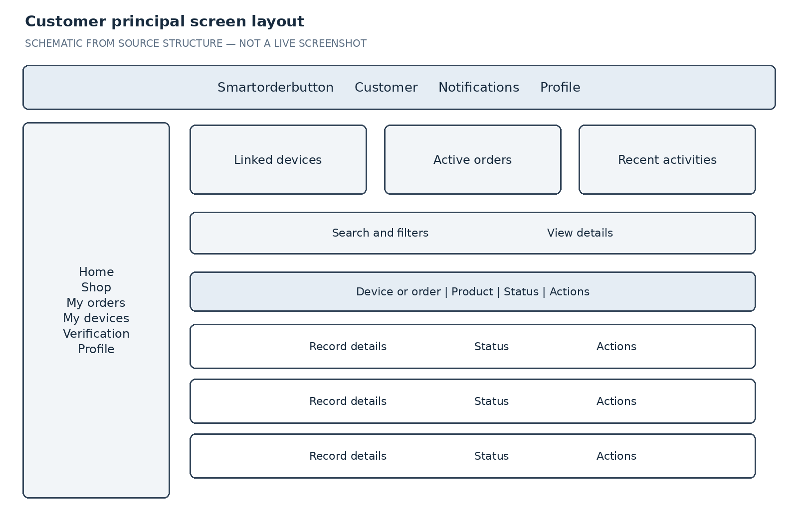

Figure 7  Customer principal screen schematic

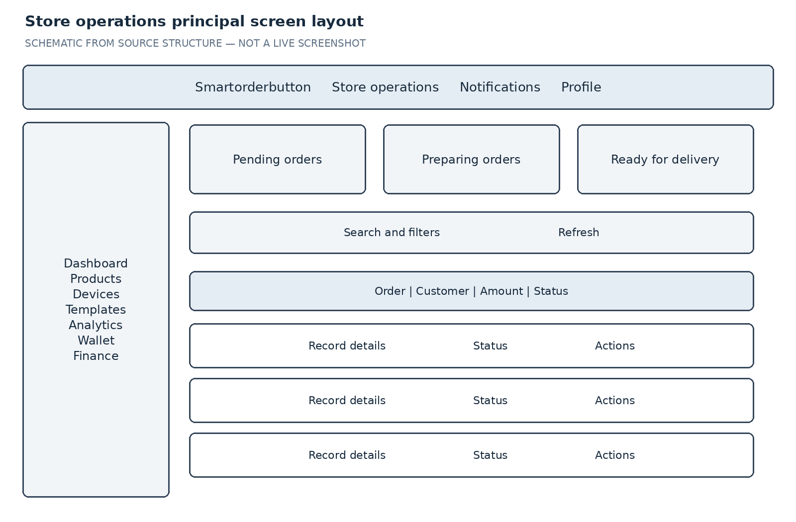

Figure 8  Store operations principal screen schematic

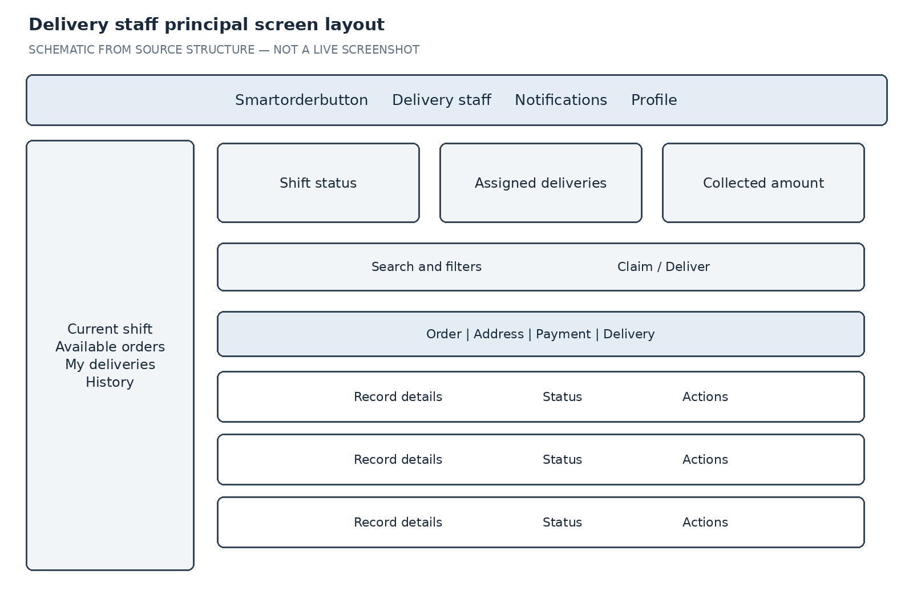

Figure 9  Delivery principal screen schematic

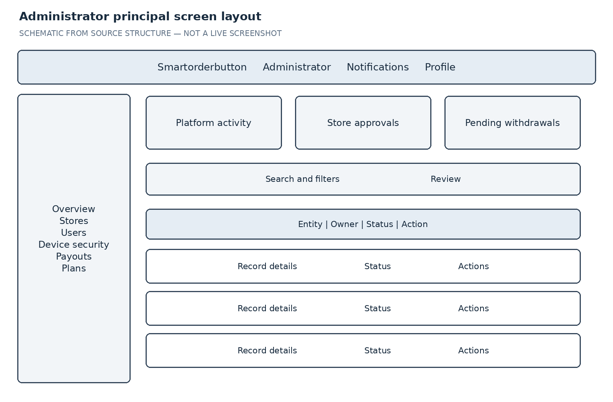

Figure 10  Administrator principal screen schematic

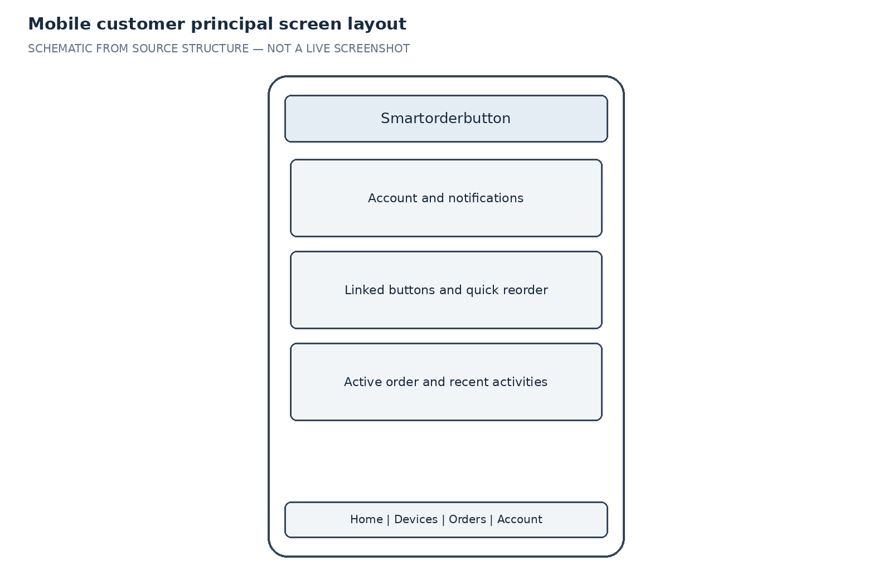

Figure 11  Mobile Home principal screen schematic

These layouts are author-created schematics based on source structure, not screenshots or approved final UI designs. They specify information grouping and actions while UI refinement continues. Real authenticated captures can replace them without changing the functional contracts.

#### 3.1.3 Screen Authorization

| Role | Screens | Permitted activity | Enforcement |
| --- | --- | --- | --- |
| Customer | SC05–SC08; SC19–SC20 | Own devices, addresses, orders, payments, identity and rentals | Customer session and object ownership. |
| Store owner | SC09–SC14; profile | Store-scoped operational and financial functions | Per-endpoint roles plus store ownership; product write explicitly supports owner. |
| Store manager | SC09–SC14; profile | Permitted operations, wallet, subscriptions and staff tools | Manager access varies by endpoint; product write is not explicitly granted by the products controller. |
| STORE_STAFF compatibility | Store route group and profile | Only actions accepted by individual backend endpoints | Current route group includes wallet/analytics, but backend finance/analytics may deny access. |
| STAFF_ORDER | Operational APIs; UI entry depends on build | Order state, queue/claim, delivery and shift/handover operations listed by backend | Specialized role is not included in the inspected common store-route wrapper. |
| STAFF_INVENTORY | Inventory APIs; UI entry depends on build | Inventory queries and authorized stock adjustment | Does not grant product creation, pricing or finance. |
| STAFF_BUTTON | Device APIs; UI entry depends on build | Explicitly allowed device lifecycle and telemetry updates | Does not automatically grant complete fleet allocation. |
| STAFF_DELIVERY | SC15 and assigned delivery operations | Duty, shift, claim, delivery evidence and collection | Check store and assignment, not only role. |
| SUPER_ADMIN / SYSTEM_ADMIN | SC16–SC17 and permitted scoped APIs | Platform administration and supported global overrides | RolesGuard override still coexists with service ownership/context checks. |
| ADMIN legacy | Some admin routes and endpoints | Only operations actually accepted by the corresponding guard/service | Do not infer SUPER_ADMIN equivalence. |
| Public visitor | SC01–SC04 where public | Catalog, authentication, guest checkout and supported setup steps | Protected device ownership actions require authenticated authorization. |

Backend authorization is authoritative. Web navigation must hide or disable unauthorized actions and still handle HTTP 401/403. Any mismatch in this table is a review finding, not a grant of additional permissions.

#### 3.1.4 Non Screen Functions

| ID | Function | Description |
| --- | --- | --- |
| NS01 | Device authentication | Validate active device, signature, timestamp and nonce before a cloud event. |
| NS02 | IoT request processing | Debounce events and acquire idempotency records before atomic order creation. |
| NS03 | Order transactions | Create snapshots, reserve/consume/release stock and record valid transitions. |
| NS04 | Payment callbacks | Verify PayOS evidence and reconcile transaction state once. |
| NS05 | Withdrawal processing | Lock wallet funds and process payout/refund outcomes safely. |
| NS06 | Verification callbacks | Verify bank and Didit events and associate results with the correct session. |
| NS07 | Real-time gateway | Authenticate connections and deliver events to authorized store/customer/user contexts. |
| NS08 | Push and email | Send account and order messages without treating delivery as transaction commit. |
| NS09 | Background queue | Retry configured work and retain exhausted failures as dead-letter records. |
| NS10 | Provisioning bootstrap | Validate session/claim and receive device bootstrap configuration. |
| NS11 | Operational monitoring | Provide liveness/readiness endpoints and audit/security views. |
| NS12 | Firmware operation | Recognize supported gestures, manage BLE/Wi-Fi and show local LED/buzzer feedback. Hardware validation remains pending. |

#### 3.1.5 Entity Relationship Diagram

The diagrams below show the principal relational modules. They are projections of the Prisma schema, not complete physical database diagrams. FK arrows identify dependency; unique constraints and nullability determine exact cardinality. Optional order customerId/buttonId support storefront/guest orders. Tables for authentication, verification and operational recovery are listed in the entity catalogue and relationship appendix.

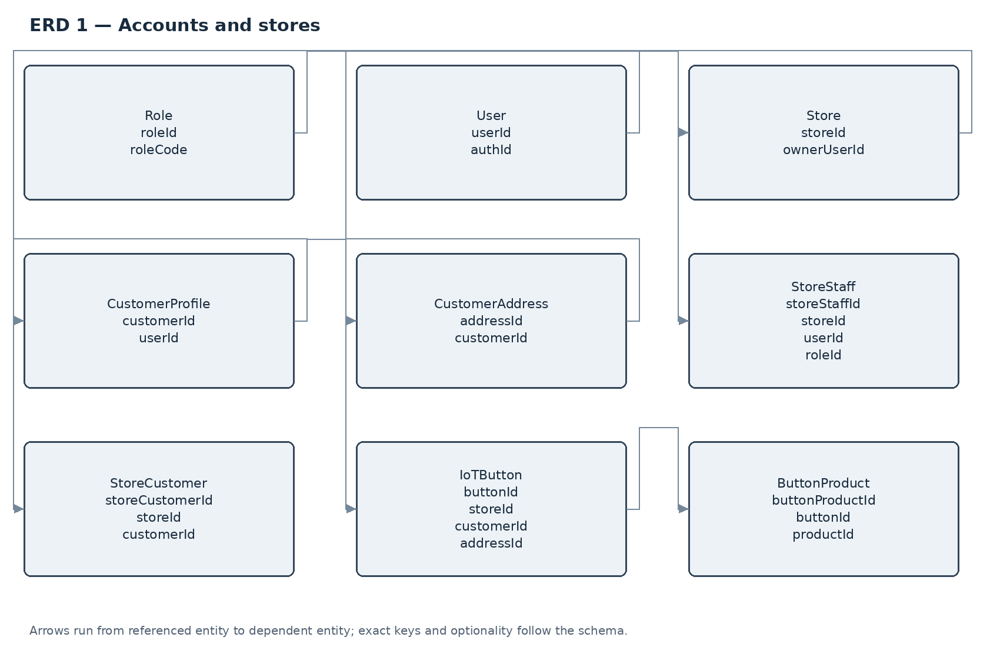

Figure 12  Accounts stores and device ownership relationships

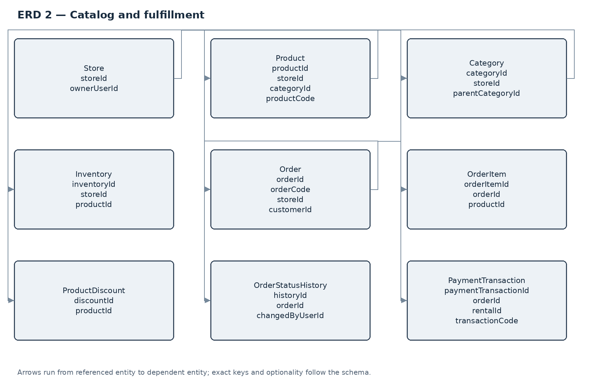

Figure 13  Catalog order and payment relationships

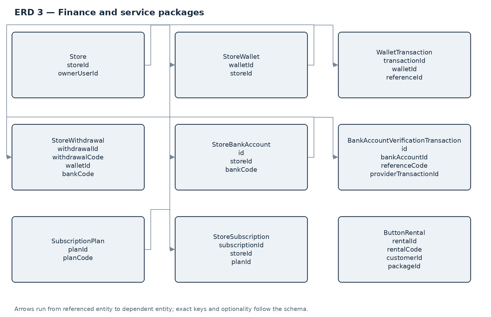

Figure 14  Wallet bank and service package relationships

| Entity | Description |
| --- | --- |
| Role | Role definitions used by account authorization. |
| User | Login identity and user profile. |
| Store | Merchant identity, owner, operating state and commercial settings. |
| StoreStaff | Association between users and store staff responsibilities. |
| CustomerProfile | Customer account context linked to a user. |
| CustomerAddress | Owned delivery address and default/coordinate data. |
| StoreCustomer | Relationship and status between a customer and a store. |
| Category | Store catalog classification. |
| Product | Product master, pricing and descriptive fields. |
| ProductPriceHistory | Historical product price changes. |
| ProductDiscount | Time-bounded product discount configuration. |
| Inventory | Store product physical/reserved quantities and stock thresholds. |
| IoTButton | Device identity, ownership, configuration, security and telemetry. |
| ButtonProduct | Product and quantity mapping for a button. |
| Order | Store/customer order, amounts, shipping snapshot and fulfillment/payment status. |
| OrderItem | Immutable ordered product/price/quantity snapshot. |
| OrderStatusHistory | Recorded order lifecycle changes. |
| PaymentTransaction | Provider payment request and settlement information. |
| RefreshToken | Refresh-session credential metadata. |
| UserFcmToken | User notification delivery endpoints. |
| DeviceTemplate | Reusable device configuration. |
| SubscriptionPlan | Store service plan pricing and limits. |
| StoreSubscription | Store plan entitlement and validity period. |
| RentalPackage | Device rental commercial definition. |
| ButtonRental | Customer rental contract and lifecycle. |
| StoreWallet | Store monetary balance and ledger context. |
| WalletTransaction | Wallet debit/credit records. |
| StoreWithdrawal | Withdrawal decision, banking snapshot and payout state. |
| ProductImage | Product media references. |
| PairingToken | Time-limited device pairing credential. |
| RevokedToken | Revoked authentication token metadata. |
| AuthOtp | Authentication verification/reset credential metadata. |
| IotIdempotencyKey | Persistent deduplication and processing lease for device requests. |
| DeviceNonce | Consumed device nonces for replay protection. |
| ProvisioningSession | Device onboarding and confirmation state. |
| SubscriptionIdempotencyKey | Deduplication of subscription transactions. |
| DriverDuty | Driver availability/duty state. |
| DriverShift | Driver shift totals and handover information. |
| IdentityVerificationSession | User Didit verification session and decision. |
| DiditWebhookEvent | Deduplicated identity callback metadata. |
| StoreBankAccount | Encrypted store bank account and ownership verification state. |
| BankAccountVerificationTransaction | Bank verification reference, provider evidence and status. |
| Notification | User-scoped persisted messages and read state. |
| ApiIdempotencyKey | Scoped API request deduplication records. |
| DeadLetterJob | Exhausted background work retained for recovery. |

### 3.2 Register account

Requirement ID FR01  |  Use case UC01

Actor and preconditions Visitor. The actor must satisfy the applicable session, device and object-scope checks. The relevant store, account or provider configuration must be available for the selected operation.

Function trigger Select Register on Web or Mobile.

Screen or interface Authentication screens

Input and validation Full name; username 3–30 characters using letters, digits, underscores or dots; valid email; password of at least eight characters with uppercase, lowercase, digit and special character; optional phone/address; CUSTOMER or STORE_OWNER self-registration role.

Normal flow

1. Select the supported registration method and enter account details.

2. Validate uniqueness and format; create the user and related customer or store record.

3. Present the email or phone verification step required by the selected method.

Alternative and error behavior Reject a duplicate identifier, invalid email, weak password or unsupported self-registration role. An interrupted verification must not create a privileged session.

Postcondition An account exists with the appropriate verification and activation state.

Acceptance examples Reject a seven-character password; accept a valid customer registration without granting any store or admin privilege.

Source basis auth/auth.controller.ts; auth/dto/auth.dto.ts

### 3.3 Sign in and manage session

Requirement ID FR02  |  Use case UC02

Actor and preconditions Registered user. The actor must satisfy the applicable session, device and object-scope checks. The relevant store, account or provider configuration must be available for the selected operation.

Function trigger Open Login, submit credentials, Google sign-in or verified phone login.

Screen or interface Login and role workspace

Input and validation Email or username and password; Google credential or Firebase phone token for the applicable alternative.

Normal flow

1. Validate the selected credential on the server.

2. Load role and associated store/customer context and issue access/refresh credentials.

3. Route the user to an authorized workspace; refresh or revoke the session through the supported endpoints.

Alternative and error behavior Invalid credentials, inactive account, invalid provider token and expired session produce an authentication error. Refresh failure requires sign-in again.

Postcondition The user receives an authenticated session with server-derived authorization context.

Acceptance examples A customer cannot obtain store access by changing a client-side role value; logout invalidates the applicable server session.

Source basis auth/auth.controller.ts; auth/auth.service.ts

### 3.4 Recover and verify account

Requirement ID FR03  |  Use case UC03

Actor and preconditions Registered user. The actor must satisfy the applicable session, device and object-scope checks. The relevant store, account or provider configuration must be available for the selected operation.

Function trigger Choose Forgot Password, Verify Email or resend verification.

Screen or interface Recovery and verification screens

Input and validation Email, verification/reset token and new password when resetting.

Normal flow

1. Submit the account email and request the appropriate verification message.

2. Validate the returned token or code and its expiry.

3. Apply verification or password reset and display the result.

Alternative and error behavior Reject missing, invalid, expired or already-consumed credentials. A reset password must satisfy the registration strength rules.

Postcondition Account verification or password update is recorded without exposing verification secrets.

Acceptance examples An expired reset token fails; the previous password cannot authenticate after a successful reset.

Source basis auth/auth.controller.ts; auth/dto/auth.dto.ts

### 3.5 Maintain user profile

Requirement ID FR04  |  Use case UC04

Actor and preconditions Authenticated user. The actor must satisfy the applicable session, device and object-scope checks. The relevant store, account or provider configuration must be available for the selected operation.

Function trigger Open Profile or Account and select Edit or Change Password.

Screen or interface Profile screen

Input and validation Supported profile fields, avatar URL, current/new passwords for password change.

Normal flow

1. Load the authenticated user profile.

2. Validate only supported editable fields and authorize changes.

3. Save the profile or password and return the updated representation.

Alternative and error behavior Reject unauthorized identity changes, invalid field formats and an incorrect current password. A profile update must not assign a privileged role.

Postcondition Profile information is updated for the authenticated user.

Acceptance examples Editing one profile does not alter another user; password changes require the configured verification checks.

Source basis auth/dto/update-profile.dto.ts; auth/dto/change-password.dto.ts

### 3.6 Maintain product catalog

Requirement ID FR05  |  Use case UC05

Actor and preconditions Store owner or platform administrator. The actor must satisfy the applicable session, device and object-scope checks. The relevant store, account or provider configuration must be available for the selected operation.

Function trigger Open Store Products and create, update or remove a product.

Screen or interface Store Products

Input and validation Product name, SKU, category, brand, description, unit, price, inventory and up to ten image records.

Normal flow

1. Load the store catalog and select an action.

2. Validate product data, ownership and applicable subscription limits.

3. Persist product and image data; preserve price history when a price changes.

Alternative and error behavior Reject negative prices/stock, invalid image URLs, excessive image count, cross-store changes and subscription restrictions. DTO aliases do not imply that an empty product is valid business data.

Postcondition The catalog reflects the accepted change within its store scope.

Acceptance examples A negative base price is rejected; a user from another store cannot update the product.

Source basis products/products.controller.ts; products/products.service.ts; products/dto/create-product.dto.ts

### 3.7 Manage categories and discounts

Requirement ID FR06  |  Use case UC06

Actor and preconditions Authorized store operator. The actor must satisfy the applicable session, device and object-scope checks. The relevant store, account or provider configuration must be available for the selected operation.

Function trigger Open catalog management and select category or discount tools.

Screen or interface Catalog tools

Input and validation Category fields; discount percentage/amount, ISO start/end timestamps and ACTIVE/INACTIVE status.

Normal flow

1. Load the store category or product discount records.

2. Validate scope, discount values and effective period.

3. Create, edit, deactivate or remove the record and return the updated data.

Alternative and error behavior Reject discounts outside 0–100 percent, negative discount amounts, invalid timestamps and unauthorized product access. Date ordering and overlaps require the applicable service/database validation.

Postcondition Category and promotion records apply only within their intended product/store scope.

Acceptance examples A 101 percent discount is rejected; expired discounts do not become a manually supplied checkout price.

Source basis categories/categories.controller.ts; product-discounts/product-discounts.controller.ts

### 3.8 Maintain inventory

Requirement ID FR07  |  Use case UC07

Actor and preconditions Store owner or inventory staff; manager for inventory queries. The actor must satisfy the applicable session, device and object-scope checks. The relevant store, account or provider configuration must be available for the selected operation.

Function trigger Open inventory or low-stock view, or adjust a product inventory value.

Screen or interface Products and inventory

Input and validation Store/product identifier, stock adjustment fields and low-stock indicators.

Normal flow

1. Load store-scoped inventory with physical and reserved stock.

2. Check permission for the requested query or adjustment.

3. Persist valid adjustments while order transactions retain stock consistency.

Alternative and error behavior Reject cross-store updates and insufficient available stock. A reservation must not make available stock negative.

Postcondition Inventory remains consistent with order reservations and stock deductions.

Acceptance examples Two orders competing for the last unit cannot both reserve it; inventory staff cannot change product pricing through this operation.

Source basis products/store-inventory.controller.ts; products/products.controller.ts; orders/orders.repository.ts

### 3.9 Maintain delivery addresses

Requirement ID FR08  |  Use case UC08

Actor and preconditions Customer. The actor must satisfy the applicable session, device and object-scope checks. The relevant store, account or provider configuration must be available for the selected operation.

Function trigger Open Account or Profile and select delivery addresses.

Screen or interface Profile and address sheet

Input and validation Recipient name, phone, address detail, ward/district/province, default flag and optional coordinates.

Normal flow

1. Load only addresses owned by the customer.

2. Create, edit or remove an address with required delivery data.

3. Apply the selected default address for eligible subsequent orders.

Alternative and error behavior Reject empty recipient/phone/address and coordinates outside latitude −90–90 or longitude −180–180. Prevent access to another customer address.

Postcondition The address book and default selection remain valid for the customer.

Acceptance examples Saving latitude 91 fails; changing an address does not rewrite an existing order shipping snapshot.

Source basis Backend/src/customer-addresses/customer-addresses.controller.ts; customer-addresses/dto/create-customer-address.dto.ts

### 3.10 Place storefront order

Requirement ID FR09  |  Use case UC09

Actor and preconditions Visitor or customer. The actor must satisfy the applicable session, device and object-scope checks. The relevant store, account or provider configuration must be available for the selected operation.

Function trigger Browse Shop, select store products and submit checkout.

Screen or interface Shop checkout

Input and validation Store ID; 1–50 item entries; quantity 1–1000; recipient name ≤100, phone ≤20, address ≤255 and note ≤500 characters; COD/CASH_ON_DELIVERY/PAYOS.

Normal flow

1. Submit product identifiers, quantities and recipient details.

2. Recompute prices on the server, validate active store/products and lock inventory.

3. Create the order and item snapshots atomically and publish an order-created event.

Alternative and error behavior Reject an inactive store, stale/unavailable product, invalid quantities, insufficient stock or total below 2,000 VND. Guest checkout does not confer authenticated access to private order lists.

Postcondition A store-scoped order exists with reserved stock, shipping snapshots and the selected payment method.

Acceptance examples Tampering with a client price does not alter the server total; resubmitting a supplied idempotency key does not duplicate the order.

Source basis orders/storefront.controller.ts; orders/dto/create-storefront-order.dto.ts; orders/orders.repository.ts

### 3.11 Place order from physical button

Requirement ID FR10  |  Use case UC10

Actor and preconditions Customer through authenticated IoT device. The actor must satisfy the applicable session, device and object-scope checks. The relevant store, account or provider configuration must be available for the selected operation.

Function trigger Receive a signed order event from an active configured button.

Screen or interface Non-screen device event

Input and validation Device headers, unique requestId, event type, payment method, optional telemetry and configured product quantities.

Normal flow

1. Authenticate device, timestamp, signature and nonce.

2. Resolve the active button, customer, selected store and configured products.

3. Validate minimum total and available stock; create one order atomically and notify the store/customer.

Alternative and error behavior Reject unconfigured/inactive devices, invalid authentication, unavailable stock and totals below 2,000 VND. Repeated request IDs reuse the recorded outcome rather than creating an additional order.

Postcondition Exactly one accepted order is associated with the button request.

Acceptance examples Two concurrent copies of the same valid request produce one order; a forged signature produces no order.

Source basis iot/iot.service.ts; orders/orders.service.ts; orders/orders.repository.ts

### 3.12 Reorder configured products

Requirement ID FR11  |  Use case UC11

Actor and preconditions Customer. The actor must satisfy the applicable session, device and object-scope checks. The relevant store, account or provider configuration must be available for the selected operation.

Function trigger Tap the quick reorder action for an owned button.

Screen or interface Customer Home or mobile device card

Input and validation Owned device ID and server-stored product configuration.

Normal flow

1. Authenticate the customer and verify button ownership.

2. Reuse the button-order creation rules with a new application request identifier.

3. Return the order and publish notifications after commit.

Alternative and error behavior Reject a foreign device, missing customer profile, inactive button, unavailable product or insufficient stock.

Postcondition A new order exists for the customer using the accepted button configuration.

Acceptance examples The customer cannot quick-reorder through a device owned by another account.

Source basis orders/orders.controller.ts; orders/orders.service.ts

### 3.13 Cancel order

Requirement ID FR12  |  Use case UC12

Actor and preconditions Customer, signed device or authorized store manager. The actor must satisfy the applicable session, device and object-scope checks. The relevant store, account or provider configuration must be available for the selected operation.

Function trigger Select Cancel or receive a supported physical cancellation event.

Screen or interface Order details and countdown

Input and validation Order ID and optional reason; server creation time, source and current status.

Normal flow

1. Check order ownership, source, current state and elapsed server time.

2. For customer orders from any channel, allow cancellation only while PENDING or CONFIRMED and before 120 seconds have elapsed since server creation time.

3. Atomically cancel and compensate inventory; notify authorized recipients.

Alternative and error behavior Reject expired (elapsed >= 120 seconds), invalid/future-dated or processed orders. Check customer ownership before responding, including an already-cancelled retry. Privileged operational cancellation remains a separate permission-controlled path.

Postcondition The order is CANCELLED and stock effects are applied once; repeating the same cancellation is safe.

Acceptance examples An owned PENDING or CONFIRMED order at 119 seconds may be cancelled; at exactly 120 seconds and 121 seconds it is rejected. The same rule applies to Web, Mobile and physical-button orders. Foreign orders and PREPARING/SHIPPING orders are rejected for a customer.

Source basis orders/orders.service.ts; iot/iot.service.ts

### 3.14 View orders and timeline

Requirement ID FR13  |  Use case UC13

Actor and preconditions Customer, store operator or authorized delivery staff. The actor must satisfy the applicable session, device and object-scope checks. The relevant store, account or provider configuration must be available for the selected operation.

Function trigger Open Orders, dashboard order detail or delivery history.

Screen or interface Orders and order detail

Input and validation Order identifier; pagination, status/payment/date filters where supported.

Normal flow

1. Resolve the actor scope and apply server-side filters.

2. Return permitted orders and snapshots with pagination.

3. Load the selected order timeline and update after authorized real-time events.

Alternative and error behavior Reject unauthorized detail/timeline access and invalid identifiers. Empty results display an empty state. A lost connection does not mean the last transaction failed.

Postcondition Only orders within the actor scope are displayed.

Acceptance examples Customer A cannot read Customer B order by editing the URL; a store query excludes other stores.

Source basis orders/orders.controller.ts; orders/orders.service.ts

### 3.15 Provision and claim device

Requirement ID FR14  |  Use case UC14

Actor and preconditions Customer using Web or Mobile. The actor must satisfy the applicable session, device and object-scope checks. The relevant store, account or provider configuration must be available for the selected operation.

Function trigger Scan a device QR/code and start setup.

Screen or interface Quick Setup and mobile onboarding

Input and validation QR/code, session ID, device ID, supported BLE credentials, optional name/product/address configuration.

Normal flow

1. Create or verify a provisioning session from the supplied code.

2. Discover the device over BLE, transfer Wi-Fi settings and wait for cloud bootstrap.

3. Confirm pairing and bind the device to the authenticated customer when checks succeed.

Alternative and error behavior Reject invalid/expired/consumed codes, conflicting ownership and invalid sessions. BLE denial or Wi-Fi failure displays a retryable setup state; it must not falsely confirm a claim.

Postcondition The verified device is bound to its owner and has an accepted configuration.

Acceptance examples A used claim token cannot bind the device to another customer; interrupted Wi-Fi setup remains distinguishable from success.

Source basis devices/provisioning.controller.ts; devices/provisioning.service.ts

### 3.16 Configure owned device

Requirement ID FR15  |  Use case UC15

Actor and preconditions Customer. The actor must satisfy the applicable session, device and object-scope checks. The relevant store, account or provider configuration must be available for the selected operation.

Function trigger Open My Devices and edit the button configuration.

Screen or interface Customer device settings

Input and validation Owned device ID, store ID, product ID, name and quantity of at least one.

Normal flow

1. Load the owned button configuration.

2. Validate the selected store and product relationship.

3. Save the configuration and expose the accepted mapping to future device events.

Alternative and error behavior Reject a foreign button, inaccessible store/product or invalid quantity. Existing orders retain their original snapshots when configuration changes.

Postcondition Subsequent requests use the accepted store/product mapping.

Acceptance examples Changing the selected store does not preserve an invalid product mapping from the previous store.

Source basis devices/devices.controller.ts; devices/devices.service.ts

### 3.17 Manage device lifecycle

Requirement ID FR16  |  Use case UC16

Actor and preconditions Authorized customer or store/platform operator. The actor must satisfy the applicable session, device and object-scope checks. The relevant store, account or provider configuration must be available for the selected operation.

Function trigger Select change Wi-Fi, unclaim, transfer, disable, warranty or factory reset as permitted.

Screen or interface Device detail and fleet tools

Input and validation Device ID and action-specific data; warranty extension 1–120 months; battery 0–100.

Normal flow

1. Authorize the requested lifecycle action against ownership and role.

2. Validate the action data and current device state.

3. Persist the action and show the resulting state; hardware-dependent work waits for device confirmation.

Alternative and error behavior Reject unauthorized transfers/resets, invalid ranges and invalid ownership transitions. A server acceptance is not evidence of successful physical reset while hardware is unavailable.

Postcondition A traceable lifecycle update exists for the selected device.

Acceptance examples A customer cannot factory-reset another customer device; invalid battery 101 is rejected.

Source basis devices/devices.controller.ts; devices/provisioning.controller.ts

### 3.18 Process device security and telemetry

Requirement ID FR17  |  Use case UC17

Actor and preconditions Registered IoT device. The actor must satisfy the applicable session, device and object-scope checks. The relevant store, account or provider configuration must be available for the selected operation.

Function trigger POST IoT event/telemetry or GET accepted configuration.

Screen or interface Non-screen security interface

Input and validation x-device-id, x-timestamp, x-nonce, x-signature; event requestId ≤128; battery 0–100 and RSSI −150–0.

Normal flow

1. Check the active device and timestamp drift of at most 300 seconds.

2. Verify signature before consuming the nonce and reject a consumed nonce.

3. Process the accepted event, enforce debounce/idempotency and update or broadcast telemetry.

Alternative and error behavior Return authentication/state/replay failures without order creation. Order events within the current 2,500 ms debounce can return BUTTON_DEBOUNCE_ACTIVE. Request retries must follow the signature and idempotency protocol.

Postcondition Accepted events are attributable to one device and retries do not duplicate business effects.

Acceptance examples An altered body fails authentication; a replayed nonce is rejected with REPLAY_DETECTED.

Source basis common/guards/hmac-auth.guard.ts; iot/iot.service.ts; iot/dto/iot-event.dto.ts

### 3.19 Process store order

Requirement ID FR18  |  Use case UC18

Actor and preconditions Store owner, manager or authorized order staff. The actor must satisfy the applicable session, device and object-scope checks. The relevant store, account or provider configuration must be available for the selected operation.

Function trigger Receive a new order or select a status action on dashboard.

Screen or interface Store Dashboard

Input and validation Order ID, requested status and authenticated store context.

Normal flow

1. Load the order within the actor store.

2. Validate the requested status against the backend transition graph.

3. Apply inventory/financial effects atomically where required, record status history and publish the committed change.

Alternative and error behavior Reject cross-store processing and an invalid transition. The dedicated cancel endpoint and the generic status endpoint do not have identical eligibility checks.

Postcondition The order reaches one valid next state and its history records the transition.

Acceptance examples PENDING → SHIPPING is rejected; PENDING → CONFIRMED is accepted only for an authorized actor.

Source basis orders/orders.service.ts; orders/dto/update-order-status.dto.ts

### 3.20 Claim delivery

Requirement ID FR19  |  Use case UC19

Actor and preconditions Delivery staff or permitted store operator. The actor must satisfy the applicable session, device and object-scope checks. The relevant store, account or provider configuration must be available for the selected operation.

Function trigger Select Claim in the delivery queue.

Screen or interface Driver orders and delivery queue

Input and validation Ready order ID, authenticated driver/store context and current assignment.

Normal flow

1. Load the available queue within permitted scope.

2. Claim the eligible order under transaction/concurrency checks.

3. Associate the accepted driver and return the delivery state.

Alternative and error behavior Reject another-store order, an ineligible state or an order already claimed by another driver.

Postcondition One driver holds the accepted delivery assignment.

Acceptance examples Two drivers claiming the same order concurrently produce one successful assignment.

Source basis orders/orders.controller.ts; orders/orders.repository.ts

### 3.21 Complete delivery

Requirement ID FR20  |  Use case UC20

Actor and preconditions Assigned delivery staff or permitted store operator. The actor must satisfy the applicable session, device and object-scope checks. The relevant store, account or provider configuration must be available for the selected operation.

Function trigger Select Deliver for an assigned SHIPPING order.

Screen or interface Delivery completion form

Input and validation DELIVERED status; COD/VIETQR/PAYOS; collection amount when required; proof-of-delivery image URL.

Normal flow

1. Verify assignment/store scope and current SHIPPING state.

2. Validate a unique Cloudinary proof image in the store POD folder and the payment evidence.

3. Record delivery, payment collection and related history atomically.

Alternative and error behavior Reject missing/reused proof, wrong image folder, COD amount different from the order total, or an unpaid electronic transaction.

Postcondition The order is DELIVERED with the accepted proof and collection information.

Acceptance examples COD delivery without collectedAmount fails; the same proof image cannot be reused for a different order.

Source basis orders/dto/deliver-order.dto.ts; orders/orders.repository.ts

### 3.22 Record delivery failure

Requirement ID FR21  |  Use case UC21

Actor and preconditions Assigned delivery staff or permitted store operator. The actor must satisfy the applicable session, device and object-scope checks. The relevant store, account or provider configuration must be available for the selected operation.

Function trigger Select Failed delivery for a SHIPPING order.

Screen or interface Delivery failure form

Input and validation Failure reason and required evidence fields from the delivery failure contract.

Normal flow

1. Check driver assignment, store scope and SHIPPING state.

2. Validate evidence and record the failure reason.

3. Update to DELIVERY_FAILED and expose the eligible retry or cancellation path.

Alternative and error behavior Reject missing evidence, a foreign assignment and a non-SHIPPING order. A failure record does not mark payment as successfully collected.

Postcondition The delivery failure is auditable and the order remains subject to valid transitions.

Acceptance examples A failed delivery cannot jump directly to COMPLETED; authorized retry can follow DELIVERY_FAILED → SHIPPING.

Source basis orders/dto/delivery-failure.dto.ts; orders/orders.repository.ts

### 3.23 Manage driver shift and handover

Requirement ID FR22  |  Use case UC22

Actor and preconditions Delivery staff; store manager or order staff for handover. The actor must satisfy the applicable session, device and object-scope checks. The relevant store, account or provider configuration must be available for the selected operation.

Function trigger Start/close a shift, change duty or review a handover.

Screen or interface Driver shifts and store finance

Input and validation Driver/store context, shift ID, duty data, handover code/note and collection totals.

Normal flow

1. Start or retrieve the current driver shift and duty status.

2. Aggregate deliveries and collection totals for the shift.

3. Close the shift and require an authorized store actor to confirm handover.

Alternative and error behavior Reject closing another driver shift or confirming a handover outside the actor store. Do not treat driver self-close as store receipt confirmation.

Postcondition Shift status and handover information are recorded separately.

Acceptance examples A driver cannot confirm their own handover through a manager-only endpoint.

Source basis driver-shifts/driver-shifts.controller.ts; driver-shifts/driver-shifts.service.ts; drivers/drivers.controller.ts

### 3.24 Process PayOS order payment

Requirement ID FR23  |  Use case UC23

Actor and preconditions Customer or permitted order actor; PayOS. The actor must satisfy the applicable session, device and object-scope checks. The relevant store, account or provider configuration must be available for the selected operation.

Function trigger Select PayOS payment or receive a payment webhook.

Screen or interface PayOS payment sheet

Input and validation Order ID, provider link data, optional return/cancel URLs and signed webhook data.

Normal flow

1. Verify order access and payment eligibility; derive the payable amount from the order.

2. Create or retrieve the provider payment request and show the returned payment link/QR.

3. Verify provider data/signature and apply the accepted settlement once.

Alternative and error behavior Reject a paid or disallowed terminal order, mismatched amount/provider data and forged webhook. Browser redirects alone do not establish settlement. Production redirect DTOs currently allow only HTTPS smartorder.vn or its subdomains.

Postcondition A verified payment transaction is linked to the order without duplicate credit.

Acceptance examples A repeated genuine webhook does not settle twice; an invalid signature cannot mark the order PAID.

Source basis payments/payments.controller.ts; payments/payments.service.ts; payments/dto/payment.dto.ts

### 3.25 View store wallet and ledger

Requirement ID FR24  |  Use case UC24

Actor and preconditions Store owner or manager; scoped platform administrator. The actor must satisfy the applicable session, device and object-scope checks. The relevant store, account or provider configuration must be available for the selected operation.

Function trigger Open Store Wallet or Finance.

Screen or interface Store Wallet and Finance

Input and validation Store context, transaction/withdrawal filters and pagination.

Normal flow

1. Resolve the permitted store from the authenticated context.

2. Read wallet balance and ledger/withdrawal history.

3. Return masked financial details and scoped transaction records.

Alternative and error behavior Reject a missing store context or unauthorized store selection. Store staff route visibility must not bypass the backend owner/manager restriction.

Postcondition The actor sees only permitted wallet and ledger information.

Acceptance examples A STORE_STAFF session cannot invoke owner/manager wallet APIs merely because a menu item is visible.

Source basis store-wallet/store-wallet.controller.ts

### 3.26 Verify store bank account

Requirement ID FR25  |  Use case UC25

Actor and preconditions Authorized store owner or manager; bank verification provider. The actor must satisfy the applicable session, device and object-scope checks. The relevant store, account or provider configuration must be available for the selected operation.

Function trigger Add a bank account and start verification.

Screen or interface Bank verification tools

Input and validation Supported bank BIN, account number, account identity and verification transaction/reference.

Normal flow

1. Validate store access and bank account data.

2. Create or reuse the applicable verification record and show the provider instructions.

3. Process authenticated evidence, expose status and allow an ownership-verified account to be selected as default.

Alternative and error behavior Reject an unsupported bank, invalid account, forged/mismatched verification or an attempt to default an unverified account. Plain account numbers must not appear in financial listings.

Postcondition Only a confirmed account reaches OWNERSHIP_VERIFIED for eligible withdrawals.

Acceptance examples PENDING account cannot become the withdrawal default; another store cannot read its verification transaction.

Source basis bank-verification/store-bank-accounts.controller.ts; bank-verification/bank-verification.service.ts

### 3.27 Request and process withdrawal

Requirement ID FR26  |  Use case UC26

Actor and preconditions Store owner/manager; platform administrator; PayOS Payout. The actor must satisfy the applicable session, device and object-scope checks. The relevant store, account or provider configuration must be available for the selected operation.

Function trigger Submit withdrawal or review an existing request.

Screen or interface Store Wallet and Admin Payouts

Input and validation Amount ≥50,000 VND, verified bank account, idempotency key where supplied, decision/rejection reason.

Normal flow

1. Verify available wallet funds and an ownership-verified bank account.

2. Reserve/debit funds atomically and record an auditable withdrawal request.

3. Process the authorized payout decision, synchronize provider status and compensate a failed payout exactly once.

Alternative and error behavior Reject insufficient funds, an unverified account, invalid amount, unauthorized approval and conflicting retries. Payout capability depends on configured provider credentials and activation.

Postcondition The withdrawal and associated ledger entries reflect one confirmed financial outcome.

Acceptance examples Concurrent withdrawals cannot spend the same balance twice; replaying a failed-payout callback cannot refund twice.

Source basis store-wallet/store-wallet.service.ts; admin/admin.controller.ts; payments/payout-webhook.controller.ts

### 3.28 Manage device rental

Requirement ID FR27  |  Use case UC27

Actor and preconditions Customer; authorized rental administrator. The actor must satisfy the applicable session, device and object-scope checks. The relevant store, account or provider configuration must be available for the selected operation.

Function trigger Choose rental package, pay, extend or request return.

Screen or interface Rental tools or customer account

Input and validation Active rental package ID, rental ID and applicable payment/extension/return data.

Normal flow

1. List active packages and create a customer rental.

2. Create the eligible payment request and activate only under the accepted payment/state rules.

3. Expose owned rentals, extension requests and return requests; authorized administrators manage status.

Alternative and error behavior Reject unavailable packages, foreign contracts and activation before the accepted paid state. Hardware fulfillment remains dependent on prototype readiness.

Postcondition The rental lifecycle remains linked to one customer and package.

Acceptance examples Customer A cannot read Customer B contract; unpaid rental cannot be activated through the normal workflow.

Source basis rentals/rentals.controller.ts; rentals/rentals.service.ts; rentals/admin-rentals.controller.ts

### 3.29 Manage store subscription

Requirement ID FR28  |  Use case UC28

Actor and preconditions Store owner or manager; administrator for plan definitions. The actor must satisfy the applicable session, device and object-scope checks. The relevant store, account or provider configuration must be available for the selected operation.

Function trigger View available plans and subscribe using the store wallet.

Screen or interface Store subscription tools

Input and validation Active plan ID, store context, price/period/product limits and optional idempotency key.

Normal flow

1. Load active plans and the current store subscription.

2. Validate the selected plan and debit the wallet through the atomic subscription operation.

3. Expose subscription dates, history and product-listing eligibility.

Alternative and error behavior Reject inactive plans, insufficient funds and another store subscription. When no plan definitions exist, the current service permits listing without a subscription; otherwise the active plan and product limit apply.

Postcondition The accepted subscription and wallet entry are recorded once.

Acceptance examples Repeating the same subscription request must not debit twice; an expired plan cannot bypass configured listing checks.

Source basis store-subscriptions/store-subscriptions.service.ts; store-subscriptions/store-subscriptions.controller.ts

### 3.30 Approve and manage stores

Requirement ID FR29  |  Use case UC29

Actor and preconditions Platform administrator. The actor must satisfy the applicable session, device and object-scope checks. The relevant store, account or provider configuration must be available for the selected operation.

Function trigger Open pending stores and approve or reject a registration.

Screen or interface Admin Dashboard stores section

Input and validation Store identifier, review decision and rejection details where required.

Normal flow

1. List pending or existing stores within platform scope.

2. Review the selected store and submit an authorized decision.

3. Persist the resulting store status and return the updated platform view.

Alternative and error behavior Reject unauthorized platform administration and nonexistent stores. A registered store does not imply operational approval.

Postcondition The store registration has one recorded review outcome.

Acceptance examples A customer cannot approve a store; storefront ordering rejects an inactive/unapproved store under backend rules.

Source basis admin/admin.controller.ts; stores/stores.controller.ts

### 3.31 Manage platform users and plans

Requirement ID FR30  |  Use case UC30

Actor and preconditions Platform administrator. The actor must satisfy the applicable session, device and object-scope checks. The relevant store, account or provider configuration must be available for the selected operation.

Function trigger Open Users, Subscription Plans or Rental Packages in the admin workspace.

Screen or interface Admin Dashboard administration sections

Input and validation User ID and allowed role/status action; package/plan pricing and limits.

Normal flow

1. List the relevant platform records.

2. Validate the privileged role/status change or package definition.

3. Persist and display the accepted change without exposing authentication secrets.

Alternative and error behavior Reject unauthorized role escalation, invalid role values and invalid package data. Customer self-registration cannot choose an admin role.

Postcondition Platform account governance and commercial definitions remain controlled.

Acceptance examples A store owner cannot change a user to SUPER_ADMIN; plan changes do not silently rewrite historical order amounts.

Source basis admin/admin.controller.ts; admin/dto/update-user-role.dto.ts

### 3.32 Manage fleet security

Requirement ID FR31  |  Use case UC31

Actor and preconditions Platform administrator; permitted device operator. The actor must satisfy the applicable session, device and object-scope checks. The relevant store, account or provider configuration must be available for the selected operation.

Function trigger Open Admin Security Hub or fleet management.

Screen or interface Admin Security Hub and fleet

Input and validation Device IDs, allocation targets, state, telemetry and audit/security events.

Normal flow

1. Query devices and security information within authorized scope.

2. Review activity, ownership and suspicious device conditions.

3. Apply an allowed allocation or state change and expose the result.

Alternative and error behavior Reject unauthorized bulk allocation and another-store operation. Disabling a device causes subsequent signed order requests to fail the active-device check.

Postcondition Device governance and permitted security views reflect accepted changes.

Acceptance examples An inactive device cannot create an order even with a correct signature.

Source basis devices/provisioning.controller.ts; devices/devices.controller.ts

### 3.33 Manage device templates and batches

Requirement ID FR32  |  Use case UC32

Actor and preconditions Store owner/manager or platform administrator. The actor must satisfy the applicable session, device and object-scope checks. The relevant store, account or provider configuration must be available for the selected operation.

Function trigger Create a template, deploy it or import/generate devices.

Screen or interface Store Device Templates and Devices

Input and validation Template configuration; imported rows 1–500; generated count 1–100; applicable store/device mappings.

Normal flow

1. Load permitted templates and validate configuration fields.

2. Select deployment targets or submit an import/generation request.

3. Create/update accepted records and return per-operation results as supported.

Alternative and error behavior Reject oversized batches, invalid configuration and unauthorized store allocation. Product/store mappings require backend validation.

Postcondition Templates and device records remain associated with authorized store scope.

Acceptance examples 501 import rows and generation count 101 are rejected.

Source basis devices/device-templates.controller.ts; devices/dto/device-template.dto.ts; devices/dto/devices.dto.ts

### 3.34 View analytics and store customers

Requirement ID FR33  |  Use case UC33

Actor and preconditions Store owner/manager; permitted order staff for customer queries. The actor must satisfy the applicable session, device and object-scope checks. The relevant store, account or provider configuration must be available for the selected operation.

Function trigger Open Store Analytics or the customer management function.

Screen or interface Store Analytics and customer tools

Input and validation Date/store filters, customer ID/status and pagination where supported.

Normal flow

1. Resolve store scope and supported date/filter values.

2. Aggregate order and commercial data or load the store-customer relationship.

3. Return analytics or perform an authorized customer status update.

Alternative and error behavior Reject cross-store access and roles excluded from analytics. Store-customer status changes require the explicit owner/manager/admin permission.

Postcondition The actor sees store-scoped analysis and customer relationship information.

Acceptance examples A staff inventory account cannot infer global financial analytics from a store filter.

Source basis analytics/analytics.controller.ts; store-customers/store-customers.controller.ts

### 3.35 Receive and manage notifications

Requirement ID FR34  |  Use case UC34

Actor and preconditions Authenticated user; notification provider. The actor must satisfy the applicable session, device and object-scope checks. The relevant store, account or provider configuration must be available for the selected operation.

Function trigger Receive an event or open the notification list.

Screen or interface Notification list and role workspaces

Input and validation User notification ID, unread filter, FCM device token and platform.

Normal flow

1. Authenticate the user and register/update permitted notification delivery information.

2. Persist or deliver a user-scoped message and show unread status.

3. Mark individual/all owned notifications as read; unregister a token when requested.

Alternative and error behavior Reject foreign notification access and unauthorized real-time room membership. Notification delay/failure must not roll back an already-committed order.

Postcondition Notification visibility and read state are limited to the intended user.

Acceptance examples A user cannot mark another user notification as read; reconnecting refreshes authoritative order state.

Source basis notifications/notifications.controller.ts; websocket/events.gateway.ts

### 3.36 Verify customer identity

Requirement ID FR35  |  Use case UC35

Actor and preconditions Authenticated user; Didit; authorized platform administrator. The actor must satisfy the applicable session, device and object-scope checks. The relevant store, account or provider configuration must be available for the selected operation.

Function trigger Start identity verification and open the hosted provider session.

Screen or interface Customer Verification

Input and validation Server-issued verification session/URL, provider decision and authenticated webhook data.

Normal flow

1. Create a provider verification session for the authenticated user.

2. Retrieve the owned session status/decision while the provider processes evidence.

3. Verify the callback and apply a deduplicated decision; expose privileged session management only to authorized administrators.

Alternative and error behavior Reject a foreign session, missing/invalid raw callback evidence and unauthorized deletion. Pending or declined verification must not display as approved.

Postcondition The verification state is associated with the correct user and provider session.

Acceptance examples A webhook replay does not apply the same decision twice; Customer A cannot retrieve Customer B decision.

Source basis identity-verifications/identity-verifications.controller.ts; identity-verifications/identity-verifications.service.ts

### 3.37 Manage store staff and profile

Requirement ID FR36  |  Use case UC36

Actor and preconditions Store owner or authorized manager subject to service checks. The actor must satisfy the applicable session, device and object-scope checks. The relevant store, account or provider configuration must be available for the selected operation.

Function trigger Open store team or store profile tools.

Screen or interface Store profile and staff tools

Input and validation Store ID, user/staff identity, role/status and supported store profile fields.

Normal flow

1. Load the permitted store profile and available staff roles.

2. Authorize the membership/profile action and validate the supplied values.

3. Save the change and return the current store-scoped representation.

Alternative and error behavior Reject another-store membership edits and unauthorized role assignment. Staff membership does not automatically permit all store screens or financial actions.

Postcondition Store profile and team permissions reflect accepted changes.

Acceptance examples A manager cannot assign a role outside the supported role catalogue; cross-store changes fail.

Source basis store-staff/store-staff.controller.ts; store-staff/store-staff.service.ts; stores/stores.controller.ts

### 3.38 Upload and manage media

Requirement ID FR37  |  Use case UC37

Actor and preconditions Permitted store staff or administrator. The actor must satisfy the applicable session, device and object-scope checks. The relevant store, account or provider configuration must be available for the selected operation.

Function trigger Request a signed upload, upload media or submit delivery proof.

Screen or interface Product images and delivery proof

Input and validation Supported media data, signed parameters and resulting public URL/public ID.

Normal flow

1. Check the actor and the upload operation permission.

2. Issue scoped signed parameters or validate/process the upload.

3. Return accepted media identifiers and enforce store-specific proof rules when attached to delivery.

Alternative and error behavior Reject unsupported media, unauthorized destroy operations and proof belonging to another store. A media URL alone is not permission to access an order.

Postcondition Accepted media can be referenced by the permitted product/profile/delivery operation.

Acceptance examples A POD image outside the required store folder cannot complete delivery.

Source basis media/media.controller.ts; orders/orders.repository.ts

### 3.39 Monitor background processing

Requirement ID FR38  |  Use case UC38

Actor and preconditions Authorized operator or infrastructure monitor. The actor must satisfy the applicable session, device and object-scope checks. The relevant store, account or provider configuration must be available for the selected operation.

Function trigger Run a background task or request health/readiness.

Screen or interface Non-screen operations

Input and validation Queue job identity and attempts; health/readiness state; failure metadata.

Normal flow

1. Execute configured queued work with a bounded retry policy.

2. Record exhausted work in the dead-letter mechanism and expose operational diagnostics without secrets.

3. Return liveness/readiness according to actual service dependencies.

Alternative and error behavior A healthy process does not imply successful provider delivery or physical device readiness. Failed jobs must remain distinguishable from completed work.

Postcondition Background work has a recoverable status and infrastructure health can be assessed.

Acceptance examples An exhausted job is retained for investigation rather than silently reported successful.

Source basis common/queues/queue.service.ts; app.controller.ts; prisma/schema.prisma

## 4 Non Functional Requirements

### 4.1 External Interfaces

| ID | Interface | Contract |
| --- | --- | --- |
| EI01 | Web and Mobile | HTTPS JSON REST interfaces under the backend prefix; supported browser/device permissions for BLE/camera. BigInt identifiers are serialized as strings. |
| EI02 | Device to cloud | Wi-Fi HTTP API with required HMAC headers, nonce and timestamp. Transport encryption must be verified in the release firmware configuration. |
| EI03 | BLE provisioning | Local BLE discovery and Wi-Fi credential exchange. Denied permissions, timeout and device disconnect must have explicit recoverable UI states. |
| EI04 | PayOS collection | Create/query/cancel payment requests and verify collection webhooks. Provider credentials remain server-side. |
| EI05 | PayOS Payout | Authenticated payout execution and status reconciliation; provider availability is a separate dependency from platform availability. |
| EI06 | Bank verification | Supported bank lookup, ownership verification transactions and authenticated provider events. |
| EI07 | Google and Firebase | Server validation of supported Google credentials and Firebase phone verification tokens. |
| EI08 | Didit | Hosted identity session and signed/raw-body verification for decision callbacks. |
| EI09 | Cloudinary | Scoped media uploads and store POD image paths. Proof reuse and cross-store attachment are rejected. |
| EI10 | Socket.IO and FCM | Authenticated real-time connections, scoped rooms and mobile push tokens. REST readback recovers authoritative state after reconnect. |
| EI11 | Email | Verification and recovery messages; transient mail delivery failure is visible/retryable without exposing secret tokens. |

### 4.2 Quality Attributes

The following measurable thresholds are acceptance targets, not measured results. Inherited targets retain their origin in Report 2. Proposed targets require team/supervisor approval and subsequent testing. Timing tests must record client device, network, dataset, server capacity, provider mode and sample size.

#### 4.2.1 Usability

| ID | Requirement and measurement | Basis |
| --- | --- | --- |
| NFR01 | A first-time customer should complete QR/BLE/Wi-Fi provisioning within 3 minutes in at least 9 of 10 supervised attempts, excluding installation and external outages. | Provisioning time inherited from Report 1; success proportion proposed. |
| NFR02 | Display remaining customer-cancellation time for all order channels from server creation time. Hide/disable expired actions; a server rejection remains authoritative if expiry occurs during submission. | Review 2 common 120-second customer rule; deadline is exclusive (elapsed < 120 seconds). |
| NFR03 | At viewport widths 360, 768 and 1366 pixels, principal Web screens must keep primary actions reachable and prevent body-level horizontal overflow. | Proposed UI acceptance target. |
| NFR04 | Required fields, loading, empty, success and error states must be distinguishable using text; keyboard focus and visible labels must be available for principal Web forms. | Proposed usability target. |

#### 4.2.2 Reliability

| ID | Requirement and verification | Basis |
| --- | --- | --- |
| NFR05 | Repeated or concurrent delivery of one IoT request or payment event must produce one business effect. Verify at least 20 concurrent copies and replay after service restart. | Source-derived invariant; load count proposed. |
| NFR06 | A transaction failure must not leave partial order items, negative available stock, duplicate settlement or duplicate wallet refund. Use transaction fault injection. | Source-derived integrity requirement. |
| NFR07 | Monthly staging availability target is 99 percent excluding approved maintenance. Recovery target is 4 hours and data-loss target is at most 24 hours through daily backup/restore exercises. | Proposed operational targets; no monitoring evidence supplied. |
| NFR08 | After a real-time reconnect, refresh permitted order state and reconcile the last displayed state within 5 seconds under the reference network. | Proposed recovery target. |
| NFR09 | Retain failed background work with job name, attempt count and failure reason after the configured retry policy is exhausted. | Queue/dead-letter source basis. |

#### 4.2.3 Performance

| ID | Target and test setup | Basis |
| --- | --- | --- |
| NFR10 | Button-to-store order notification target is below 2.5 seconds at the 95th percentile over 100 accepted requests, with established Wi-Fi and provider calls excluded from the critical path. Measure cold-connect timing separately. | 2.5-second objective inherited from Report 2; test protocol proposed. |
| NFR11 | Ordinary list/detail API responses should have 95th percentile latency ≤2 seconds for 50 concurrent users against a documented staging dataset of 10 stores and 10,000 orders. | Proposed load/response target. |
| NFR12 | Order history must paginate; the inspected order listing caps page size at 100. Client screens must not require an unbounded order download. | Backend source constraint. |
| NFR13 | Run a 15-minute reference load test and report throughput, error rate, CPU, memory and database connection saturation. A successful test has no business-invariant violations. | Proposed verification protocol. |

#### 4.2.4 Security and Privacy

| ID | Requirement | Verification |
| --- | --- | --- |
| NFR14 | Validate session and object/store scope server-side for every protected operation; customer and store identifiers from the client are untrusted. | Cross-account and cross-store negative tests. |
| NFR15 | Require device authentication headers, reject timestamp drift >300 seconds, verify signature before consuming nonce and reject nonce replay. | Missing-header, tamper, stale-timestamp and replay tests. |
| NFR16 | Use HTTPS for deployed client/API/provider communication and protect passwords, tokens, device secrets and bank account numbers in logs/responses. Bank listings expose masked data. | Release configuration review and response/log inspection. |
| NFR17 | Accept payment, bank and identity state changes only from verified provider evidence. Deduplicate callback processing and prevent client redirects from authorizing settlement. | Forged, mismatched and replayed callback tests. |
| NFR18 | Restrict media operations by role/store scope; proof images must satisfy the backend store folder and reuse checks. | Foreign-folder and duplicate-proof tests. |
| NFR19 | Collect only required profile, delivery and verification data. Record access controls and retention decisions before release; no claim of a completed legal compliance audit is made. | Data inventory and approved retention policy. |

#### 4.2.5 Maintainability and Compatibility

| ID | Requirement | Status |
| --- | --- | --- |
| NFR20 | Backend unit coverage target ≥80 percent and Mobile target ≥75 percent for the defined measured scope; require passing checks for financial, authorization and idempotency paths. | Coverage objectives inherited from Report 2; reports not supplied. |
| NFR21 | Document supported Chrome/Edge versions, Android versions and the tested BLE devices. Mobile source availability does not establish a released or tested iOS build. | Proposed compatibility matrix. |
| NFR22 | Keep versioned database migrations, typed request contracts and stable requirement identifiers. Record changes to commercial rules and permissions in the document change history. | Maintainability target. |
| NFR23 | Hardware acceptance must measure actual Wi-Fi/BLE interoperability, button recognition, LED/buzzer feedback and battery consumption for the selected board. Do not use earlier deep-sleep or battery-life estimates as achieved results. | Pending physical prototype verification. |

## 5 Requirement Appendix

### 5.1 Business Rules

| ID | Rule definition |
| --- | --- |
| BR01 | Customers may cancel their own orders from any channel only while PENDING or CONFIRMED, with elapsed server time >= 0 and < 120 seconds from order creation. At exactly 120 seconds or later, reject with CANCEL_WINDOW_EXPIRED. Authenticate and check ownership before an idempotent response; a retry of an already CANCELLED order by its owner does not repeat stock effects. Privileged operational cancellation remains a separate permission-controlled path. |
| BR02 | Web, Mobile and button orders share the same customer deadline. Per-device configuration does not override it. The customer may cancel PENDING/CONFIRMED only; privileged staff operations retain separate authorization. |
| BR03 | A dedicated cancel call is limited to the backend eligible states; generic status transitions have a separate graph. UI actions must invoke the intended operation. |
| BR04 | Minimum order total is 2,000 VND. The PayOS payment DTO minimum of 1,000 VND is a distinct provider-request input constraint, not a reduction of the order minimum. |
| BR05 | The server derives order prices, discounts, commission and totals. Historical order items preserve accepted product/price snapshots. |
| BR06 | Inventory available for reservation is physical quantity minus reserved quantity. Accepted order operations must maintain atomic reservation, consumption and compensation. |
| BR07 | A request may create at most one accepted order per device/request identifier. API idempotency is scoped to actor, method and actual path where supported. |
| BR08 | Orders and data are isolated by store and customer ownership. Global administrator behavior is limited by the actual guard and service contract. |
| BR09 | A button must be active and configured with valid products. A store/product change must not leave an incompatible button mapping. |
| BR10 | Customer self-registration supports CUSTOMER or STORE_OWNER; it does not authorize privileged system roles. |
| BR11 | Storefront checkout accepts COD, CASH_ON_DELIVERY or PAYOS; delivery evidence accepts COD, VIETQR or PAYOS. Aliases are context-specific. |
| BR12 | Financial settlement requires verified evidence. A paid state is not inferred from the payment return page. |
| BR13 | Commission is taken from the store configuration and recorded on the order. The inspected fallback calculation defaults to 8 percent when no truthy rate is available; this report does not impose 8 percent on every store. |
| BR14 | A store withdrawal is at least 50,000 VND, must not exceed permitted available funds and requires an ownership-verified bank account. |
| BR15 | Withdrawal reservation and refund are atomic and idempotent. A retried provider notification must not duplicate a debit, payout or refund. |
| BR16 | Only an OWNERSHIP_VERIFIED bank account can be selected as an eligible default. Bank account numbers are encrypted in storage and masked in financial listings. |
| BR17 | A valid delivery completion begins from SHIPPING, requires accepted proof and, for COD, a collected amount equal to the order total. Electronic payments require confirmed paid state. |
| BR18 | A proof image must be a valid Cloudinary URL within the order store POD folder and must not be reused for another order. |
| BR19 | Delivery failure begins from SHIPPING and records the required reason/evidence. Retry and cancellation follow the allowed transition graph. |
| BR20 | A driver shift close and a store handover confirmation are distinct events; a driver cannot use a manager-only confirmation operation. |
| BR21 | Product listing follows the configured active subscription and product limit. The current service allows listing when no subscription plans are configured. |
| BR22 | Rental activation requires the accepted paid state. Rental ownership, extensions and return requests remain customer-scoped. |
| BR23 | A device timestamp may differ from server time by at most 300 seconds. A nonce is consumed only after the signature is accepted. |
| BR24 | Production PayOS return/cancel URL inputs currently accept smartorder.vn or its HTTPS subdomains. Vercel deployment compatibility requires verification before release. |
| BR25 | Household management and its associated insights/service functions are deferred and are not acceptance requirements in this baseline. |

#### 5.1.1 Order status transitions

| Current state | Allowed next state |
| --- | --- |
| PENDING | CONFIRMED, CANCELLED, REJECTED |
| CONFIRMED | PREPARING, CANCELLED, REJECTED |
| PREPARING | READY_FOR_DELIVERY, CANCELLED |
| READY_FOR_DELIVERY | SHIPPING, CANCELLED |
| SHIPPING | DELIVERED, DELIVERY_FAILED, CANCELLED |
| DELIVERY_FAILED | SHIPPING, CANCELLED |
| DELIVERED | COMPLETED |
| COMPLETED | None — terminal state |
| CANCELLED | None — terminal state |
| REJECTED | None — terminal state |

This table reproduces ALLOWED_ORDER_TRANSITIONS from update-order-status.dto.ts. It is the state graph, not a universal role permission table. Additional actor/payment/assignment checks still apply. The legacy input OUT_FOR_DELIVERY is normalized by this DTO to READY_FOR_DELIVERY. Legacy PROCESSING appears in dedicated cancellation compatibility code but is not a normal status in this graph.

### 5.2 Common Requirements

| ID | Common requirement |
| --- | --- |
| CR01 | Use stable FR, UC, BR, NFR and SC identifiers across design and testing documents. |
| CR02 | Treat identifiers as opaque strings in clients when backed by BigInt; reject malformed identifiers at the appropriate boundary. |
| CR03 | Preserve server timestamps as instants; display business dates consistently for Asia/Ho_Chi_Minh and compute cancellation eligibility on the server. |
| CR04 | Preserve Vietnamese customer/store content and UTF-8 encoding. This report is English; the application may continue using Vietnamese messages. |
| CR05 | Show a loading state during submission, avoid accidental duplicate UI submissions and retain server idempotency safeguards. |
| CR06 | Display field validation errors, empty states and safe retry messages. Never expose stack traces, credentials or provider secrets. |
| CR07 | Store financial amounts using the schema decimal precision and server calculations. UI formatting in VND must not change stored amounts. |
| CR08 | Apply pagination/filter limits and clear stale data when the authenticated account or store context changes. |
| CR09 | Publish order events after the transaction commits. An event delivery failure does not prove an order creation failure. |
| CR10 | For physical operations, distinguish server acceptance, device acknowledgment and completed hardware action. |
| CR11 | Retain audit/history records sufficient to explain accepted state and financial changes; retention periods require an explicit release policy. |
| CR12 | Quality targets, team completion statements and independent acceptance evidence are separate records. Report 3 specifies requirements rather than inventing test results. |

### 5.3 Application Messages List

MSG identifiers below are report-level references, not invented API error codes. Vietnamese content is quoted from the inspected backend where available; English meanings aid report readers. Placement is a required UI presentation recommendation because final UI is being refined.

| ID | Display | Context | Source content and English meaning |
| --- | --- | --- | --- |
| MSG01 | Inline | Registration name missing | Vui lòng nhập họ và tên Enter a full name. |
| MSG02 | Inline | Invalid registration email | Định dạng email không hợp lệ Enter a valid email. |
| MSG03 | Inline | Short password | Mật khẩu phải có ít nhất 8 ký tự Use at least eight characters. |
| MSG04 | Inline | Missing recipient | Vui lòng nhập tên người nhận hàng Enter the recipient name. |
| MSG05 | Inline | Missing delivery address | Vui lòng nhập địa chỉ nhận hàng Enter a delivery address. |
| MSG06 | Toast or form | Order below minimum | Giá trị đơn hàng tối thiểu là 2.000 VND The minimum order total is 2,000 VND. |
| MSG07 | Toast | Storefront order created | Đặt hàng thành công Order placed successfully. |
| MSG08 | Toast | Order cancelled | Đã hủy đơn hàng thành công Order cancelled successfully. |
| MSG09 | Banner | Cancellation window expired | Đã hết thời gian hủy đơn hàng (120 giây kể từ khi tạo đơn). The common customer cancellation deadline has expired. Error code: CANCEL_WINDOW_EXPIRED. |
| MSG10 | Toast or banner | Missing device request ID | Thiếu trường requestId The device request ID is required. |
| MSG11 | API or safe banner | Invalid device signature | Chữ ký mã hóa của thiết bị không hợp lệ The device signature is invalid. |
| MSG12 | API or safe banner | Replay detected | Nonce đã được sử dụng. Phát hiện dấu hiệu Replay Attack! The device nonce has already been used. |
| MSG13 | Toast | Order not found | Đơn hàng không tồn tại The order does not exist. |
| MSG14 | Toast | Insufficient button-order stock | Không đủ tồn kho khả dụng cho sản phẩm trong nút bấm Insufficient available stock for the configured products. |
| MSG15 | Toast | Foreign button | Bạn không sở hữu nút bấm này You do not own this button. |
| MSG16 | Inline | Withdrawal below minimum | Số tiền rút tối thiểu là 50,000 VND The minimum withdrawal is 50,000 VND. |
| MSG17 | Toast | Withdrawal requested | Gửi yêu cầu rút tiền thành công! Withdrawal request submitted. |
| MSG18 | Toast | Delivery completed | Hoàn tất giao hàng thành công! Delivery completed. |
| MSG19 | Toast | Delivery failure recorded | Đã ghi nhận giao hàng thất bại Delivery failure recorded. |
| MSG20 | Empty state | No matching records | No matching records. Recommended UI text; not asserted as an existing backend literal. |

Some inspected withdrawal/payment strings contain encoding artifacts. The readable Vietnamese form above is normalized for documentation where the intended text is unambiguous; release UI and API message encoding still require verification.

### 5.4 Review Items and Release Evidence

| ID | Review topic | Required evidence or action |
| --- | --- | --- |
| RV01 | Final UI evidence | Replace schematics with selected authenticated role-screen captures after UI refinement. Current report contains source-derived layouts, not fabricated screenshots. |
| RV02 | Frontend packaging | The Review 2 copy has one Web build root at frontend/ and passes its build. Verify authenticated routes and the actual staging revision separately. |
| RV03 | Staff navigation | Specialized STAFF_ORDER/STAFF_INVENTORY/STAFF_BUTTON roles exist in backend permissions but are absent from the inspected common store-route wrapper. Verify intended navigation and role-specific screen entry. |
| RV04 | Financial permissions | Common store route visibility includes STORE_STAFF for wallet/analytics, while backend restrictions are narrower. Keep server permission checks and align UI visibility. |
| RV05 | PayOS redirect hosts | Payment DTO production redirect validation permits smartorder.vn domains, while the supplied demo uses vercel.app. Verify generated/default return URLs and intended production domains. |
| RV06 | Physical validation | Firmware source does not prove a completed device. Complete prototype, BLE/Wi-Fi, power, gesture and cloud integration measurements before hardware acceptance. |
| RV07 | Quality verification | Approve proposed NFR thresholds and collect test/monitoring results. Team-reported software completion is not substituted for measured evidence. |
| RV08 | Document reconciliation | Reports1/2 aligned; Registration v0.2 proposed with change record; final reviewer acceptance remains pending. |
| RV09 | Cancellation configuration | Verify that all customer entry points use the central 120-second policy and creation timestamp. Historical per-device cancelWindowSeconds metadata must not override this rule. |
| RV10 | Operational records | If Project Tracking is required, populate actual owners, iterations, dates, defects and Q&A from team records. No historical completion dates or test outcomes are invented here. |

### 5.5 Requirement Traceability

| Use case | Requirement | Screen or interface | Source module |
| --- | --- | --- | --- |
| UC01 | FR01 | Authentication screens | auth/auth.controller.ts |
| UC02 | FR02 | Login and role workspace | auth/auth.controller.ts |
| UC03 | FR03 | Recovery and verification screens | auth/auth.controller.ts |
| UC04 | FR04 | Profile screen | auth/dto/update-profile.dto.ts |
| UC05 | FR05 | Store Products | products/products.controller.ts |
| UC06 | FR06 | Catalog tools | categories/categories.controller.ts |
| UC07 | FR07 | Products and inventory | products/store-inventory.controller.ts |
| UC08 | FR08 | Profile and address sheet | customer-addresses/customer-addresses.controller.ts |
| UC09 | FR09 | Shop checkout | orders/storefront.controller.ts |
| UC10 | FR10 | Non-screen device event | iot/iot.service.ts |
| UC11 | FR11 | Customer Home or mobile device card | orders/orders.controller.ts |
| UC12 | FR12 | Order details and countdown | orders/orders.service.ts |
| UC13 | FR13 | Orders and order detail | orders/orders.controller.ts |
| UC14 | FR14 | Quick Setup and mobile onboarding | devices/provisioning.controller.ts |
| UC15 | FR15 | Customer device settings | devices/devices.controller.ts |
| UC16 | FR16 | Device detail and fleet tools | devices/devices.controller.ts |
| UC17 | FR17 | Non-screen security interface | common/guards/hmac-auth.guard.ts |
| UC18 | FR18 | Store Dashboard | orders/orders.service.ts |
| UC19 | FR19 | Driver orders and delivery queue | orders/orders.controller.ts |
| UC20 | FR20 | Delivery completion form | orders/dto/deliver-order.dto.ts |
| UC21 | FR21 | Delivery failure form | orders/dto/delivery-failure.dto.ts |
| UC22 | FR22 | Driver shifts and store finance | driver-shifts/driver-shifts.controller.ts |
| UC23 | FR23 | PayOS payment sheet | payments/payments.controller.ts |
| UC24 | FR24 | Store Wallet and Finance | store-wallet/store-wallet.controller.ts |
| UC25 | FR25 | Bank verification tools | bank-verification/store-bank-accounts.controller.ts |
| UC26 | FR26 | Store Wallet and Admin Payouts | store-wallet/store-wallet.service.ts |
| UC27 | FR27 | Rental tools or customer account | rentals/rentals.controller.ts |
| UC28 | FR28 | Store subscription tools | store-subscriptions/store-subscriptions.service.ts |
| UC29 | FR29 | Admin Dashboard stores section | admin/admin.controller.ts |
| UC30 | FR30 | Admin Dashboard administration sections | admin/admin.controller.ts |
| UC31 | FR31 | Admin Security Hub and fleet | devices/provisioning.controller.ts |
| UC32 | FR32 | Store Device Templates and Devices | devices/device-templates.controller.ts |
| UC33 | FR33 | Store Analytics and customer tools | analytics/analytics.controller.ts |
| UC34 | FR34 | Notification list and role workspaces | notifications/notifications.controller.ts |
| UC35 | FR35 | Customer Verification | identity-verifications/identity-verifications.controller.ts |
| UC36 | FR36 | Store profile and staff tools | store-staff/store-staff.controller.ts |
| UC37 | FR37 | Product images and delivery proof | media/media.controller.ts |
| UC38 | FR38 | Non-screen operations | common/queues/queue.service.ts |

### 5.6 Relationship Catalogue

This catalogue lists actual Prisma relation fields with explicit foreign-key declarations. It complements the module diagrams. Source cardinality is stated without assuming every relation is mandatory: nullable means the dependent reference can be absent; unique foreign-key sets limit dependents to at most one per referenced key.

| Dependent relation | Referenced model | Foreign key to referenced key |
| --- | --- | --- |
| Store.owner | User | ownerUserId → userId |
| StoreStaff.store | Store | storeId → storeId |
| StoreStaff.user | User | userId → userId |
| StoreStaff.role | Role | roleId → roleId |
| CustomerProfile.user | User | userId → userId |
| CustomerAddress.customer | CustomerProfile | customerId → customerId |
| StoreCustomer.store | Store | storeId → storeId |
| StoreCustomer.customer | CustomerProfile | customerId → customerId |
| Category.store | Store | storeId → storeId |
| Category.parentCategory | Category? | storeId, parentCategoryId → storeId, categoryId |
| Product.store | Store | storeId → storeId |
| Product.category | Category? | storeId, categoryId → storeId, categoryId |
| ProductPriceHistory.product | Product | productId → productId |
| ProductPriceHistory.changedByUser | User? | changedByUserId → userId |
| ProductDiscount.product | Product | productId → productId |
| Inventory.store | Store | storeId → storeId |
| Inventory.product | Product | productId → productId |
| IoTButton.store | Store | storeId → storeId |
| IoTButton.customer | CustomerProfile? | customerId → customerId |
| IoTButton.address | CustomerAddress? | customerId, addressId → customerId, addressId |
| IoTButton.deployedTemplate | DeviceTemplate? | deployedTemplateId → templateId |
| IoTButton.rental | ButtonRental? | rentalId → rentalId |
| ButtonProduct.button | IoTButton | buttonId → buttonId |
| ButtonProduct.product | Product | productId → productId |
| Order.store | Store | storeId → storeId |
| Order.customer | CustomerProfile? | customerId → customerId |
| Order.button | IoTButton? | buttonId → buttonId |
| Order.assignedDriver | User? | assignedDriverId → userId |
| OrderItem.order | Order | orderId → orderId |
| OrderItem.product | Product | productId → productId |
| OrderStatusHistory.order | Order | orderId → orderId |
| OrderStatusHistory.changedByUser | User? | changedByUserId → userId |
| PaymentTransaction.order | Order? | orderId → orderId |
| PaymentTransaction.rental | ButtonRental? | rentalId → rentalId |
| RefreshToken.user | User | userId → userId |
| UserFcmToken.user | User | userId → userId |
| DeviceTemplate.store | Store? | storeId → storeId |
| DeviceTemplate.defaultProduct | Product? | defaultProductId → productId |
| StoreSubscription.store | Store | storeId → storeId |
| StoreSubscription.plan | SubscriptionPlan | planId → planId |
| ButtonRental.customer | CustomerProfile | customerId → customerId |
| ButtonRental.package | RentalPackage | packageId → packageId |
| StoreWallet.store | Store | storeId → storeId |
| WalletTransaction.wallet | StoreWallet | walletId → walletId |
| StoreWithdrawal.wallet | StoreWallet | walletId → walletId |
| StoreWithdrawal.approvedByUser | User? | approvedByUserId → userId |
| StoreWithdrawal.store | Store? | storeId → storeId |
| StoreWithdrawal.bankAccount | StoreBankAccount? | bankAccountId → id |
| ProductImage.product | Product | productId → productId |
| AuthOtp.user | User? | userId → userId |
| IotIdempotencyKey.device | IoTButton | deviceId → buttonId |
| IotIdempotencyKey.order | Order? | orderId → orderId |
| SubscriptionIdempotencyKey.store | Store | storeId → storeId |
| SubscriptionIdempotencyKey.subscription | StoreSubscription | subscriptionId → subscriptionId |
| DriverDuty.driver | User | driverId → userId |
| DriverDuty.store | Store | storeId → storeId |
| DriverShift.store | Store | storeId → storeId |
| DriverShift.driver | User | driverId → userId |
| DriverShift.confirmedByUser | User? | confirmedByUserId → userId |
| IdentityVerificationSession.user | User | userId → userId |
| DiditWebhookEvent.session | IdentityVerificationSession? | diditSessionId → diditSessionId |
| StoreBankAccount.store | Store | storeId → storeId |
| BankAccountVerificationTransaction.bankAccount | StoreBankAccount | bankAccountId → id |
| Notification.user | User | userId → userId |
| ApiIdempotencyKey.user | User? | userId → userId |

### 5.7 Source Reference Index

Report structure: Report3_Software Requirement Specification.docx in the supplied Drive folder. Identity and team: the supplied Report1_Project Introduction.docx. Planning context: the supplied Report2_Project Management Plan.docx. Scope overrides: project team decisions confirmed on 27 October 2026.

Frontend: https://github.com/AmazonButton/Review-2/tree/review-2/frontend

Backend: https://github.com/AmazonButton/Review-2/tree/review-2/backend

Mobile: https://github.com/AmazonButton/Review-2/tree/review-2/mobile

Hardware: https://github.com/AmazonButton/Hardware/tree/ac82792daebf01b47e4c8489435308a27c793688

Key backend references: prisma/schema.prisma; src/orders/orders.service.ts; src/orders/orders.repository.ts; src/orders/dto/update-order-status.dto.ts; src/orders/dto/create-storefront-order.dto.ts; src/iot/iot.service.ts; src/common/guards/hmac-auth.guard.ts; src/payments/payments.service.ts; src/store-wallet/store-wallet.service.ts; and controllers/DTOs for the other indexed modules.

Key client references: Frontend/src/App.tsx, nested frontend/src/pages/operations/OperationsPages.tsx and frontend/src/pages/store/StoreWalletPage.tsx; Mobile/lib/screens/main_layout.dart and the supporting screen/service directories. Hardware reference: src/core/StateMachine.cpp and the firmware source tree. Revision-pinned repository references above identify the inspected versions.

## Review 2 synchronization addendum — working draft

Prepared 29 October 2026. Frozen software snapshot: https://github.com/AmazonButton/Review-2/tree/review-2; commit 9e7ff50dc6f0c60392b5fe96dd76779d9396c6d1.

These edits synchronize the available documents with the implemented Iteration 1 snapshot. The final Registration form is not yet baselined. Existing wider product requirements are retained as proposals, not silently removed. COD is selected for Iteration 1; PayOS collection, bank verification and withdrawals are included and implementation-complete as reported by the team on 30 October 2026. Deployment providers are declared as Vercel/Render/Supabase; Flutter is the Mobile framework. Formal Registration approval and deployed-revision/provider acceptance evidence remain separate. No BM03/BM02 approval is asserted.

### Iteration 1 boundary

| ID | Review scope |
| --- | --- |
| I1-01 | Sign-in and basic role authorization |
| I1-02 | Store and product browsing |
| I1-03 | Customer delivery-address management |
| I1-04 | COD checkout |
| I1-05 | Store order processing |
| I1-06 | Customer order list, detail and timeline |
| I1-07 | Hardware component research, block diagram, proposed schematic and operating flow |
| I1-08 | Common 120-second customer cancellation rule |

Hardware is research and proposed drawings in Iteration 1, not an assembled or validated prototype. This does not remove functional IoT hardware from the final capstone scope. Features outside Iteration 1 remain subject to the approved final Registration.

### Customer cancellation contract

Customers may cancel their own orders from any channel only while PENDING or CONFIRMED, with elapsed server time >= 0 and < 120 seconds from order creation. At exactly 120 seconds or later, reject with CANCEL_WINDOW_EXPIRED. Authenticate and check ownership before an idempotent response; a retry of an already CANCELLED order by its owner does not repeat stock effects. Privileged operational cancellation remains a separate permission-controlled path.

The service validates eligibility and the repository repeats status/deadline validation after SELECT ... FOR UPDATE using a database clock read after the lock. Invalid requests have no inventory mutation. Active generic status transitions are still subject to staff authorization. A legacy device cancelWindowSeconds column/default may remain in the schema; it no longer overrides the common customer-cancellation policy in this snapshot.

### Observed verification

| Evidence | Observed result | Limit |
| --- | --- | --- |
| Tag workflow | https://github.com/AmazonButton/Review-2/actions/runs/40885061978 — success, four jobs | Selected Iteration 1 checks; not the full inherited suite |
| Backend | Build/type check and 9 cancellation regressions passed locally; DB/API job passed on tag | Does not certify real provider or physical-device behavior |
| Web | Build and 4 cancellation-policy tests passed | Manual browser acceptance remains pending |
| Mobile | Analysis: no issues; selected local suite: 71 tests passed; tag CI job passed | Initial full inherited run failed; not replaced by a full-suite pass claim |
| Hardware | Research, two proposed drawings, valid SVG XML | No assembly, flashing, physical measurements or integration acceptance |

### Open review items

Obtain BM03 and approve the proposed Registration baseline; synchronize Reports 1 and 2 afterwards.

Record exact staging URLs, deployed commit, provider mode and rollback plan for the declared Vercel/Render/Supabase environment. The team confirms financial implementation complete; retain separate controlled execution evidence.

Add source diagrams for architecture, Logical ERD, state machines and main activity workflows to the submission repo.

Review existing embedded diagrams against the changed cancellation policy. Figure captions and images are retained; the new Mermaid cancellation source is supplied beside these drafts for the next diagram-rendering pass.

Map each main workflow to one owner, acceptance criteria, demo scenarios and uniquely identified test cases.

Retest inherited bank-verification and DLQ findings separately before closing them; selected CI success does not prove those fixes.

Complete manual demo/NFR/provider execution records; do not convert Not Run/Blocked into Pass without evidence.

After approval and final layout review, export official English PDFs with the course naming convention and reconcile the submission snapshot without silently moving the published tag.

### Review 2 NFR measurement cross-reference

The full NFR01–NFR23 set remains proposed and must be reviewed as a whole. Six BM01 priority measurements are a subset, not a waiver. Monthly availability/recovery and line/branch coverage objectives remain unmeasured and depend on actual deployment/recovery facilities; do not label them passed or convert the six-item priority set into the final N term automatically.
