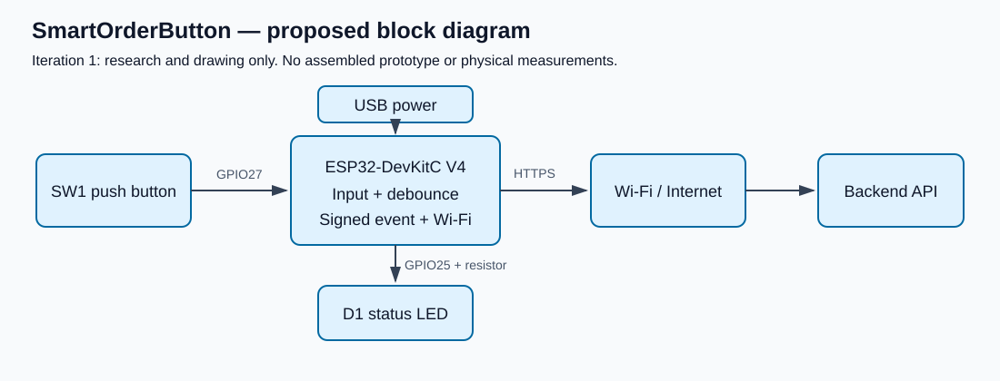
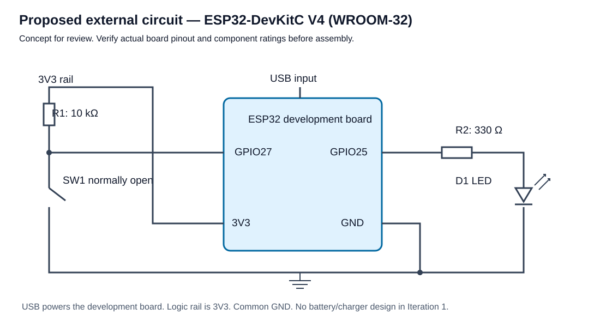
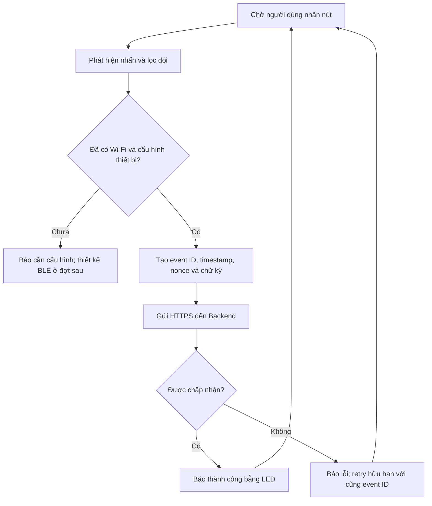

# I1-07 — Nghiên cứu và thiết kế nút bấm IoT

**Trạng thái: thiết kế đề xuất để review, chưa lắp ráp, nạp firmware hoặc đo kiểm vật lý.**
Bản vẽ minh họa chức năng cho ESP32-DevKitC V4/ESP32-WROOM-32; cần xác nhận đúng board thực tế trước khi lắp.

## Mục tiêu nghiên cứu

Đánh giá nút nhấn gửi sự kiện qua Wi-Fi đến Backend, nhận phản hồi bằng LED.
Bluetooth Low Energy có thể dùng để cấp cấu hình Wi-Fi ở đợt sau.
Iteration 1 không tuyên bố độ trễ, tuổi thọ pin, độ tin cậy hoặc công suất đã được đo.

## Linh kiện dự kiến (BOM)

| Linh kiện | Số lượng | Lý do / giả định |
|---|---|---|
| ESP32-DevKitC V4, module WROOM-32 | 1 | Wi-Fi/Bluetooth, USB-UART; thuận tiện thử nghiệm trên breadboard |
| Nút nhấn thường mở SW1 | 1 | Đầu vào bấm đặt hàng |
| Điện trở kéo lên R1 10 kΩ | 1 | Tạo trạng thái HIGH ổn định tại đầu vào, bấm kéo xuống GND |
| LED D1 + điện trở R2 330 Ω | 1 bộ | Báo trạng thái; dòng dự kiến cần đối chiếu LED thực tế |
| Cáp USB và nguồn USB phù hợp board | 1 | Cấp nguồn qua USB cho nguyên mẫu |
| Breadboard và dây nối | 1 bộ | Lắp thử trước khi thiết kế PCB |

Không chọn pin, mạch sạc hoặc vỏ thành phẩm ở đợt này. Không nối nguồn 5V vào GPIO.
Chỉ dùng một phương án cấp nguồn theo hướng dẫn board; không cấp đồng thời các nguồn tùy tiện.

## Bản vẽ

Sơ đồ nguyên lý là kết nối ngoài một **board phát triển đã có mạch nguồn**, không phải thiết kế chip ESP32 rời.

| Kết nối | Đề xuất |
|---|---|
| SW1 | GPIO27 ↔ SW1 ↔ GND |
| R1 | 3V3 ↔ 10 kΩ ↔ GPIO27 |
| LED | GPIO25 ↔ 330 Ω ↔ anode LED; cathode ↔ GND |
| Nguồn | USB của DevKitC; 3V3/GND board cấp cho R1/mạch logic |

Chân GPIO25/27 là lựa chọn đề xuất cho board WROOM-32; nhóm cần kiểm tra pinout đúng biến thể,
khả năng wake-up và xung đột với các peripheral trong firmware thực tế. Debounce dự kiến xử lý phần mềm,
chưa xác định tham số từ phép đo.

## Luồng hoạt động dự kiến

Giới hạn hủy đơn 120 giây thuộc nghiệp vụ Backend và bắt đầu từ thời điểm tạo đơn;
không bắt đầu lại khi thiết bị gửi lại sự kiện hoặc người dùng mở app.

## Kiểm chứng ở đợt tiếp theo

- Review pinout, điện áp, cực LED và dòng tải trước cấp nguồn.
- Đo dội nút, thử nhấn liên tiếp, mất mạng, retry và chống tạo trùng.
- Thử pairing/BLE, Wi-Fi và xác thực request theo Backend.
- Đo dòng, độ trễ và mức tiêu thụ thực tế trước tuyên bố tối ưu pin.
- Ghi nhận ảnh mạch, log firmware, số đo và kết quả; chưa có trong đợt này.

## Nguồn tham khảo chính thức

- [Espressif ESP32-DevKitC V4 user guide — nguồn và pinout](https://docs.espressif.com/projects/esp-dev-kits/en/latest/esp32/esp32-devkitc/user_guide.html).
- [Sơ đồ board tham chiếu của Espressif](https://dl.espressif.com/dl/schematics/esp32_devkitc_v4-sch.pdf).

Các sơ đồ trong repo là đề xuất của bản nộp dựa trên board tham chiếu, không phải bằng chứng thiết bị đã hoạt động.
